# Figure notes

Caption stubs collected by `src/plots.save_fig()` each time a notebook runs. The interpretation of each figure is in the *Reading this* cell under it in the notebook. Report captions are written from these.

<!-- fig:01_01_column_completeness -->
### 01_01_column_completeness

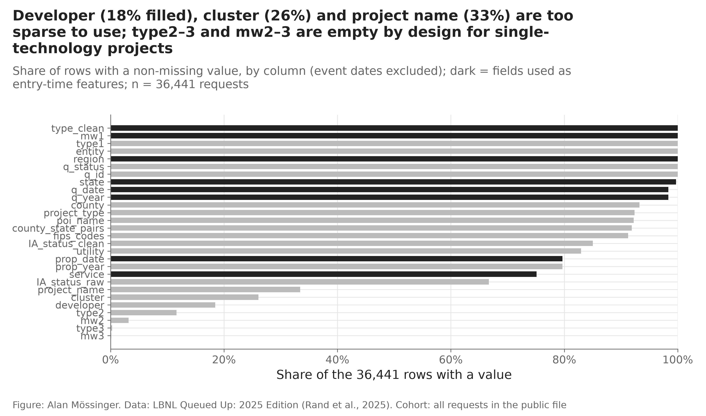

*Notebook:* `notebooks/01_get_data.ipynb` · *Files:* `figures/01_get_data/01_01_column_completeness.png`, `.svg`

**Caption (stub).** Share of the 36,441 LBNL queue rows with a value in each column; status-specific event dates are excluded and shown in 01_02.
<!-- /fig:01_01_column_completeness -->

<!-- fig:01_02_event_date_coverage -->
### 01_02_event_date_coverage

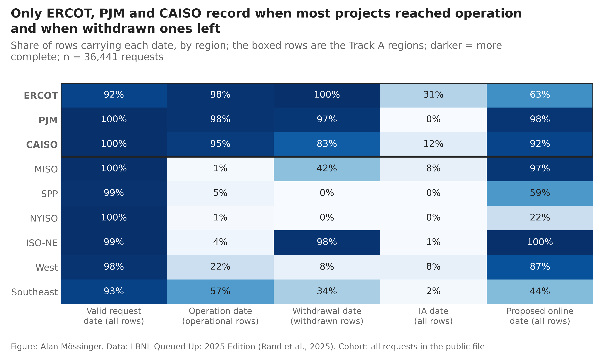

*Notebook:* `notebooks/01_get_data.ipynb` · *Files:* `figures/01_get_data/01_02_event_date_coverage.png`, `.svg`

**Caption (stub).** Share of LBNL queue rows carrying each date field, by region. Operation and withdrawal dates are measured among operational and withdrawn rows respectively.
<!-- /fig:01_02_event_date_coverage -->

<!-- fig:01_03_requests_by_year_region -->
### 01_03_requests_by_year_region

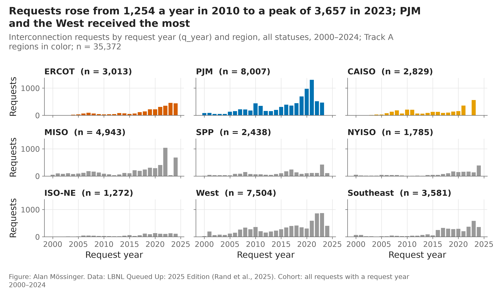

*Notebook:* `notebooks/01_get_data.ipynb` · *Files:* `figures/01_get_data/01_03_requests_by_year_region.png`, `.svg`

**Caption (stub).** Number of interconnection requests per year by region, 2000–2024, all statuses.
<!-- /fig:01_03_requests_by_year_region -->

<!-- fig:01_04_capacity_by_year_technology -->
### 01_04_capacity_by_year_technology

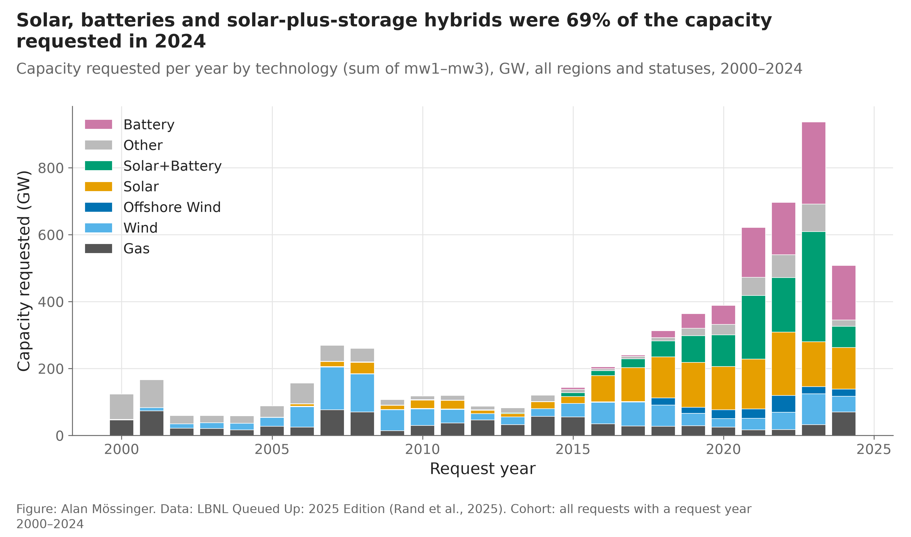

*Notebook:* `notebooks/01_get_data.ipynb` · *Files:* `figures/01_get_data/01_04_capacity_by_year_technology.png`, `.svg`

**Caption (stub).** Capacity requested per year by technology group (GW), all regions, 2000–2024.
<!-- /fig:01_04_capacity_by_year_technology -->

<!-- fig:01_05_status_mix_by_region -->
### 01_05_status_mix_by_region

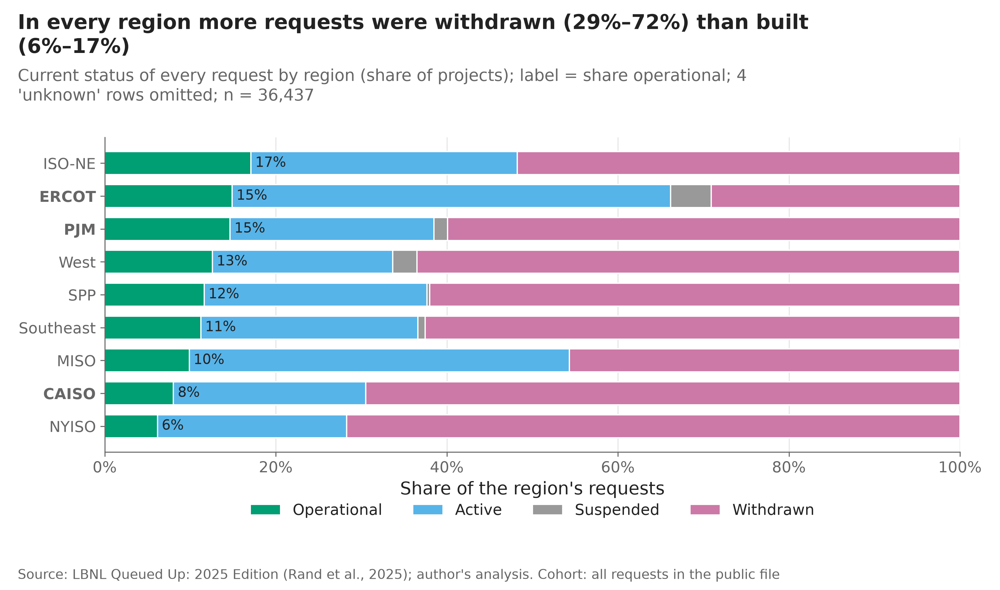

*Notebook:* `notebooks/01_get_data.ipynb` · *Files:* `figures/01_get_data/01_05_status_mix_by_region.png`, `.svg`

**Caption (stub).** Share of requests in each current status (operational, active, suspended, withdrawn) by region.
<!-- /fig:01_05_status_mix_by_region -->

<!-- fig:01_06_outcome_by_request_year -->
### 01_06_outcome_by_request_year

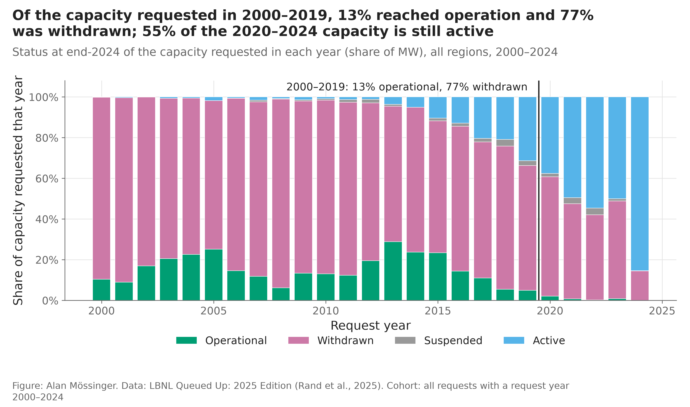

*Notebook:* `notebooks/01_get_data.ipynb` · *Files:* `figures/01_get_data/01_06_outcome_by_request_year.png`, `.svg`

**Caption (stub).** Share of each request year's capacity that is operational, withdrawn, suspended or still active at the end of 2024.
<!-- /fig:01_06_outcome_by_request_year -->

<!-- fig:01_07_ir_to_cod_by_year -->
### 01_07_ir_to_cod_by_year

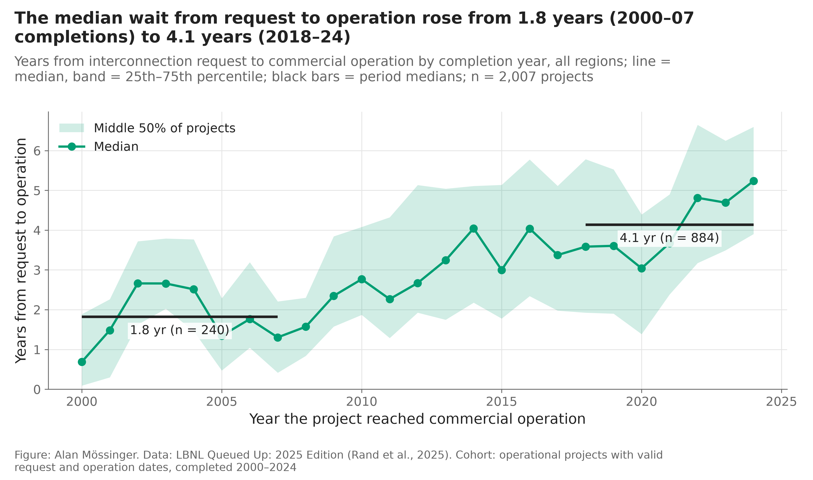

*Notebook:* `notebooks/01_get_data.ipynb` · *Files:* `figures/01_get_data/01_07_ir_to_cod_by_year.png`, `.svg`

**Caption (stub).** Median and interquartile range of years from interconnection request to commercial operation, by year of operation, all regions.
<!-- /fig:01_07_ir_to_cod_by_year -->

<!-- fig:01_08_ir_to_cod_by_region -->
### 01_08_ir_to_cod_by_region

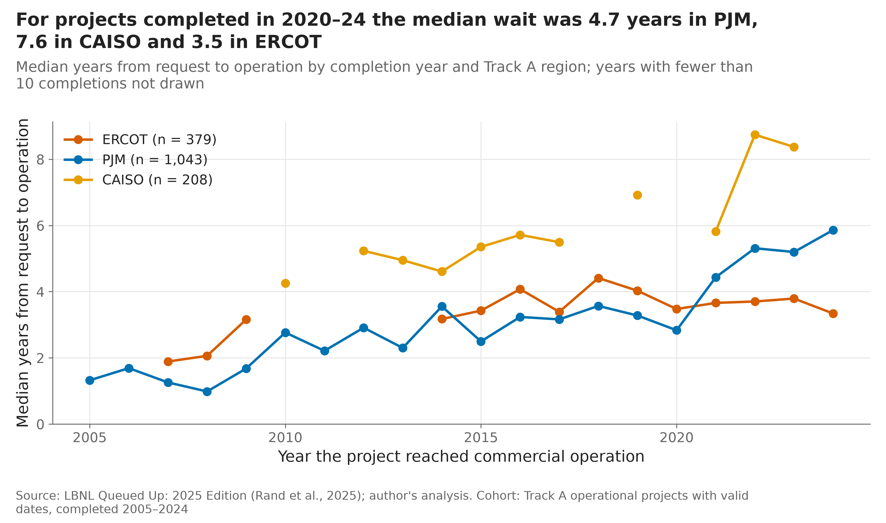

*Notebook:* `notebooks/01_get_data.ipynb` · *Files:* `figures/01_get_data/01_08_ir_to_cod_by_region.png`, `.svg`

**Caption (stub).** Median years from request to commercial operation by completion year for CAISO, ERCOT and PJM.
<!-- /fig:01_08_ir_to_cod_by_region -->

<!-- fig:01_09_naive_five_year_completion -->
### 01_09_naive_five_year_completion

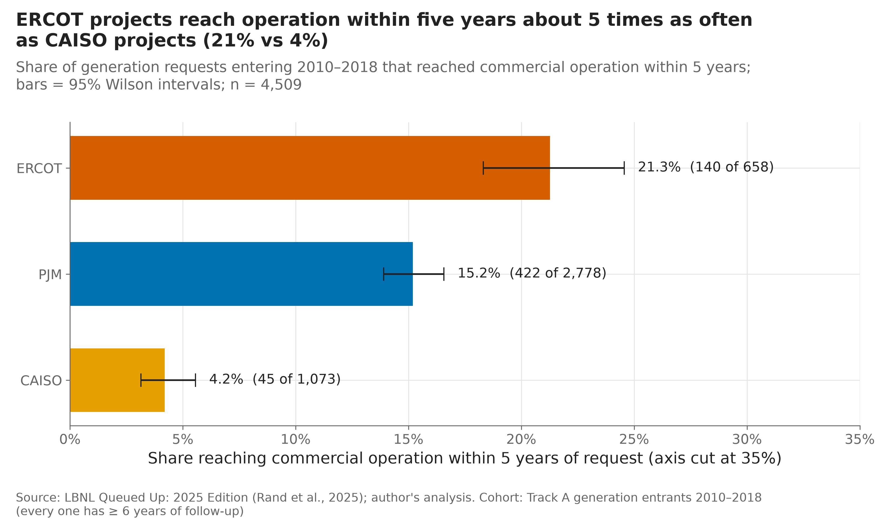

*Notebook:* `notebooks/01_get_data.ipynb` · *Files:* `figures/01_get_data/01_09_naive_five_year_completion.png`, `.svg`

**Caption (stub).** Naive five-year completion share for 2010–2018 generation entrants in CAISO, ERCOT and PJM, with 95% Wilson intervals.
<!-- /fig:01_09_naive_five_year_completion -->

<!-- fig:01_10_track_a_sample_flow -->
### 01_10_track_a_sample_flow

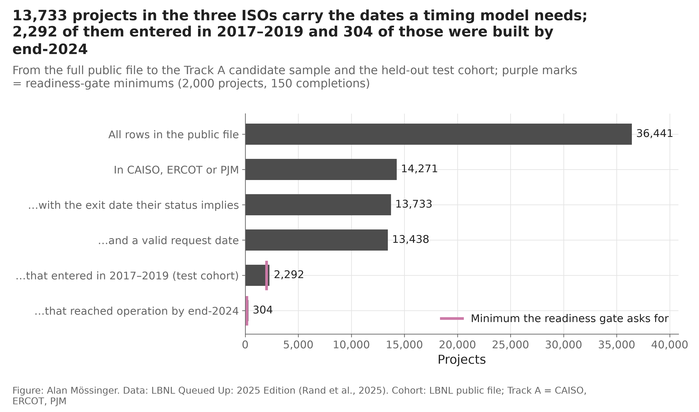

*Notebook:* `notebooks/01_get_data.ipynb` · *Files:* `figures/01_get_data/01_10_track_a_sample_flow.png`, `.svg`

**Caption (stub).** Row counts from the full public file to the Track A candidate sample and the 2017–2019 test cohort, with the readiness-gate minimums.
<!-- /fig:01_10_track_a_sample_flow -->

<!-- fig:01_11_size_by_technology -->
### 01_11_size_by_technology

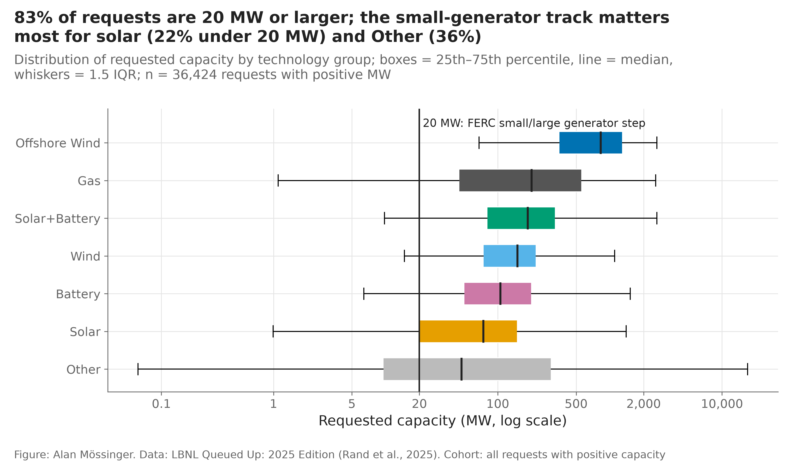

*Notebook:* `notebooks/01_get_data.ipynb` · *Files:* `figures/01_get_data/01_11_size_by_technology.png`, `.svg`

**Caption (stub).** Distribution of requested capacity (MW, log scale) by technology group with the 20 MW FERC small/large generator threshold.
<!-- /fig:01_11_size_by_technology -->

<!-- fig:01_12_active_capacity_region_technology -->
### 01_12_active_capacity_region_technology

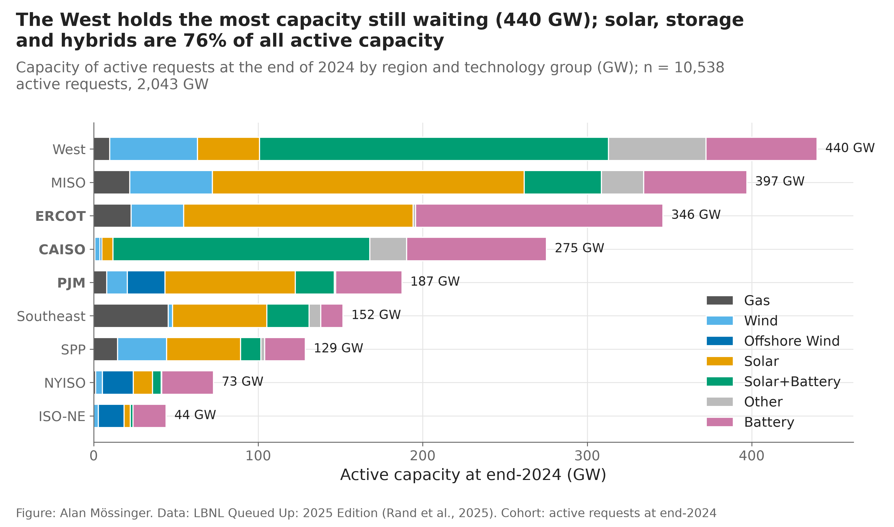

*Notebook:* `notebooks/01_get_data.ipynb` · *Files:* `figures/01_get_data/01_12_active_capacity_region_technology.png`, `.svg`

**Caption (stub).** Capacity of requests still active at the end of 2024 by region and technology group (GW).
<!-- /fig:01_12_active_capacity_region_technology -->

<!-- fig:01_13_time_to_withdrawal -->
### 01_13_time_to_withdrawal

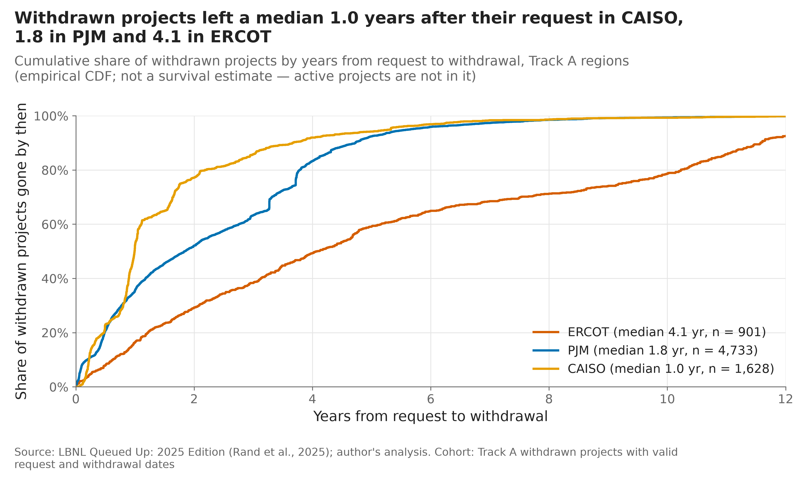

*Notebook:* `notebooks/01_get_data.ipynb` · *Files:* `figures/01_get_data/01_13_time_to_withdrawal.png`, `.svg`

**Caption (stub).** Empirical cumulative distribution of years from request to withdrawal for withdrawn projects in CAISO, ERCOT and PJM.
<!-- /fig:01_13_time_to_withdrawal -->

<!-- fig:01_14_proposed_timeline -->
### 01_14_proposed_timeline

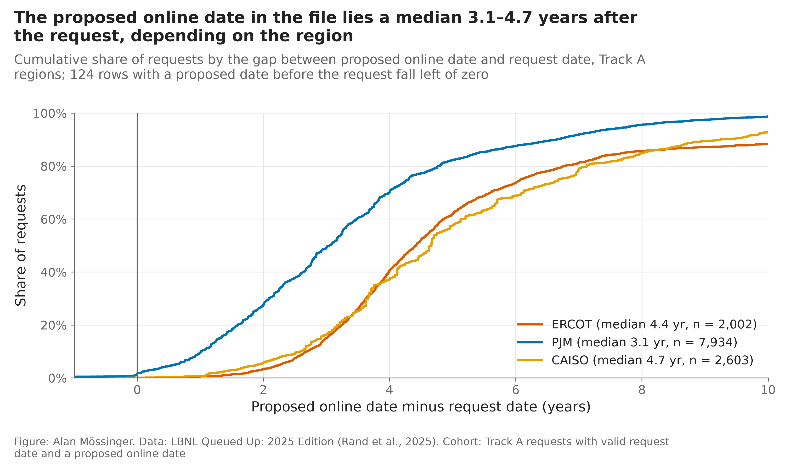

*Notebook:* `notebooks/01_get_data.ipynb` · *Files:* `figures/01_get_data/01_14_proposed_timeline.png`, `.svg`

**Caption (stub).** Distribution of the gap between the proposed online date and the request date (years) in CAISO, ERCOT and PJM.
<!-- /fig:01_14_proposed_timeline -->

<!-- fig:01_15_proposed_vs_actual_online_date -->
### 01_15_proposed_vs_actual_online_date

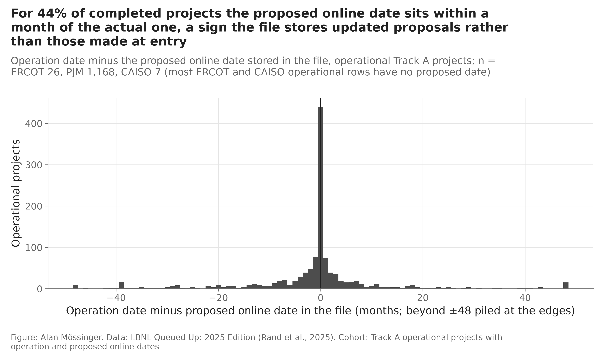

*Notebook:* `notebooks/01_get_data.ipynb` · *Files:* `figures/01_get_data/01_15_proposed_vs_actual_online_date.png`, `.svg`

**Caption (stub).** Months between the actual operation date and the proposed online date recorded in the LBNL file for completed projects in CAISO, ERCOT and PJM.
<!-- /fig:01_15_proposed_vs_actual_online_date -->

<!-- fig:01_16_hybrid_share -->
### 01_16_hybrid_share

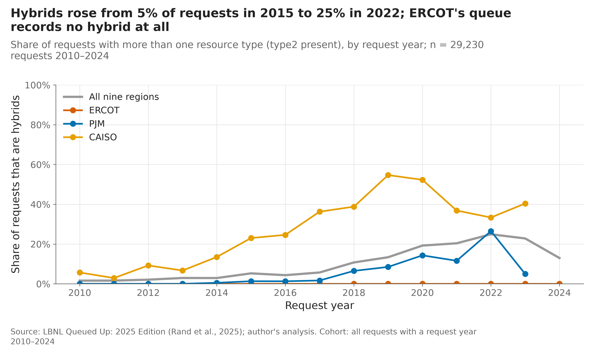

*Notebook:* `notebooks/01_get_data.ipynb` · *Files:* `figures/01_get_data/01_16_hybrid_share.png`, `.svg`

**Caption (stub).** Share of interconnection requests that combine more than one resource type, by request year, nationally and for CAISO, ERCOT and PJM.
<!-- /fig:01_16_hybrid_share -->

<!-- fig:01_17_eia_fleet_by_technology -->
### 01_17_eia_fleet_by_technology

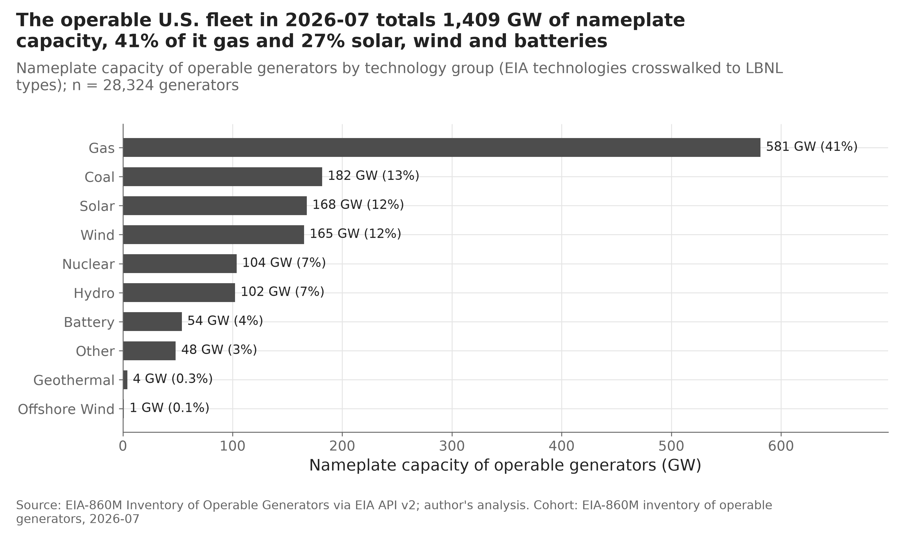

*Notebook:* `notebooks/01_get_data.ipynb` · *Files:* `figures/01_get_data/01_17_eia_fleet_by_technology.png`, `.svg`

**Caption (stub).** Nameplate capacity of all operable U.S. generators by technology group, from EIA-860M.
<!-- /fig:01_17_eia_fleet_by_technology -->

<!-- fig:01_18_eia_additions_by_year -->
### 01_18_eia_additions_by_year

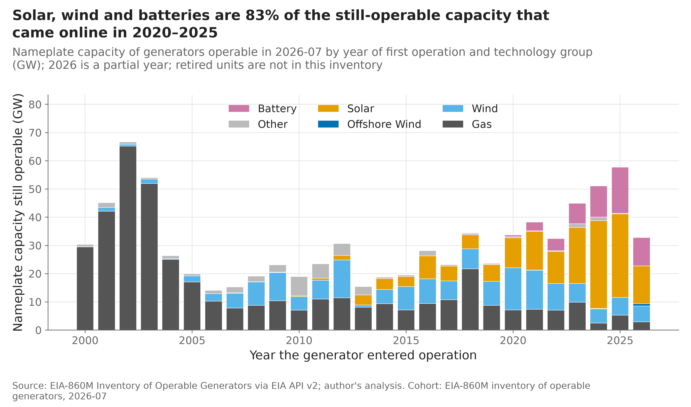

*Notebook:* `notebooks/01_get_data.ipynb` · *Files:* `figures/01_get_data/01_18_eia_additions_by_year.png`, `.svg`

**Caption (stub).** Nameplate capacity of still-operable generators by year of first operation and technology group, from EIA-860M.
<!-- /fig:01_18_eia_additions_by_year -->

<!-- fig:01_19_eia_generator_map -->
### 01_19_eia_generator_map

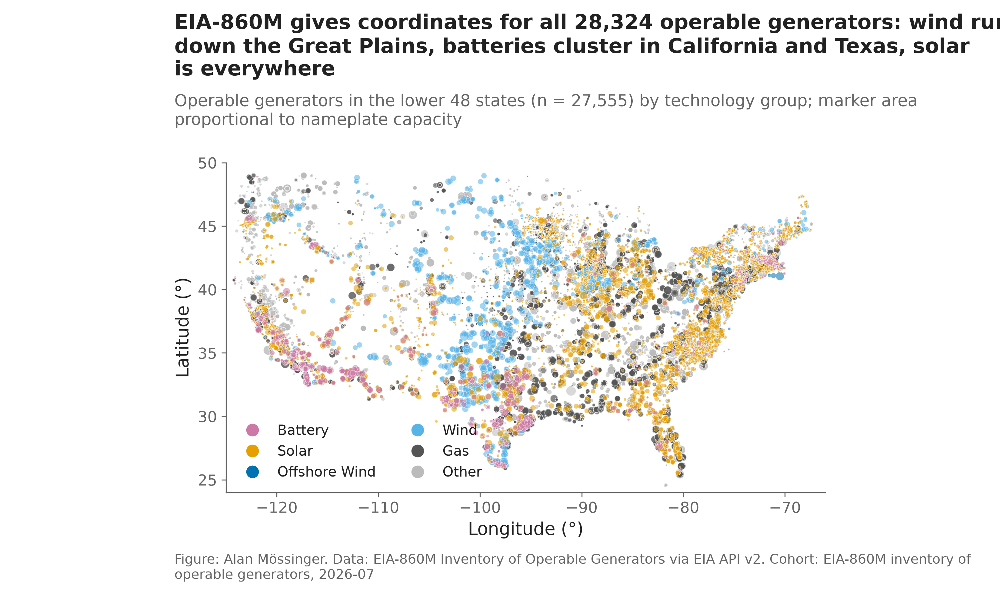

*Notebook:* `notebooks/01_get_data.ipynb` · *Files:* `figures/01_get_data/01_19_eia_generator_map.png`, `.svg`

**Caption (stub).** Locations of operable generators in the lower 48 states from EIA-860M, colored by technology group and sized by nameplate capacity.
<!-- /fig:01_19_eia_generator_map -->

<!-- fig:01_20_linkage_by_technology -->
### 01_20_linkage_by_technology

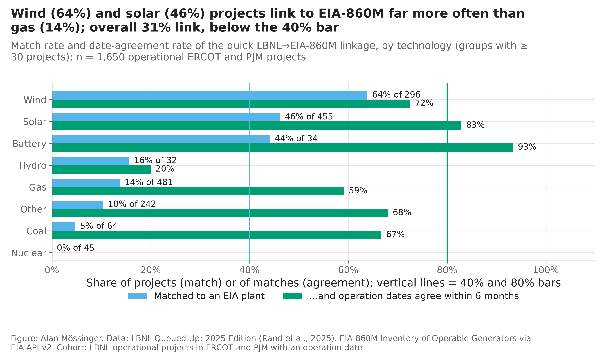

*Notebook:* `notebooks/01_get_data.ipynb` · *Files:* `figures/01_get_data/01_20_linkage_by_technology.png`, `.svg`

**Caption (stub).** Share of LBNL operational ERCOT/PJM projects matched to an EIA-860M plant, and share of matches whose operation dates agree within six months, by technology.
<!-- /fig:01_20_linkage_by_technology -->

<!-- fig:01_21_linkage_date_gap -->
### 01_21_linkage_date_gap

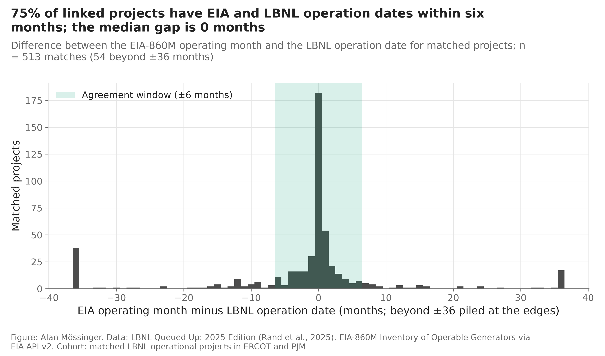

*Notebook:* `notebooks/01_get_data.ipynb` · *Files:* `figures/01_get_data/01_21_linkage_date_gap.png`, `.svg`

**Caption (stub).** Distribution of the gap between EIA-860M operating month and LBNL operation date for linked projects.
<!-- /fig:01_21_linkage_date_gap -->

<!-- fig:01_22_lbnl_vs_eia_additions -->
### 01_22_lbnl_vs_eia_additions

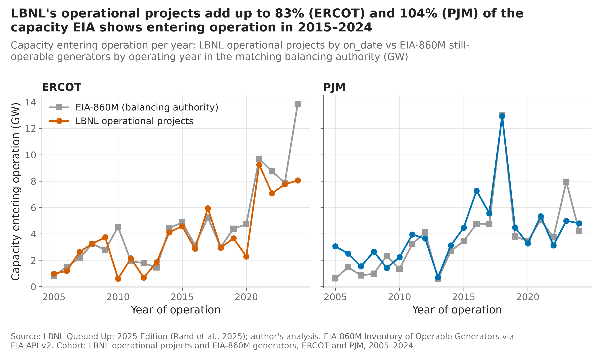

*Notebook:* `notebooks/01_get_data.ipynb` · *Files:* `figures/01_get_data/01_22_lbnl_vs_eia_additions.png`, `.svg`

**Caption (stub).** Capacity entering operation per year according to LBNL operational projects and EIA-860M generators, ERCOT and PJM.
<!-- /fig:01_22_lbnl_vs_eia_additions -->

<!-- fig:01b_01_date_coverage -->
### 01b_01_date_coverage

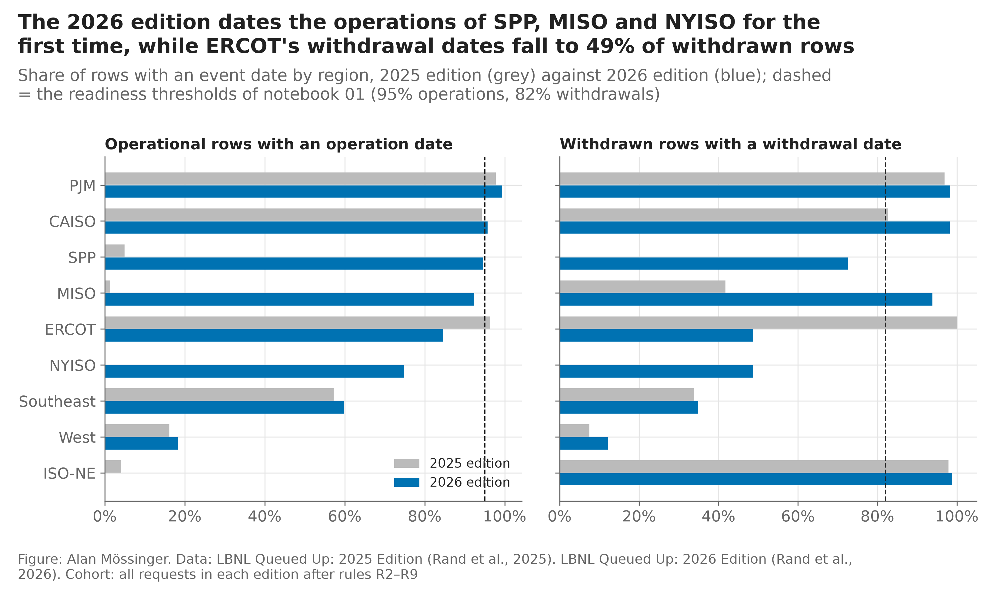

*Notebook:* `notebooks/01b_lbnl_2026_reconcile.ipynb` · *Files:* `figures/01b_lbnl_2026_reconcile/01b_01_date_coverage.png`, `.svg`

**Caption (stub).** Event-date coverage by region in the 2025 and 2026 editions of the LBNL file.
<!-- /fig:01b_01_date_coverage -->

<!-- fig:01b_02_early_incidence -->
### 01b_02_early_incidence

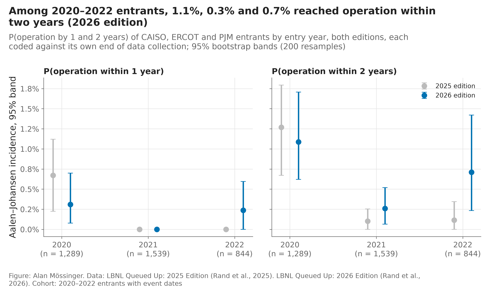

*Notebook:* `notebooks/01b_lbnl_2026_reconcile.ipynb` · *Files:* `figures/01b_lbnl_2026_reconcile/01b_02_early_incidence.png`, `.svg`

**Caption (stub).** One- and two-year incidence of operation for 2020–2022 entrants in the three ISOs, 2025 and 2026 editions.
<!-- /fig:01b_02_early_incidence -->

<!-- fig:02_01_event_dates_vs_status -->
### 02_01_event_dates_vs_status

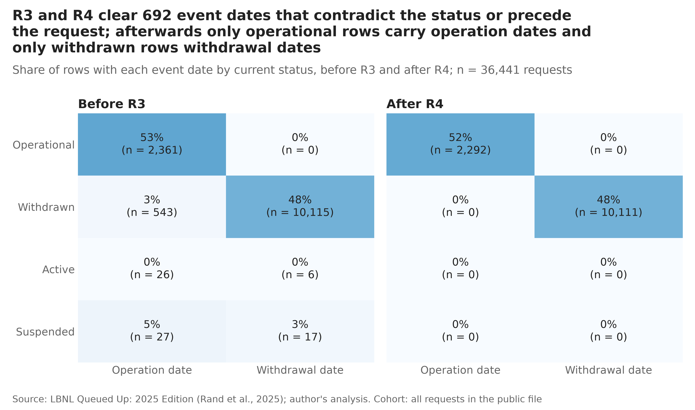

*Notebook:* `notebooks/02_clean_queue_data.ipynb` · *Files:* `figures/02_clean_queue_data/02_01_event_dates_vs_status.png`, `.svg`

**Caption (stub).** Share of rows carrying an operation date and a withdrawal date by status, before and after rules R3–R4.
<!-- /fig:02_01_event_dates_vs_status -->

<!-- fig:02_02_operation_before_request -->
### 02_02_operation_before_request

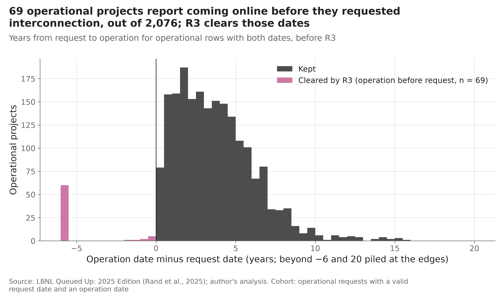

*Notebook:* `notebooks/02_clean_queue_data.ipynb` · *Files:* `figures/02_clean_queue_data/02_02_operation_before_request.png`, `.svg`

**Caption (stub).** Distribution of years from request to operation for operational projects, with the negative values removed by rule R3 highlighted.
<!-- /fig:02_02_operation_before_request -->

<!-- fig:02_03_capacity_by_region -->
### 02_03_capacity_by_region

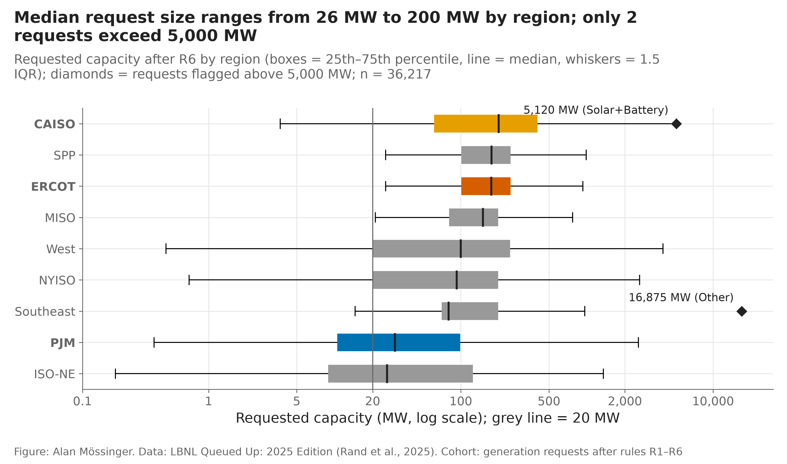

*Notebook:* `notebooks/02_clean_queue_data.ipynb` · *Files:* `figures/02_clean_queue_data/02_03_capacity_by_region.png`, `.svg`

**Caption (stub).** Distribution of requested capacity (MW, log scale) by region after rule R6, with the two requests above 5,000 MW marked.
<!-- /fig:02_03_capacity_by_region -->

<!-- fig:02_04_rows_removed_by_region -->
### 02_04_rows_removed_by_region

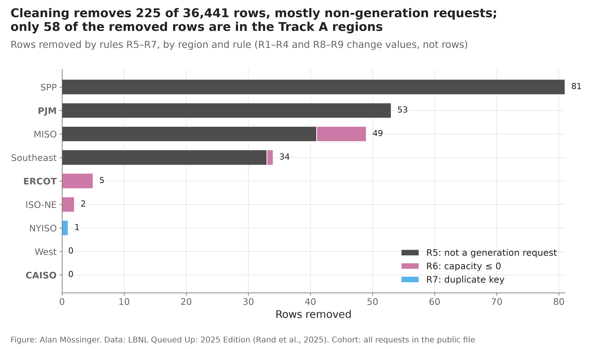

*Notebook:* `notebooks/02_clean_queue_data.ipynb` · *Files:* `figures/02_clean_queue_data/02_04_rows_removed_by_region.png`, `.svg`

**Caption (stub).** Number of rows removed by cleaning rules R5, R6 and R7, by region.
<!-- /fig:02_04_rows_removed_by_region -->

<!-- fig:02_05_feature_completeness_by_region -->
### 02_05_feature_completeness_by_region

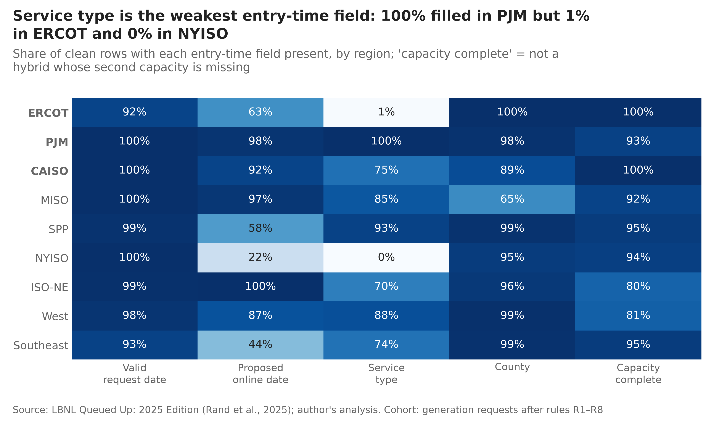

*Notebook:* `notebooks/02_clean_queue_data.ipynb` · *Files:* `figures/02_clean_queue_data/02_05_feature_completeness_by_region.png`, `.svg`

**Caption (stub).** Share of clean rows with each entry-time field present, by region.
<!-- /fig:02_05_feature_completeness_by_region -->

<!-- fig:02_06_hybrids_by_region -->
### 02_06_hybrids_by_region

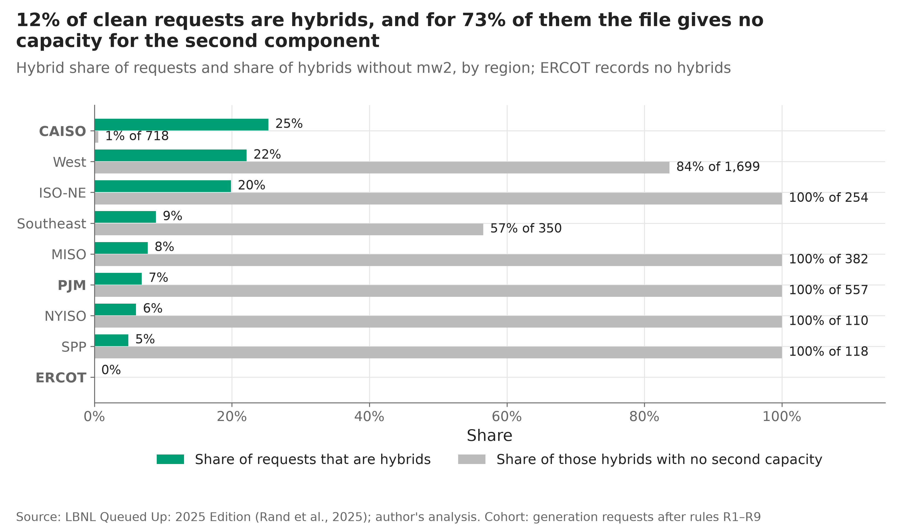

*Notebook:* `notebooks/02_clean_queue_data.ipynb` · *Files:* `figures/02_clean_queue_data/02_06_hybrids_by_region.png`, `.svg`

**Caption (stub).** Share of requests that are hybrids, and share of hybrids without a second-component capacity, by region.
<!-- /fig:02_06_hybrids_by_region -->

<!-- fig:02_07_rules_summary -->
### 02_07_rules_summary

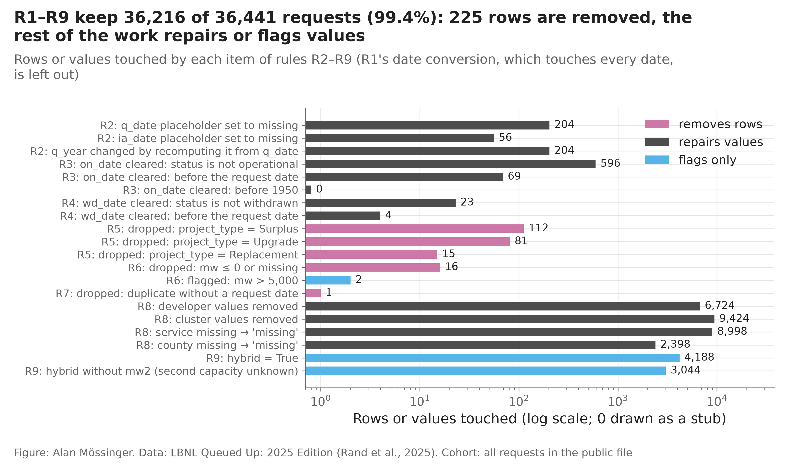

*Notebook:* `notebooks/02_clean_queue_data.ipynb` · *Files:* `figures/02_clean_queue_data/02_07_rules_summary.png`, `.svg`

**Caption (stub).** Number of rows or values touched by each item of cleaning rules R2–R9, by kind of action.
<!-- /fig:02_07_rules_summary -->

<!-- fig:02_08_withdrawals_after_censor_date -->
### 02_08_withdrawals_after_censor_date

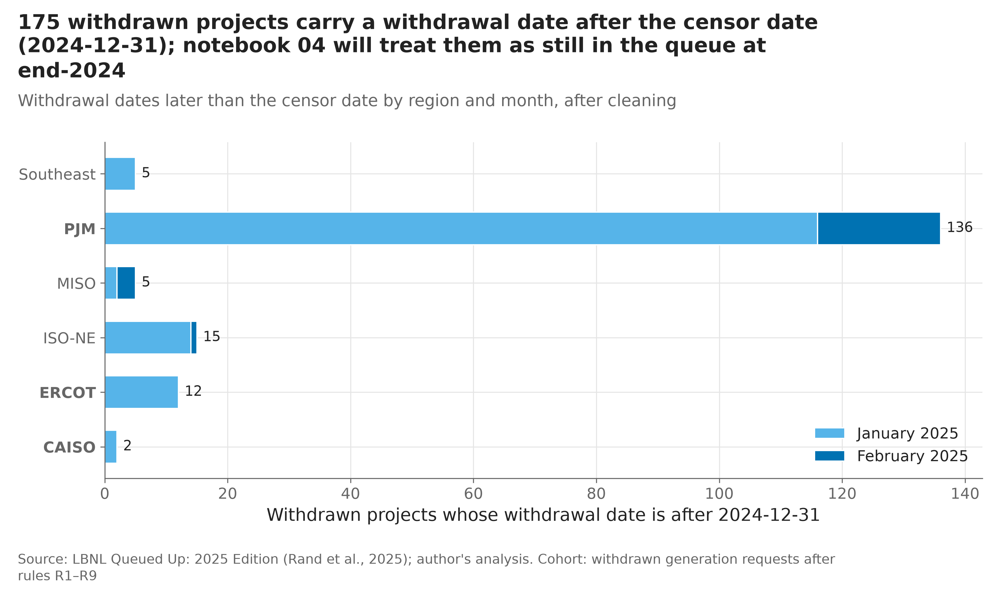

*Notebook:* `notebooks/02_clean_queue_data.ipynb` · *Files:* `figures/02_clean_queue_data/02_08_withdrawals_after_censor_date.png`, `.svg`

**Caption (stub).** Withdrawn projects whose withdrawal date falls after the 2024-12-31 censor date, by region and month.
<!-- /fig:02_08_withdrawals_after_censor_date -->

<!-- fig:02_09_unresolved_share_by_cohort -->
### 02_09_unresolved_share_by_cohort

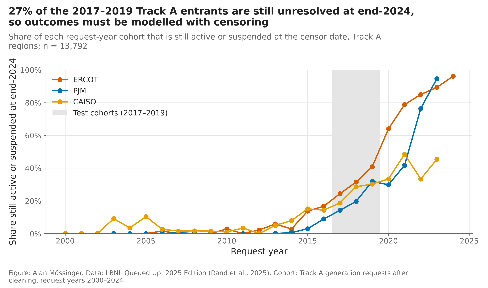

*Notebook:* `notebooks/02_clean_queue_data.ipynb` · *Files:* `figures/02_clean_queue_data/02_09_unresolved_share_by_cohort.png`, `.svg`

**Caption (stub).** Share of each request-year cohort still active or suspended at the end of 2024, for CAISO, ERCOT and PJM.
<!-- /fig:02_09_unresolved_share_by_cohort -->

<!-- fig:03_01_still_in_queue_by_region -->
### 03_01_still_in_queue_by_region

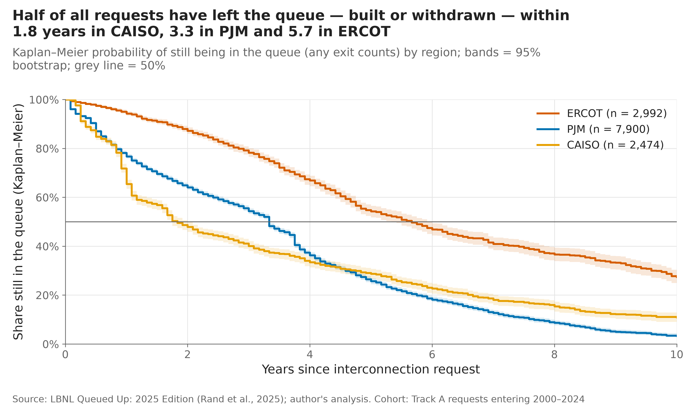

*Notebook:* `notebooks/03_explore_survival_curves.ipynb` · *Files:* `figures/03_explore_survival_curves/03_01_still_in_queue_by_region.png`, `.svg`

**Caption (stub).** Kaplan–Meier share of requests still in the queue by years since request, for CAISO, ERCOT and PJM.
<!-- /fig:03_01_still_in_queue_by_region -->

<!-- fig:03_02_withdrawal_by_technology -->
### 03_02_withdrawal_by_technology

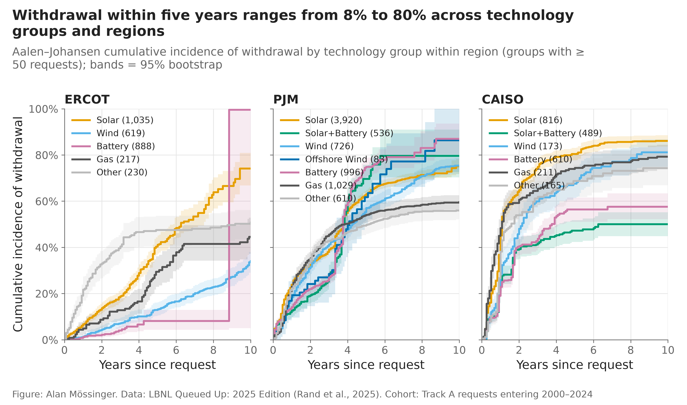

*Notebook:* `notebooks/03_explore_survival_curves.ipynb` · *Files:* `figures/03_explore_survival_curves/03_02_withdrawal_by_technology.png`, `.svg`

**Caption (stub).** Cumulative incidence of withdrawal by technology group within CAISO, ERCOT and PJM.
<!-- /fig:03_02_withdrawal_by_technology -->

<!-- fig:03_03_operation_by_cohort -->
### 03_03_operation_by_cohort

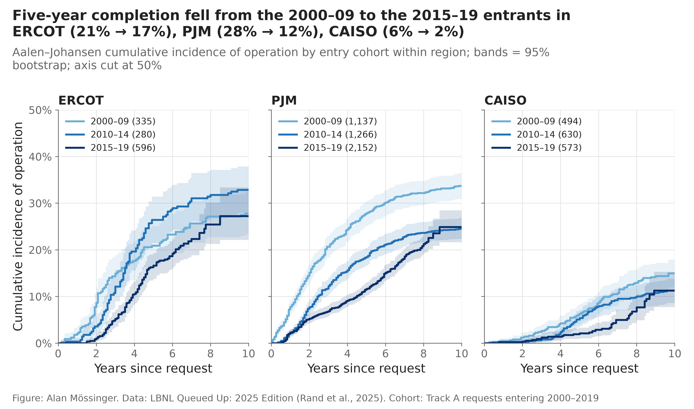

*Notebook:* `notebooks/03_explore_survival_curves.ipynb` · *Files:* `figures/03_explore_survival_curves/03_03_operation_by_cohort.png`, `.svg`

**Caption (stub).** Cumulative incidence of operation by entry cohort (2000–09, 2010–14, 2015–19) within CAISO, ERCOT and PJM.
<!-- /fig:03_03_operation_by_cohort -->

<!-- fig:03_04_withdrawal_by_cohort -->
### 03_04_withdrawal_by_cohort

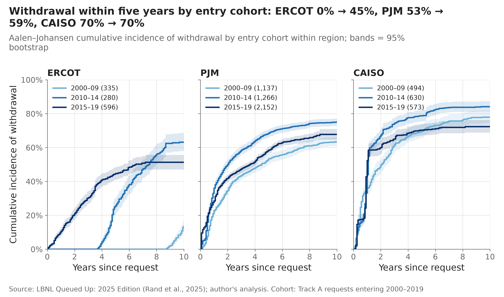

*Notebook:* `notebooks/03_explore_survival_curves.ipynb` · *Files:* `figures/03_explore_survival_curves/03_04_withdrawal_by_cohort.png`, `.svg`

**Caption (stub).** Cumulative incidence of withdrawal by entry cohort within CAISO, ERCOT and PJM.
<!-- /fig:03_04_withdrawal_by_cohort -->

<!-- fig:03_05_region_technology_base_rates -->
### 03_05_region_technology_base_rates

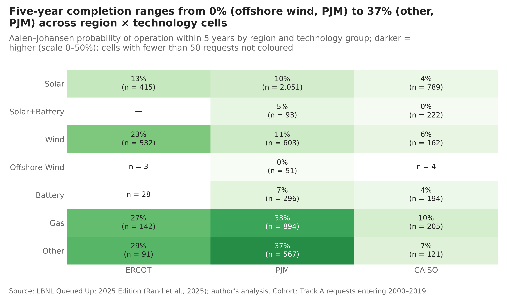

*Notebook:* `notebooks/03_explore_survival_curves.ipynb` · *Files:* `figures/03_explore_survival_curves/03_05_region_technology_base_rates.png`, `.svg`

**Caption (stub).** Five-year completion probability for each region × technology cell (2000–2019 entrants) — the cells of the baseline predictor.
<!-- /fig:03_05_region_technology_base_rates -->

<!-- fig:03_06_benchmarks -->
### 03_06_benchmarks

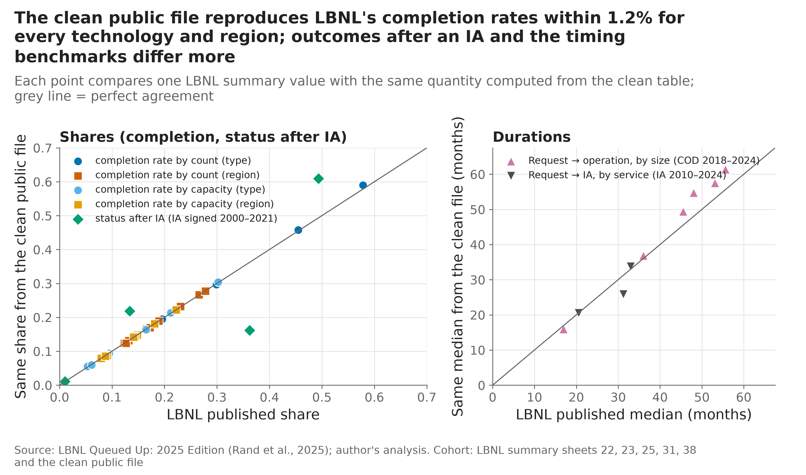

*Notebook:* `notebooks/03_explore_survival_curves.ipynb` · *Files:* `figures/03_explore_survival_curves/03_06_benchmarks.png`, `.svg`

**Caption (stub).** LBNL's published completion rates, post-IA outcomes and median durations against the same quantities computed from the clean public file.
<!-- /fig:03_06_benchmarks -->

<!-- fig:03_07_hybrid_vs_single -->
### 03_07_hybrid_vs_single

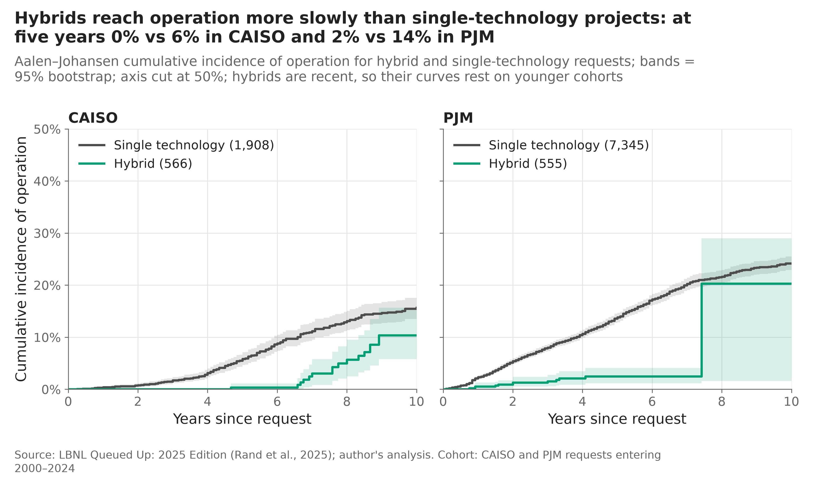

*Notebook:* `notebooks/03_explore_survival_curves.ipynb` · *Files:* `figures/03_explore_survival_curves/03_07_hybrid_vs_single.png`, `.svg`

**Caption (stub).** Cumulative incidence of operation for hybrid and single-technology requests in CAISO and PJM.
<!-- /fig:03_07_hybrid_vs_single -->

<!-- fig:03_08_service_type -->
### 03_08_service_type

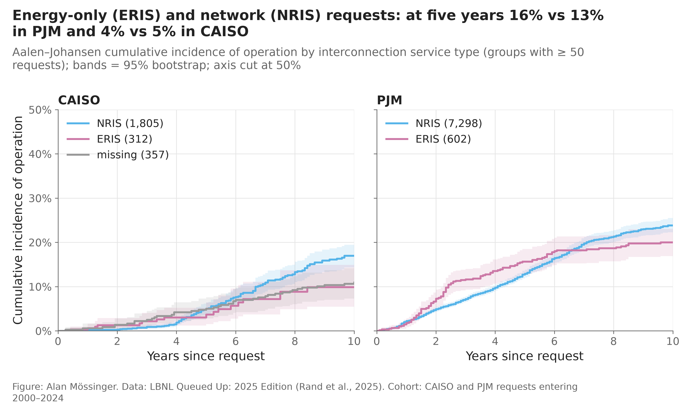

*Notebook:* `notebooks/03_explore_survival_curves.ipynb` · *Files:* `figures/03_explore_survival_curves/03_08_service_type.png`, `.svg`

**Caption (stub).** Cumulative incidence of operation by interconnection service type (ERIS, NRIS) in CAISO and PJM.
<!-- /fig:03_08_service_type -->

<!-- fig:03_09_congestion_over_time -->
### 03_09_congestion_over_time

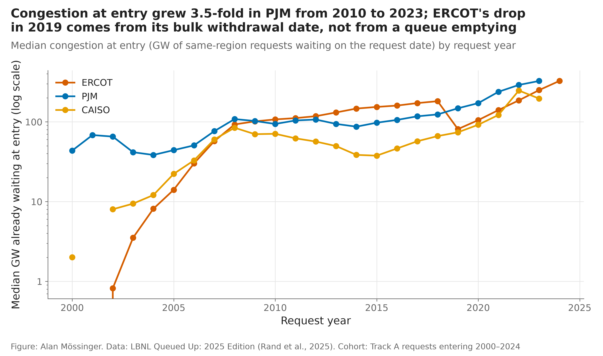

*Notebook:* `notebooks/03_explore_survival_curves.ipynb` · *Files:* `figures/03_explore_survival_curves/03_09_congestion_over_time.png`, `.svg`

**Caption (stub).** Median queue congestion at entry (GW waiting in the same region) by request year for CAISO, ERCOT and PJM.
<!-- /fig:03_09_congestion_over_time -->

<!-- fig:03_10_withdrawal_date_spikes -->
### 03_10_withdrawal_date_spikes

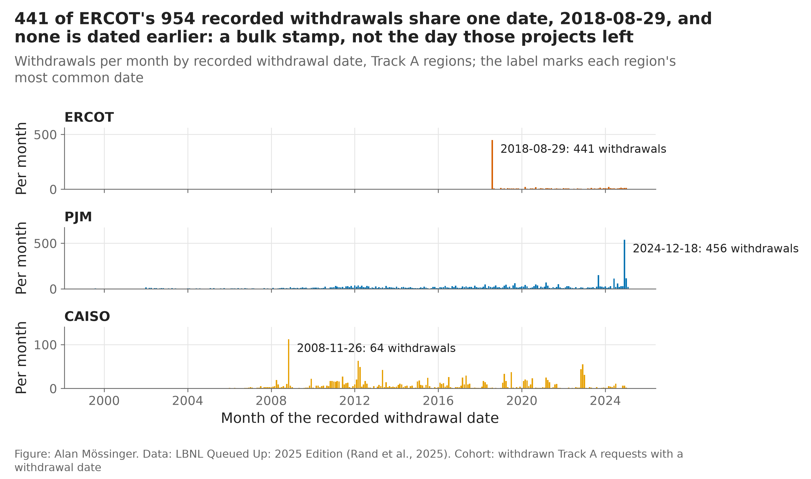

*Notebook:* `notebooks/03_explore_survival_curves.ipynb` · *Files:* `figures/03_explore_survival_curves/03_10_withdrawal_date_spikes.png`, `.svg`

**Caption (stub).** Number of withdrawals per month by recorded withdrawal date in CAISO, ERCOT and PJM, showing ERCOT's single bulk withdrawal date.
<!-- /fig:03_10_withdrawal_date_spikes -->

<!-- fig:03b_02_built_share_by_state -->
### 03b_02_built_share_by_state

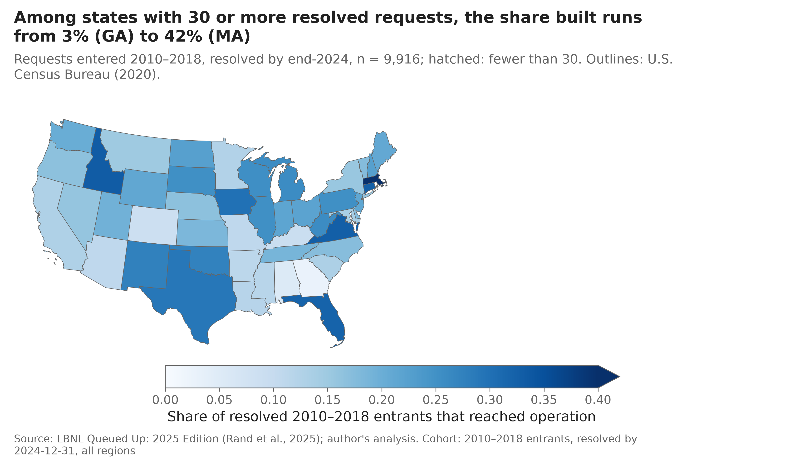

*Notebook:* `notebooks/03b_project_map.ipynb` · *Files:* `figures/03b_project_map/03b_02_built_share_by_state.png`, `.svg`

**Caption (stub).** Share of resolved 2010–2018 entrants that reached operation, by state; states with fewer than 30 resolved requests hatched.
<!-- /fig:03b_02_built_share_by_state -->

<!-- fig:04_01_sample_by_split -->
### 04_01_sample_by_split

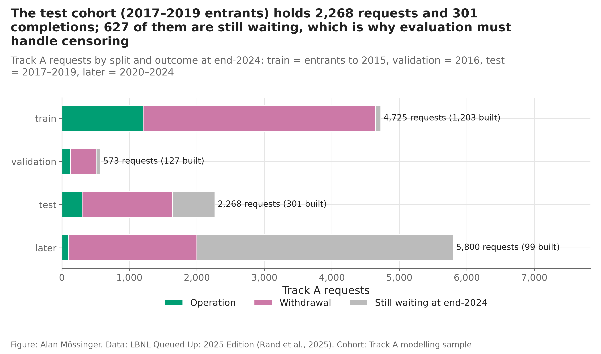

*Notebook:* `notebooks/04_build_features.ipynb` · *Files:* `figures/04_build_features/04_01_sample_by_split.png`, `.svg`

**Caption (stub).** Track A requests by temporal split and outcome at the end of 2024.
<!-- /fig:04_01_sample_by_split -->

<!-- fig:04_02_feature_correlation -->
### 04_02_feature_correlation

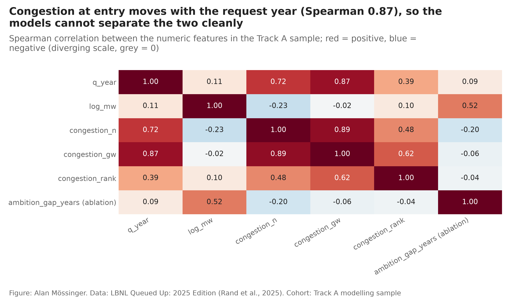

*Notebook:* `notebooks/04_build_features.ipynb` · *Files:* `figures/04_build_features/04_02_feature_correlation.png`, `.svg`

**Caption (stub).** Spearman correlations between the numeric entry-time features in Track A.
<!-- /fig:04_02_feature_correlation -->

<!-- fig:04_03_technology_mix_by_split -->
### 04_03_technology_mix_by_split

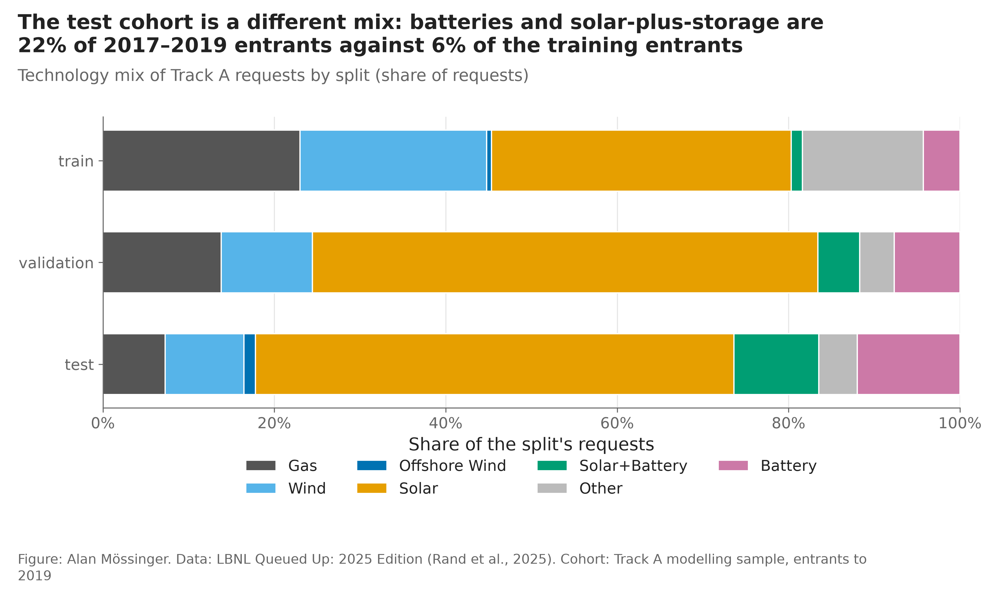

*Notebook:* `notebooks/04_build_features.ipynb` · *Files:* `figures/04_build_features/04_03_technology_mix_by_split.png`, `.svg`

**Caption (stub).** Technology mix of Track A requests in the train, validation and test splits.
<!-- /fig:04_03_technology_mix_by_split -->

<!-- fig:04_04_yearly_hazards -->
### 04_04_yearly_hazards

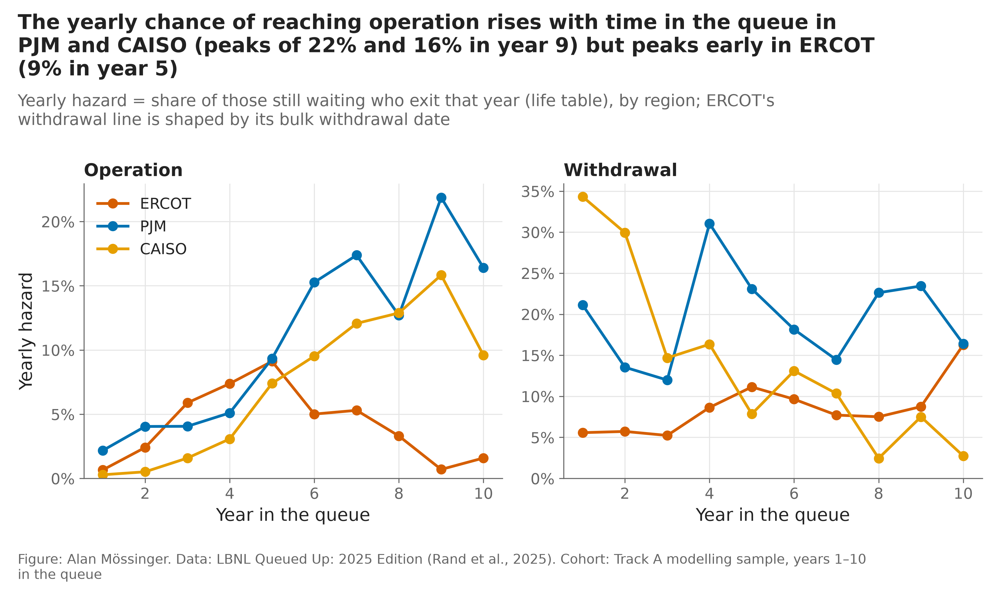

*Notebook:* `notebooks/04_build_features.ipynb` · *Files:* `figures/04_build_features/04_04_yearly_hazards.png`, `.svg`

**Caption (stub).** Yearly hazards of operation and withdrawal by year in the queue for CAISO, ERCOT and PJM.
<!-- /fig:04_04_yearly_hazards -->

<!-- fig:04_05_ambition_gap_leakage -->
### 04_05_ambition_gap_leakage

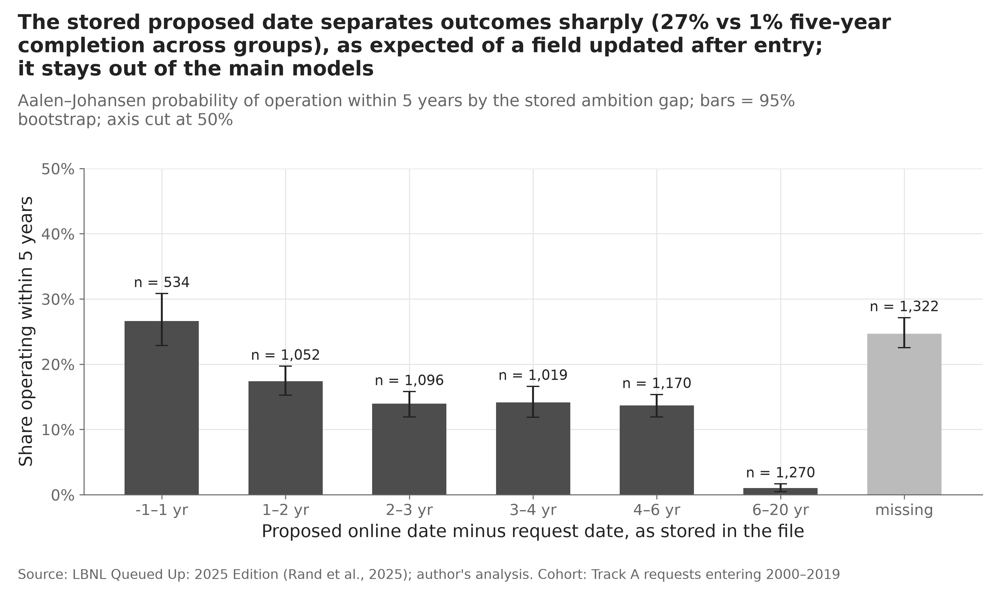

*Notebook:* `notebooks/04_build_features.ipynb` · *Files:* `figures/04_build_features/04_05_ambition_gap_leakage.png`, `.svg`

**Caption (stub).** Five-year completion by the gap between the stored proposed online date and the request date (leakage illustration).
<!-- /fig:04_05_ambition_gap_leakage -->

<!-- fig:04_06_stamp_simulation -->
### 04_06_stamp_simulation

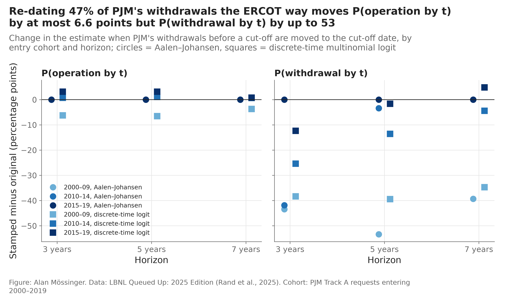

*Notebook:* `notebooks/04_build_features.ipynb` · *Files:* `figures/04_build_features/04_06_stamp_simulation.png`, `.svg`

**Caption (stub).** Change in estimated P(operation by t) and P(withdrawal by t) when PJM's withdrawal dates are bulk-stamped the way ERCOT's are, by cohort, horizon and method.
<!-- /fig:04_06_stamp_simulation -->

<!-- fig:04_07_track_b_built_share -->
### 04_07_track_b_built_share

*Notebook:* `notebooks/04_build_features.ipynb` · *Files:* `figures/04_build_features/04_07_track_b_built_share.png`, `.svg`

**Caption (stub).** Share of resolved requests that were built, by request year and region (Track B).
<!-- /fig:04_07_track_b_built_share -->

<!-- fig:04_08_ercot_treatment_validation -->
### 04_08_ercot_treatment_validation

*Notebook:* `notebooks/04_build_features.ipynb` · *Files:* `figures/04_build_features/04_08_ercot_treatment_validation.png`, `.svg`

**Caption (stub).** Predicted versus observed P(operation by 3, 5 and 7 years) for ERCOT 2016 entrants under three treatments of the bulk-dated withdrawals.
<!-- /fig:04_08_ercot_treatment_validation -->

<!-- fig:05_01_baseline_cells -->
### 05_01_baseline_cells

*Notebook:* `notebooks/05_cox_models.ipynb` · *Files:* `figures/05_cox_models/05_01_baseline_cells.png`, `.svg`

**Caption (stub).** Baseline P(operation by 3, 5 and 7 years) for each region × technology cell of the training data.
<!-- /fig:05_01_baseline_cells -->

<!-- fig:05_02_penalizer_tuning -->
### 05_02_penalizer_tuning

*Notebook:* `notebooks/05_cox_models.ipynb` · *Files:* `figures/05_cox_models/05_02_penalizer_tuning.png`, `.svg`

**Caption (stub).** Validation log partial likelihood of the cause-specific Cox models by ridge penalty.
<!-- /fig:05_02_penalizer_tuning -->

<!-- fig:05_03_hazard_ratios -->
### 05_03_hazard_ratios

*Notebook:* `notebooks/05_cox_models.ipynb` · *Files:* `figures/05_cox_models/05_03_hazard_ratios.png`, `.svg`

**Caption (stub).** Hazard ratios of the cause-specific Cox models for operation and withdrawal (forest plot).
<!-- /fig:05_03_hazard_ratios -->

<!-- fig:05_04_ph_tests -->
### 05_04_ph_tests

*Notebook:* `notebooks/05_cox_models.ipynb` · *Files:* `figures/05_cox_models/05_04_ph_tests.png`, `.svg`

**Caption (stub).** Proportional-hazards test p-values for each covariate of the two cause-specific Cox models.
<!-- /fig:05_04_ph_tests -->

<!-- fig:05_05_sensitivity_ercot_dates -->
### 05_05_sensitivity_ercot_dates

*Notebook:* `notebooks/05_cox_models.ipynb` · *Files:* `figures/05_cox_models/05_05_sensitivity_ercot_dates.png`, `.svg`

**Caption (stub).** Hazard ratios of the main Cox fit against the fit with ERCOT's withdrawal dates as recorded.
<!-- /fig:05_05_sensitivity_ercot_dates -->

<!-- fig:05_06_validation_check -->
### 05_06_validation_check

*Notebook:* `notebooks/05_cox_models.ipynb` · *Files:* `figures/05_cox_models/05_06_validation_check.png`, `.svg`

**Caption (stub).** Mean predicted versus observed P(operation by 3, 5 and 7 years) on the 2016 validation cohort, by region.
<!-- /fig:05_06_validation_check -->

<!-- fig:05_07_reference_request -->
### 05_07_reference_request

*Notebook:* `notebooks/05_cox_models.ipynb` · *Files:* `figures/05_cox_models/05_07_reference_request.png`, `.svg`

**Caption (stub).** Predicted P(operation by year) for the same reference solar request in each region.
<!-- /fig:05_07_reference_request -->

<!-- fig:05_08_test_prediction_spread -->
### 05_08_test_prediction_spread

*Notebook:* `notebooks/05_cox_models.ipynb` · *Files:* `figures/05_cox_models/05_08_test_prediction_spread.png`, `.svg`

**Caption (stub).** Distribution of 5-year predictions for the test entrants, Cox models versus baseline.
<!-- /fig:05_08_test_prediction_spread -->

<!-- fig:06_01_life_table_hazards -->
### 06_01_life_table_hazards

*Notebook:* `notebooks/06_discrete_time_models.ipynb` · *Files:* `figures/06_discrete_time_models/06_01_life_table_hazards.png`, `.svg`

**Caption (stub).** Yearly hazards of operation and withdrawal by year in the queue and region (life table of the fit sample).
<!-- /fig:06_01_life_table_hazards -->

<!-- fig:06_02_queue_gw_over_time -->
### 06_02_queue_gw_over_time

*Notebook:* `notebooks/06_discrete_time_models.ipynb` · *Files:* `figures/06_discrete_time_models/06_02_queue_gw_over_time.png`, `.svg`

**Caption (stub).** GW waiting in each Track A queue, monthly, 2000–2024.
<!-- /fig:06_02_queue_gw_over_time -->

<!-- fig:06_03_congestion_drift -->
### 06_03_congestion_drift

*Notebook:* `notebooks/06_discrete_time_models.ipynb` · *Files:* `figures/06_discrete_time_models/06_03_congestion_drift.png`, `.svg`

**Caption (stub).** Ratio of yearly congestion to congestion at entry, by year in the queue and region.
<!-- /fig:06_03_congestion_drift -->

<!-- fig:06_04_logit_cv -->
### 06_04_logit_cv

*Notebook:* `notebooks/06_discrete_time_models.ipynb` · *Files:* `figures/06_discrete_time_models/06_04_logit_cv.png`, `.svg`

**Caption (stub).** Grouped cross-validation log loss of the multinomial logit by ridge strength, with and without early-years interactions.
<!-- /fig:06_04_logit_cv -->

<!-- fig:06_05_lgbm_cv -->
### 06_05_lgbm_cv

*Notebook:* `notebooks/06_discrete_time_models.ipynb` · *Files:* `figures/06_discrete_time_models/06_05_lgbm_cv.png`, `.svg`

**Caption (stub).** Grouped cross-validation log loss of LightGBM by boosting round for 15 tree settings.
<!-- /fig:06_05_lgbm_cv -->

<!-- fig:06_06_early_stopping -->
### 06_06_early_stopping

*Notebook:* `notebooks/06_discrete_time_models.ipynb` · *Files:* `figures/06_discrete_time_models/06_06_early_stopping.png`, `.svg`

**Caption (stub).** LightGBM tree settings scored in grouped cross-validation and on the 2016 cohort, and the 2016 log loss by round.
<!-- /fig:06_06_early_stopping -->

<!-- fig:06_07_validation_2016 -->
### 06_07_validation_2016

*Notebook:* `notebooks/06_discrete_time_models.ipynb` · *Files:* `figures/06_discrete_time_models/06_07_validation_2016.png`, `.svg`

**Caption (stub).** Mean predicted versus observed P(operation by 3, 5 and 7 years) on the 2016 cohort for the four models, by region.
<!-- /fig:06_07_validation_2016 -->

<!-- fig:06_08_frozen_vs_realised_congestion -->
### 06_08_frozen_vs_realised_congestion

*Notebook:* `notebooks/06_discrete_time_models.ipynb` · *Files:* `figures/06_discrete_time_models/06_08_frozen_vs_realised_congestion.png`, `.svg`

**Caption (stub).** Effect of freezing congestion at its entry value on the 2016 cohort's mean predictions.
<!-- /fig:06_08_frozen_vs_realised_congestion -->

<!-- fig:06_09_logit_odds_ratios -->
### 06_09_logit_odds_ratios

*Notebook:* `notebooks/06_discrete_time_models.ipynb` · *Files:* `figures/06_discrete_time_models/06_09_logit_odds_ratios.png`, `.svg`

**Caption (stub).** Odds ratios of the final multinomial logit for operation and withdrawal, early and late years in the queue.
<!-- /fig:06_09_logit_odds_ratios -->

<!-- fig:06_10_lgbm_importance -->
### 06_10_lgbm_importance

*Notebook:* `notebooks/06_discrete_time_models.ipynb` · *Files:* `figures/06_discrete_time_models/06_10_lgbm_importance.png`, `.svg`

**Caption (stub).** Split-gain importance of each feature in the LightGBM hazard model.
<!-- /fig:06_10_lgbm_importance -->

<!-- fig:06_11_reference_hazards -->
### 06_11_reference_hazards

*Notebook:* `notebooks/06_discrete_time_models.ipynb` · *Files:* `figures/06_discrete_time_models/06_11_reference_hazards.png`, `.svg`

**Caption (stub).** Predicted yearly hazards of operation and withdrawal for a reference solar request in each region, both models.
<!-- /fig:06_11_reference_hazards -->

<!-- fig:06_12_technology_profiles -->
### 06_12_technology_profiles

*Notebook:* `notebooks/06_discrete_time_models.ipynb` · *Files:* `figures/06_discrete_time_models/06_12_technology_profiles.png`, `.svg`

**Caption (stub).** Predicted yearly hazard of operation by year in the queue for each technology, PJM reference request, both models.
<!-- /fig:06_12_technology_profiles -->

<!-- fig:06_13_band_check -->
### 06_13_band_check

*Notebook:* `notebooks/06_discrete_time_models.ipynb` · *Files:* `figures/06_discrete_time_models/06_13_band_check.png`, `.svg`

**Caption (stub).** Model-averaged P(operation by year) against the Aalen–Johansen estimate and bootstrap band, by region (acceptance check).
<!-- /fig:06_13_band_check -->

<!-- fig:06_14_cohort_check -->
### 06_14_cohort_check

*Notebook:* `notebooks/06_discrete_time_models.ipynb` · *Files:* `figures/06_discrete_time_models/06_14_cohort_check.png`, `.svg`

**Caption (stub).** Observed versus predicted P(operation by 3 and 5 years) by entry cohort and region.
<!-- /fig:06_14_cohort_check -->

<!-- fig:06_15_test_prediction_spread -->
### 06_15_test_prediction_spread

*Notebook:* `notebooks/06_discrete_time_models.ipynb` · *Files:* `figures/06_discrete_time_models/06_15_test_prediction_spread.png`, `.svg`

**Caption (stub).** Distribution of 5-year predictions for the test entrants: discrete-time models versus baseline.
<!-- /fig:06_15_test_prediction_spread -->

<!-- fig:06_16_cox_vs_lgbm_test -->
### 06_16_cox_vs_lgbm_test

*Notebook:* `notebooks/06_discrete_time_models.ipynb` · *Files:* `figures/06_discrete_time_models/06_16_cox_vs_lgbm_test.png`, `.svg`

**Caption (stub).** Cox versus discrete-time LightGBM 5-year predictions for each test request.
<!-- /fig:06_16_cox_vs_lgbm_test -->

<!-- fig:06_17_expected_time -->
### 06_17_expected_time

*Notebook:* `notebooks/06_discrete_time_models.ipynb` · *Files:* `figures/06_discrete_time_models/06_17_expected_time.png`, `.svg`

**Caption (stub).** Distribution of the expected time to operation (among requests built within 10 years) for the test entrants.
<!-- /fig:06_17_expected_time -->

<!-- fig:07_01_built_share_by_region -->
### 07_01_built_share_by_region

*Notebook:* `notebooks/07_all_regions_model.ipynb` · *Files:* `figures/07_all_regions_model/07_01_built_share_by_region.png`, `.svg`

**Caption (stub).** Share built among resolved requests by region, training and validation cohorts.
<!-- /fig:07_01_built_share_by_region -->

<!-- fig:07_02_unresolved_share -->
### 07_02_unresolved_share

*Notebook:* `notebooks/07_all_regions_model.ipynb` · *Files:* `figures/07_all_regions_model/07_02_unresolved_share.png`, `.svg`

**Caption (stub).** Share of requests still unresolved at the end of 2024, by request year and region.
<!-- /fig:07_02_unresolved_share -->

<!-- fig:07_03_base_rates -->
### 07_03_base_rates

*Notebook:* `notebooks/07_all_regions_model.ipynb` · *Files:* `figures/07_all_regions_model/07_03_base_rates.png`, `.svg`

**Caption (stub).** Region × technology share built among resolved training requests (the Track B benchmark).
<!-- /fig:07_03_base_rates -->

<!-- fig:07_04_tuning -->
### 07_04_tuning

*Notebook:* `notebooks/07_all_regions_model.ipynb` · *Files:* `figures/07_all_regions_model/07_04_tuning.png`, `.svg`

**Caption (stub).** Track B tuning: logit ridge strength and LightGBM settings in cross-validation and on the 2016 cohort.
<!-- /fig:07_04_tuning -->

<!-- fig:07_05_validation_metrics -->
### 07_05_validation_metrics

*Notebook:* `notebooks/07_all_regions_model.ipynb` · *Files:* `figures/07_all_regions_model/07_05_validation_metrics.png`, `.svg`

**Caption (stub).** AUC and Brier score of the Track B models and the base rate on the 2016 cohort.
<!-- /fig:07_05_validation_metrics -->

<!-- fig:07_06_reliability_2016 -->
### 07_06_reliability_2016

*Notebook:* `notebooks/07_all_regions_model.ipynb` · *Files:* `figures/07_all_regions_model/07_06_reliability_2016.png`, `.svg`

**Caption (stub).** Reliability diagrams of the Track B models on the 2016 cohort, raw and isotonic-calibrated.
<!-- /fig:07_06_reliability_2016 -->

<!-- fig:07_07_isotonic_maps -->
### 07_07_isotonic_maps

*Notebook:* `notebooks/07_all_regions_model.ipynb` · *Files:* `figures/07_all_regions_model/07_07_isotonic_maps.png`, `.svg`

**Caption (stub).** Isotonic calibration maps of the two Track B models, fitted on the 2016 cohort.
<!-- /fig:07_07_isotonic_maps -->

<!-- fig:07_08_calibration_by_region -->
### 07_08_calibration_by_region

*Notebook:* `notebooks/07_all_regions_model.ipynb` · *Files:* `figures/07_all_regions_model/07_08_calibration_by_region.png`, `.svg`

**Caption (stub).** Mean calibrated P(built) against the observed share by region, on 2016 and with the region held out.
<!-- /fig:07_08_calibration_by_region -->

<!-- fig:07_09_loro_auc -->
### 07_09_loro_auc

*Notebook:* `notebooks/07_all_regions_model.ipynb` · *Files:* `figures/07_all_regions_model/07_09_loro_auc.png`, `.svg`

**Caption (stub).** Leave-one-region-out AUC of the Track B models against a technology-only benchmark.
<!-- /fig:07_09_loro_auc -->

<!-- fig:07_10_odds_ratios -->
### 07_10_odds_ratios

*Notebook:* `notebooks/07_all_regions_model.ipynb` · *Files:* `figures/07_all_regions_model/07_10_odds_ratios.png`, `.svg`

**Caption (stub).** Odds ratios of the Track B logistic regression for being built.
<!-- /fig:07_10_odds_ratios -->

<!-- fig:07_11_lgbm_importance -->
### 07_11_lgbm_importance

*Notebook:* `notebooks/07_all_regions_model.ipynb` · *Files:* `figures/07_all_regions_model/07_11_lgbm_importance.png`, `.svg`

**Caption (stub).** Split-gain importance of each feature in the Track B LightGBM model.
<!-- /fig:07_11_lgbm_importance -->

<!-- fig:07_12_test_predictions -->
### 07_12_test_predictions

*Notebook:* `notebooks/07_all_regions_model.ipynb` · *Files:* `figures/07_all_regions_model/07_12_test_predictions.png`, `.svg`

**Caption (stub).** Distribution of calibrated P(built) for the 2017 test cohort by region.
<!-- /fig:07_12_test_predictions -->

<!-- fig:07_13_track_a_vs_b -->
### 07_13_track_a_vs_b

*Notebook:* `notebooks/07_all_regions_model.ipynb` · *Files:* `figures/07_all_regions_model/07_13_track_a_vs_b.png`, `.svg`

**Caption (stub).** Track A 7-year P(operation) against Track B P(built) for the shared 2017 requests.
<!-- /fig:07_13_track_a_vs_b -->

<!-- fig:08_01_outcome_status -->
### 08_01_outcome_status

*Notebook:* `notebooks/08_evaluate.ipynb` · *Files:* `figures/08_evaluate/08_01_outcome_status.png`, `.svg`

**Caption (stub).** Status of the 2017–2019 test requests at 3, 5 and 7 years after the request, by region.
<!-- /fig:08_01_outcome_status -->

<!-- fig:08_02_censoring_weights -->
### 08_02_censoring_weights

*Notebook:* `notebooks/08_evaluate.ipynb` · *Files:* `figures/08_evaluate/08_02_censoring_weights.png`, `.svg`

**Caption (stub).** Censoring distribution of the test cohort and follow-up windows by entry year.
<!-- /fig:08_02_censoring_weights -->

<!-- fig:08_03_concordance -->
### 08_03_concordance

*Notebook:* `notebooks/08_evaluate.ipynb` · *Files:* `figures/08_evaluate/08_03_concordance.png`, `.svg`

**Caption (stub).** Uno's and Harrell's concordance of the four Track A models by horizon, with bootstrap intervals.
<!-- /fig:08_03_concordance -->

<!-- fig:08_04_differences_from_baseline -->
### 08_04_differences_from_baseline

*Notebook:* `notebooks/08_evaluate.ipynb` · *Files:* `figures/08_evaluate/08_04_differences_from_baseline.png`, `.svg`

**Caption (stub).** Paired differences from the baseline in Uno's concordance and Brier score, three models, three horizons.
<!-- /fig:08_04_differences_from_baseline -->

<!-- fig:08_05_within_region -->
### 08_05_within_region

*Notebook:* `notebooks/08_evaluate.ipynb` · *Files:* `figures/08_evaluate/08_05_within_region.png`, `.svg`

**Caption (stub).** Within-region concordance and AUC at 5 years for the four Track A models.
<!-- /fig:08_05_within_region -->

<!-- fig:08_06_calibration_slope_intercept -->
### 08_06_calibration_slope_intercept

*Notebook:* `notebooks/08_evaluate.ipynb` · *Files:* `figures/08_evaluate/08_06_calibration_slope_intercept.png`, `.svg`

**Caption (stub).** Calibration slope and intercept of the four Track A models by horizon.
<!-- /fig:08_06_calibration_slope_intercept -->

<!-- fig:08_07_calibration_by_region -->
### 08_07_calibration_by_region

*Notebook:* `notebooks/08_evaluate.ipynb` · *Files:* `figures/08_evaluate/08_07_calibration_by_region.png`, `.svg`

**Caption (stub).** Mean predicted versus observed P(operation by 3, 5 and 7 years) by region, test cohort, four models.
<!-- /fig:08_07_calibration_by_region -->

<!-- fig:08_08_gains_5yr -->
### 08_08_gains_5yr

*Notebook:* `notebooks/08_evaluate.ipynb` · *Files:* `figures/08_evaluate/08_08_gains_5yr.png`, `.svg`

**Caption (stub).** Gains curves at 5 years: share of operating requests captured by the top x% of each model's ranking.
<!-- /fig:08_08_gains_5yr -->

<!-- fig:08_09_top_decile -->
### 08_09_top_decile

*Notebook:* `notebooks/08_evaluate.ipynb` · *Files:* `figures/08_evaluate/08_09_top_decile.png`, `.svg`

**Caption (stub).** Top-decile lift and precision of the four Track A models by horizon.
<!-- /fig:08_09_top_decile -->

<!-- fig:08_10_trackB_roc_reliability -->
### 08_10_trackB_roc_reliability

*Notebook:* `notebooks/08_evaluate.ipynb` · *Files:* `figures/08_evaluate/08_10_trackB_roc_reliability.png`, `.svg`

**Caption (stub).** Track B on the 2017 cohort: ROC curves and reliability by predicted decile.
<!-- /fig:08_10_trackB_roc_reliability -->

<!-- fig:08_11_trackB_by_region -->
### 08_11_trackB_by_region

*Notebook:* `notebooks/08_evaluate.ipynb` · *Files:* `figures/08_evaluate/08_11_trackB_by_region.png`, `.svg`

**Caption (stub).** Track B on the 2017 cohort: observed share built versus mean predictions by region.
<!-- /fig:08_11_trackB_by_region -->

<!-- fig:08_12_success_criteria -->
### 08_12_success_criteria

*Notebook:* `notebooks/08_evaluate.ipynb` · *Files:* `figures/08_evaluate/08_12_success_criteria.png`, `.svg`

**Caption (stub).** The pre-registered success criteria with their bootstrap intervals and PASS/FAIL verdicts.
<!-- /fig:08_12_success_criteria -->

<!-- fig:08_13_seven_year_check -->
### 08_13_seven_year_check

*Notebook:* `notebooks/08_evaluate.ipynb` · *Files:* `figures/08_evaluate/08_13_seven_year_check.png`, `.svg`

**Caption (stub).** Seven-year metrics: IPCW on all test entrants versus the fully observed 2017 entrants.
<!-- /fig:08_13_seven_year_check -->

<!-- fig:08_14_by_entry_year -->
### 08_14_by_entry_year

*Notebook:* `notebooks/08_evaluate.ipynb` · *Files:* `figures/08_evaluate/08_14_by_entry_year.png`, `.svg`

**Caption (stub).** Mean predicted versus observed P(operation by 3 and 5 years) for each test entry year.
<!-- /fig:08_14_by_entry_year -->

<!-- fig:08_15_leave_one_iso_out -->
### 08_15_leave_one_iso_out

*Notebook:* `notebooks/08_evaluate.ipynb` · *Files:* `figures/08_evaluate/08_15_leave_one_iso_out.png`, `.svg`

**Caption (stub).** Leave-one-ISO-out: concordance and mean predicted level at 5 years for each held-out ISO.
<!-- /fig:08_15_leave_one_iso_out -->

<!-- fig:08_16_leakage_ablation -->
### 08_16_leakage_ablation

*Notebook:* `notebooks/08_evaluate.ipynb` · *Files:* `figures/08_evaluate/08_16_leakage_ablation.png`, `.svg`

**Caption (stub).** Leakage ablation: time-dependent AUC and Brier score with and without post-entry columns, CAISO and ERCOT.
<!-- /fig:08_16_leakage_ablation -->

<!-- fig:08_17_robustness -->
### 08_17_robustness

*Notebook:* `notebooks/08_evaluate.ipynb` · *Files:* `figures/08_evaluate/08_17_robustness.png`, `.svg`

**Caption (stub).** Robustness reruns: LightGBM versus the baseline under five data versions, three horizons.
<!-- /fig:08_17_robustness -->

<!-- fig:08b_01_choice_on_2016 -->
### 08b_01_choice_on_2016

*Notebook:* `notebooks/08b_posthoc_improvements.ipynb` · *Files:* `figures/08b_posthoc_improvements/08b_01_choice_on_2016.png`, `.svg`

**Caption (stub).** The five post-hoc candidates on the 2016 cohort: Brier score relative to the main LightGBM and calibration slope.
<!-- /fig:08b_01_choice_on_2016 -->

<!-- fig:08b_02_chosen_on_test -->
### 08b_02_chosen_on_test

*Notebook:* `notebooks/08b_posthoc_improvements.ipynb` · *Files:* `figures/08b_posthoc_improvements/08b_02_chosen_on_test.png`, `.svg`

**Caption (stub).** Post-hoc: test-cohort AUC, Brier score and calibration slope of the chosen candidate, the registered LightGBM and the baseline.
<!-- /fig:08b_02_chosen_on_test -->

<!-- fig:08b_03_calibration_deciles -->
### 08b_03_calibration_deciles

*Notebook:* `notebooks/08b_posthoc_improvements.ipynb` · *Files:* `figures/08b_posthoc_improvements/08b_03_calibration_deciles.png`, `.svg`

**Caption (stub).** Post-hoc: calibration by predicted decile of the chosen candidate and the registered LightGBM.
<!-- /fig:08b_03_calibration_deciles -->

<!-- fig:08b_04_levels_by_group -->
### 08b_04_levels_by_group

*Notebook:* `notebooks/08b_posthoc_improvements.ipynb` · *Files:* `figures/08b_posthoc_improvements/08b_04_levels_by_group.png`, `.svg`

**Caption (stub).** Post-hoc: mean predicted versus observed 5-year completion by region and entry year.
<!-- /fig:08b_04_levels_by_group -->

<!-- fig:08b_05_all_candidates_test -->
### 08b_05_all_candidates_test

*Notebook:* `notebooks/08b_posthoc_improvements.ipynb` · *Files:* `figures/08b_posthoc_improvements/08b_05_all_candidates_test.png`, `.svg`

**Caption (stub).** Post-hoc, not used for the choice: all five candidates on the test cohort.
<!-- /fig:08b_05_all_candidates_test -->

<!-- fig:08b_06_congestion_entry_fit -->
### 08b_06_congestion_entry_fit

*Notebook:* `notebooks/08b_posthoc_improvements.ipynb` · *Files:* `figures/08b_posthoc_improvements/08b_06_congestion_entry_fit.png`, `.svg`

**Caption (stub).** Post-hoc: partial dependence on GW waiting at entry for LightGBM fitted on yearly and on entry-time congestion.
<!-- /fig:08b_06_congestion_entry_fit -->

<!-- fig:09_01_shap_by_category -->
### 09_01_shap_by_category

*Notebook:* `notebooks/09_explain_and_rank.ipynb` · *Files:* `figures/09_explain_and_rank/09_01_shap_by_category.png`, `.svg`

**Caption (stub).** Mean SHAP contribution of each region, technology and service level to P(operation within 5 years).
<!-- /fig:09_01_shap_by_category -->

<!-- fig:09_02_shap_congestion -->
### 09_02_shap_congestion

*Notebook:* `notebooks/09_explain_and_rank.ipynb` · *Files:* `figures/09_explain_and_rank/09_02_shap_congestion.png`, `.svg`

**Caption (stub).** SHAP dependence of P(operation within 5 years) on GW waiting at entry, by region.
<!-- /fig:09_02_shap_congestion -->

<!-- fig:09_03_shap_by_region -->
### 09_03_shap_by_region

*Notebook:* `notebooks/09_explain_and_rank.ipynb` · *Files:* `figures/09_explain_and_rank/09_03_shap_by_region.png`, `.svg`

**Caption (stub).** Mean absolute SHAP value of each feature by region.
<!-- /fig:09_03_shap_by_region -->

<!-- fig:09_04_pd_size -->
### 09_04_pd_size

*Notebook:* `notebooks/09_explain_and_rank.ipynb` · *Files:* `figures/09_explain_and_rank/09_04_pd_size.png`, `.svg`

**Caption (stub).** Partial dependence of P(operation within 5 years) on requested size, by region, with the 20 MW step marked.
<!-- /fig:09_04_pd_size -->

<!-- fig:09_05_pd_congestion -->
### 09_05_pd_congestion

*Notebook:* `notebooks/09_explain_and_rank.ipynb` · *Files:* `figures/09_explain_and_rank/09_05_pd_congestion.png`, `.svg`

**Caption (stub).** Partial dependence of P(operation within 5 years) on GW waiting at entry, by region.
<!-- /fig:09_05_pd_congestion -->

<!-- fig:09_06_pd_technology -->
### 09_06_pd_technology

*Notebook:* `notebooks/09_explain_and_rank.ipynb` · *Files:* `figures/09_explain_and_rank/09_06_pd_technology.png`, `.svg`

**Caption (stub).** Partial dependence of P(operation within 5 years) on technology within each region.
<!-- /fig:09_06_pd_technology -->

<!-- fig:09_07_ranking_book -->
### 09_07_ranking_book

*Notebook:* `notebooks/09_explain_and_rank.ipynb` · *Files:* `figures/09_explain_and_rank/09_07_ranking_book.png`, `.svg`

**Caption (stub).** A book of 25 requests from 2019 ranked by predicted P(operation within 5 years), with the baseline and the observed status five years later.
<!-- /fig:09_07_ranking_book -->

<!-- fig:09_08_worked_examples -->
### 09_08_worked_examples

*Notebook:* `notebooks/09_explain_and_rank.ipynb` · *Files:* `figures/09_explain_and_rank/09_08_worked_examples.png`, `.svg`

**Caption (stub).** SHAP decomposition of P(operation within 5 years) for three requests from the book.
<!-- /fig:09_08_worked_examples -->

<!-- fig:09_09_congestion_confounding -->
### 09_09_congestion_confounding

*Notebook:* `notebooks/09_explain_and_rank.ipynb` · *Files:* `figures/09_explain_and_rank/09_09_congestion_confounding.png`, `.svg`

**Caption (stub).** PJM fitting rows: GW waiting by year in the queue, against the entry values of the test requests, and the yearly operation hazard.
<!-- /fig:09_09_congestion_confounding -->

<!-- fig:11_01_fair_baseline_cells -->
### 11_01_fair_baseline_cells

*Notebook:* `notebooks/11_fair_baseline_and_scale.ipynb` · *Files:* `figures/11_fair_baseline_and_scale/11_01_fair_baseline_cells.png`, `.svg`

**Caption (stub).** P(operation within 5 years) by size band within each region and technology: the cells of the fair baseline.
<!-- /fig:11_01_fair_baseline_cells -->

<!-- fig:12_01_hazards_by_cohort -->
### 12_01_hazards_by_cohort

*Notebook:* `notebooks/12_level_repair.ipynb` · *Files:* `figures/12_level_repair/12_01_hazards_by_cohort.png`, `.svg`

**Caption (stub).** Early-year hazards of operation and withdrawal by entry cohort, 2012–2019.
<!-- /fig:12_01_hazards_by_cohort -->

<!-- fig:12_03_early_hazards_2020_2022 -->
### 12_03_early_hazards_2020_2022

*Notebook:* `notebooks/12_level_repair.ipynb` · *Files:* `figures/12_level_repair/12_03_early_hazards_2020_2022.png`, `.svg`

**Caption (stub).** Predicted against observed one- and two-year incidence of operation for 2020–2022 entrants.
<!-- /fig:12_03_early_hazards_2020_2022 -->

<!-- fig:13_01_milestone_coverage -->
### 13_01_milestone_coverage

*Notebook:* `notebooks/13_iso_queue_files.ipynb` · *Files:* `figures/13_iso_queue_files/13_01_milestone_coverage.png`, `.svg`

**Caption (stub).** Coverage of post-entry milestones by region and the timing of executed agreements.
<!-- /fig:13_01_milestone_coverage -->

<!-- fig:18_01_v2_criteria -->
### 18_01_v2_criteria

*Notebook:* `notebooks/18_evaluate_v2.ipynb` · *Files:* `figures/18_evaluate_v2/18_01_v2_criteria.png`, `.svg`

**Caption (stub).** The pre-registered v2 criteria scored, with PASS/FAIL per line.
<!-- /fig:18_01_v2_criteria -->

<!-- fig:18_02_trackB_calibration -->
### 18_02_trackB_calibration

*Notebook:* `notebooks/18_evaluate_v2.ipynb` · *Files:* `figures/18_evaluate_v2/18_02_trackB_calibration.png`, `.svg`

**Caption (stub).** Calibration of the Track B models by prediction bin.
<!-- /fig:18_02_trackB_calibration -->

<!-- fig:20_02_level_at_the_landmark -->
### 20_02_level_at_the_landmark

*Notebook:* `notebooks/20_managed_book.ipynb` · *Files:* `figures/20_managed_book/20_02_level_at_the_landmark.png`, `.svg`

**Caption (stub).** Observed and predicted three-year operation after the two-year landmark by entry cohort, before and after the level repair.
<!-- /fig:20_02_level_at_the_landmark -->

<!-- fig:D0_decision_board -->
### D0_decision_board

*Notebook:* `notebooks/18_evaluate_v2.ipynb` · *Files:* `figures/D0_decision_board.png`, `.svg`

**Caption (stub).** The decision board: the six decisions of the report, each with its headline numbers and its rule, read from the result tables.
<!-- /fig:D0_decision_board -->

<!-- fig:D1_where -->
### D1_where

*Notebook:* `notebooks/18_evaluate_v2.ipynb` · *Files:* `figures/D1_where.png`, `.svg`

**Caption (stub).** Decision 1, where: five-year completion by region and the four state archetypes with the share of 2017–2019 entrants operating by end-2024.
<!-- /fig:D1_where -->

<!-- fig:D2_which_and_when -->
### D2_which_and_when

*Notebook:* `notebooks/18_evaluate_v2.ipynb` · *Files:* `figures/D2_which_and_when.png`, `.svg`

**Caption (stub).** Decision 2, which and when: ranking at entry against averages, the landmark gain from the agreement, and the fall of the level across entry cohorts.
<!-- /fig:D2_which_and_when -->

<!-- fig:D3_why -->
### D3_why

*Notebook:* `notebooks/18_evaluate_v2.ipynb` · *Files:* `figures/D3_why.png`, `.svg`

**Caption (stub).** Decision 3, why requests fail: five-year completion by size, technology and the executed agreement within each region, and the annual withdrawal hazard by year in the queue.
<!-- /fig:D3_why -->

<!-- fig:D4_worth -->
### D4_worth

*Notebook:* `notebooks/18_evaluate_v2.ipynb` · *Files:* `figures/D4_worth.png`, `.svg`

**Caption (stub).** Decision 4, what a plant is worth: NPV per MW by technology and region at a 2024 operation date under merchant and contracted revenue, and the break-even flat price against the captured energy price.
<!-- /fig:D4_worth -->

<!-- fig:D5_book -->
### D5_book

*Notebook:* `notebooks/18_evaluate_v2.ipynb` · *Files:* `figures/D5_book.png`, `.svg`

**Caption (stub).** Decision 5, the book: the gate classes scored on what happened under contracted and merchant revenue, and the model's floor book per region two years in.
<!-- /fig:D5_book -->

<!-- fig:D6_policies -->
### D6_policies

*Notebook:* `notebooks/18_evaluate_v2.ipynb` · *Files:* `figures/D6_policies.png`, `.svg`

**Caption (stub).** Decision 5, continued: six allocation policies under the same deposit budget, contracted and merchant revenue: expected NPV, expected shortfall and realised NPV.
<!-- /fig:D6_policies -->

<!-- fig:F10_gains_over_baselines -->
### F10_gains_over_baselines

*Notebook:* `notebooks/11_fair_baseline_and_scale.ipynb` · *Files:* `figures/F10_gains_over_baselines.png`, `.svg`

**Caption (stub).** Paired gains of the v2 model over the v1 and the fair baseline in Uno's C and Brier score, by size cohort and horizon.
<!-- /fig:F10_gains_over_baselines -->

<!-- fig:F11_level_by_entry_year -->
### F11_level_by_entry_year

*Notebook:* `notebooks/12_level_repair.ipynb` · *Files:* `figures/F11_level_by_entry_year.png`, `.svg`

**Caption (stub).** Observed against predicted P(operation by 3 and 5 years) by test entry year for requests of 20 MW and more, before and after the rolling recalibration.
<!-- /fig:F11_level_by_entry_year -->

<!-- fig:F12_landmark_models -->
### F12_landmark_models

*Notebook:* `notebooks/14_landmark_models.ipynb` · *Files:* `figures/F12_landmark_models.png`, `.svg`

**Caption (stub).** Gains over the entry model from updating congestion and the agreement status at each landmark, 3 years after the landmark.
<!-- /fig:F12_landmark_models -->

<!-- fig:F13_expected_mw_and_value -->
### F13_expected_mw_and_value

*Notebook:* `notebooks/15_value_and_cost.ipynb` · *Files:* `figures/F13_expected_mw_and_value.png`, `.svg`

**Caption (stub).** Expected cumulative MW online of the 2017–2019 cohort against realised MW, and the expected value index by region under three value cases.
<!-- /fig:F13_expected_mw_and_value -->

<!-- fig:F14_simulated_book -->
### F14_simulated_book

*Notebook:* `notebooks/16_portfolio.ipynb` · *Files:* `figures/F14_simulated_book.png`, `.svg`

**Caption (stub).** Expected cumulative MW online of a 25-request book with its simulated 5–95% band under shared and independent risk, against the realised MW.
<!-- /fig:F14_simulated_book -->

<!-- fig:F15_backtest -->
### F15_backtest

*Notebook:* `notebooks/16_portfolio.ipynb` · *Files:* `figures/F15_backtest.png`, `.svg`

**Caption (stub).** Realised MW online within five years and realised value of the books each chooser would have held, with bootstrap intervals.
<!-- /fig:F15_backtest -->

<!-- fig:F16_constraint_map -->
### F16_constraint_map

*Notebook:* `notebooks/17_constraints_and_levers.ipynb` · *Files:* `figures/F16_constraint_map.png`, `.svg`

**Caption (stub).** Congestion at entry and three-year exits by region and entry year: the constraint map.
<!-- /fig:F16_constraint_map -->

<!-- fig:F17_miso_spp -->
### F17_miso_spp

*Notebook:* `notebooks/19_miso_spp_timing.ipynb` · *Files:* `figures/F17_miso_spp.png`, `.svg`

**Caption (stub).** Uno's C, Brier score and calibration slope of the MISO and SPP timing models at 3 and 5 years, with baselines.
<!-- /fig:F17_miso_spp -->

<!-- fig:F18_managed_book -->
### F18_managed_book

*Notebook:* `notebooks/20_managed_book.ipynb` · *Files:* `figures/F18_managed_book.png`, `.svg`

**Caption (stub).** Operations and MW realised within three years by the books each chooser keeps two years after the request, with bootstrap intervals.
<!-- /fig:F18_managed_book -->

<!-- fig:F19_drivers -->
### F19_drivers

*Notebook:* `notebooks/03_explore_survival_curves.ipynb` · *Files:* `figures/F19_drivers.png`, `.svg`

**Caption (stub).** Five-year completion by six drivers (size, technology, regional queue at entry, county crowding, service type, executed agreement within two years) within each region, 2010–2019 entrants, with 95% Wilson intervals.
<!-- /fig:F19_drivers -->

<!-- fig:F1_cif_by_region -->
### F1_cif_by_region

*Notebook:* `notebooks/03_explore_survival_curves.ipynb` · *Files:* `figures/F1_cif_by_region.png`, `.svg`

**Caption (stub).** Cumulative incidence of reaching commercial operation and of withdrawing, by years since the interconnection request, for CAISO, ERCOT and PJM, with 95% bootstrap bands.
<!-- /fig:F1_cif_by_region -->

<!-- fig:F20_when_requests_die -->
### F20_when_requests_die

*Notebook:* `notebooks/03_explore_survival_curves.ipynb` · *Files:* `figures/F20_when_requests_die.png`, `.svg`

**Caption (stub).** When and where requests leave the queue: annual withdrawal and operation hazards by year in the queue, the study stage reached at withdrawal, and the share operating within the next three years conditional on surviving s years, by region, 2010–2019 entrants.
<!-- /fig:F20_when_requests_die -->

<!-- fig:F21_segments -->
### F21_segments

*Notebook:* `notebooks/09_explain_and_rank.ipynb` · *Files:* `figures/F21_segments.png`, `.svg`

**Caption (stub).** Five-year completion by the ten leaves of a depth-4 classification tree on entry attributes, on the fitting cohort (2010–2016) and the later cohort (2017–2019) with Wilson intervals.
<!-- /fig:F21_segments -->

<!-- fig:F22_tournament -->
### F22_tournament

*Notebook:* `notebooks/08b_posthoc_improvements.ipynb` · *Files:* `figures/F22_tournament.png`, `.svg`

**Caption (stub).** The chosen alternative learner (T3 blend of five) against the registered LightGBM and the fair lookup: paired differences in Uno's C and Brier score by horizon, all sizes and 20 MW and more, test cohort 2017–2019, 95% bootstrap intervals.
<!-- /fig:F22_tournament -->

<!-- fig:F23_portfolio_review -->
### F23_portfolio_review

*Notebook:* `notebooks/16_portfolio.ipynb` · *Files:* `figures/F23_portfolio_review.png`, `.svg`

**Caption (stub).** Share of requests that reached operation by gate decision (invest / hold / exit at entry with hurdle 3; accelerate / hold or sell / exit two years in with hurdle 2) and region, under merchant and contracted revenue, with Wilson intervals, test cohort 2017–2019.
<!-- /fig:F23_portfolio_review -->

<!-- fig:F24_book_per_region -->
### F24_book_per_region

*Notebook:* `notebooks/20_managed_book.ipynb` · *Files:* `figures/F24_book_per_region.png`, `.svg`

**Caption (stub).** How many requests to add two years in and where: operations realised within three years of the landmark against the number added in the landmark model's and the agreement-aware lookup's order, and the model's floor book by region with resampling intervals.
<!-- /fig:F24_book_per_region -->

<!-- fig:F25_state_archetypes -->
### F25_state_archetypes

*Notebook:* `notebooks/03b_project_map.ipynb` · *Files:* `figures/F25_state_archetypes.png`, `.svg`

**Caption (stub).** State archetypes from k-means on seven market features (queue relative to the fleet, technology mix of the waiting MW, median request size, recent-entry share, historical share built), mapped, and the share of 2017–2019 entrants operating by end-2024 in each archetype with Wilson intervals.
<!-- /fig:F25_state_archetypes -->

<!-- fig:F26_npv_per_mw -->
### F26_npv_per_mw

*Notebook:* `notebooks/15_value_and_cost.ipynb` · *Files:* `figures/F26_npv_per_mw.png`, `.svg`

**Caption (stub).** Net present value per MW at operation by technology and region: merchant revenue with today's credits (2024), a 15-year contract at index prices (2024), and merchant revenue after the credit deadline (2028); 20-year life, ATB real cost of capital per technology, low and high value cases as lines.
<!-- /fig:F26_npv_per_mw -->

<!-- fig:F2_operation_by_technology -->
### F2_operation_by_technology

*Notebook:* `notebooks/03_explore_survival_curves.ipynb` · *Files:* `figures/F2_operation_by_technology.png`, `.svg`

**Caption (stub).** Cumulative incidence of reaching operation by technology group, in small multiples for CAISO, ERCOT and PJM, with 95% bootstrap bands.
<!-- /fig:F2_operation_by_technology -->

<!-- fig:F3_five_year_by_size -->
### F3_five_year_by_size

*Notebook:* `notebooks/03_explore_survival_curves.ipynb` · *Files:* `figures/F3_five_year_by_size.png`, `.svg`

**Caption (stub).** Probability of reaching operation within five years by requested capacity (size regime) for CAISO, ERCOT and PJM, with the 20 MW FERC small/large generator threshold marked.
<!-- /fig:F3_five_year_by_size -->

<!-- fig:F4_calibration_by_horizon -->
### F4_calibration_by_horizon

*Notebook:* `notebooks/08_evaluate.ipynb` · *Files:* `figures/F4_calibration_by_horizon.png`, `.svg`

**Caption (stub).** Calibration of P(operation by 3, 5 and 7 years) by predicted decile: baseline, discrete-time logit and LightGBM, test cohort.
<!-- /fig:F4_calibration_by_horizon -->

<!-- fig:F5_auc_brier_by_horizon -->
### F5_auc_brier_by_horizon

*Notebook:* `notebooks/08_evaluate.ipynb` · *Files:* `figures/F5_auc_brier_by_horizon.png`, `.svg`

**Caption (stub).** Time-dependent AUC and IPCW Brier score of the four Track A models at 3, 5 and 7 years, test cohort, with bootstrap intervals.
<!-- /fig:F5_auc_brier_by_horizon -->

<!-- fig:F6_hazard_ratios -->
### F6_hazard_ratios

*Notebook:* `notebooks/09_explain_and_rank.ipynb` · *Files:* `figures/F6_hazard_ratios.png`, `.svg`

**Caption (stub).** Hazard ratios for operation and withdrawal from the cause-specific Cox models, main version.
<!-- /fig:F6_hazard_ratios -->

<!-- fig:F7_shap_summary -->
### F7_shap_summary

*Notebook:* `notebooks/09_explain_and_rank.ipynb` · *Files:* `figures/F7_shap_summary.png`, `.svg`

**Caption (stub).** SHAP values of P(operation within 5 years) from the discrete-time LightGBM, 300 test requests.
<!-- /fig:F7_shap_summary -->

<!-- fig:F8_congestion_vs_completion -->
### F8_congestion_vs_completion

*Notebook:* `notebooks/03_explore_survival_curves.ipynb` · *Files:* `figures/F8_congestion_vs_completion.png`, `.svg`

**Caption (stub).** Probability of reaching operation within five years against the capacity already waiting in the same region's queue at entry, by fifths of congestion, for CAISO, ERCOT and PJM.
<!-- /fig:F8_congestion_vs_completion -->

<!-- fig:F9_project_map -->
### F9_project_map

*Notebook:* `notebooks/03b_project_map.ipynb` · *Files:* `figures/F9_project_map.png`, `.svg`

**Caption (stub).** Requests waiting in U.S. interconnection queues at end-2024 by county (left) and the operating fleet from EIA-860M (right), with ERCOT, PJM and CAISO in their fixed colours.
<!-- /fig:F9_project_map -->

<!-- fig:diag_schoenfeld_operation -->
### diag_schoenfeld_operation

*Notebook:* `notebooks/05_cox_models.ipynb` · *Files:* `figures/05_cox_models/diag_schoenfeld_operation.png`, `.svg`

**Caption (stub).** Scaled Schoenfeld residuals over time for the covariates with the strongest evidence of non-proportional hazards in the operation model.
<!-- /fig:diag_schoenfeld_operation -->

<!-- fig:diag_schoenfeld_withdrawal -->
### diag_schoenfeld_withdrawal

*Notebook:* `notebooks/05_cox_models.ipynb` · *Files:* `figures/05_cox_models/diag_schoenfeld_withdrawal.png`, `.svg`

**Caption (stub).** Scaled Schoenfeld residuals over time for the covariates with the strongest evidence of non-proportional hazards in the withdrawal model.
<!-- /fig:diag_schoenfeld_withdrawal -->
