```{=typst}
#pagebreak()
```

## Executive summary

**1. The problem and the objective.** Energy companies allocate one budget across investments that differ in return, market exposure, execution risk, capital intensity and downside: oil and gas, conventional generation, renewables and storage compete for the same capital. The usual tools — forecasts, project valuations, net present value — are necessary and not sufficient: they rank projects one at a time, and a set of individually attractive projects can carry a concentrated tail, an unplanned call on liquidity, and an exposure to one adverse market that no single valuation shows. The objective of this project is to build and evaluate a prescriptive decision system that helps an investment committee allocate capital under uncertainty and make decisions that are financially disciplined, transparent and auditable. The question it answers is not "what will happen" but: *given limited capital, uncertain markets, competing investments and stated risk preferences, which projects should the company fund, stage, defer or reject — and why?* The system combines machine learning, joint scenario simulation, mathematical optimization, financial analysis and a governed language model, and its ambition is operational: a decision-intelligence system a committee could use through its capital-allocation process, not a forecast it consults.

**2. The five challenges.** *Allocation across competing technologies:* distinct risk–return profiles, horizons and capital needs mean the best portfolio is not the best projects taken one by one. *Uncertainty and its interactions:* commodity prices, power prices, production, completion and construction costs are uncertain together, and their co-movement can produce portfolio losses that no single investment shows. *The gap between forecasting and deciding:* a more accurate prediction changes a ranking; it does not say how much risk to accept or when to commit. *Financing and liquidity:* some projects cost little to hold and much to build, so a portfolio that is attractive on paper can be infeasible when several call for construction capital at once. *Committee decision quality:* proposals carry inconsistent assumptions, sunk-cost reasoning, unpriced downside and departures from the company's own rules, and conventional tools find numerical errors without challenging the reasoning. These five challenges motivate a system that joins quantitative optimization to structured, governed executive reasoning.

**3. The method: six stages from prediction to a prescribed, challenged, signed decision.** *Stage 1, prediction:* hazard models and statistical baselines estimate completion probabilities, production and market variables, each scored against a transparent benchmark. *Stage 2, uncertainty:* joint scenarios of oil, gas and power prices, production, costs and timing, drawn from 2018–2024 market history with mean reversion, quantify expected value, downside and the effect of correlated risk. *Stage 3, prescription:* a mixed-integer program chooses the book under the budget, concentration limits, liquidity and the committee's tail weight, and prices the trade-off between expected value and downside. *Stage 4, AI challenge:* a governed language model reads the committee's preferences from its words, tests its proposal against them with deterministic tools, names inconsistencies and unsupported arguments and explains the alternatives; every financial number is computed by the tools, never by the model. *Stage 5, authorization:* a named person decides; recommendations, assumptions, exceptions and overrides are recorded in a hash-chained ledger. *Stage 6, evaluation:* competing strategies and decision-support methods are scored on held-out scenarios against pre-registered criteria. The architecture keeps prediction, optimization, language-based reasoning and decision authority apart, so that each contribution can be measured on its own.

**4. The experimental application.** A historical decision dated 1 January 2025, built only from what was public that day: 40 candidates — 20 producing Gulf of Mexico leases evaluated for redevelopment and 20 ERCOT interconnection requests for gas, solar, wind and storage — and a budget of $3.82B to allocate while managing return, downside, diversification and future construction financing. The data are public energy datasets, market history and technology cost benchmarks, with every assumption labelled. Strategies are scored on 2,000 held-out scenarios; further experiments vary market conditions, dependence, financing and the contributions of optimization and language-model support. The language model is tested on 48 simulated committee proposals that probe financial consistency, policy reading, reasoning and governance controls.

**5. Principal results.** *Risk-aware optimization improves the modelled risk–return balance.* The optimizer recommends five lease redevelopments and eight interconnection requests. Against NPV ranking it gives up expected NPV, $2.68B to $2.17B, and cuts the modelled worst-5% average loss from $1.55B to $0.82B; on the pre-registered risk-adjusted objective it beats NPV ranking by $219M, with an interval that is positive and narrow. *Financial feasibility changes the decision.* The book commits $3.78B including construction reserves and needs a contingent facility of $2.53B for the construction capital its requests may call; net of the facility's cost it expects $1.98B with a worst-5% loss of $0.95B. Under the same financing treatment the risk-aware book beats NPV ranking by $312M — but the recommendation depends on the facility: without one, equal capital by sector is the better allocation. Selection and financing must be evaluated together. *Better predictions do not by themselves make a better portfolio.* Machine learning ranks completion outcomes better than a transparent benchmark and sets their level badly; the portfolio built on it is not demonstrably better. Forecast accuracy creates value only through the decision. *Language-model assistance improves simulated committee decisions, with a role that must be read carefully.* On the 48 cases, deterministic tools improve the committee's own objective by $76M per case over its proposal; adding the language model adds $43M more; it also names the sunk costs, double standards and unsupported claims the tools cannot see. But a fixed optimizer-first rule matches the model's choice of book, so the experiment does not establish that the model produces better economic outcomes than a strong optimization-first process. Its demonstrated role is to read policies, challenge reasoning and communicate evidence-based alternatives. These are modelled improvements in simulated decisions, not realized returns. *Governance is what makes the assistance reliable.* Calculations stay with tools, decisions with a named person, and every recommendation is recorded; the tests also found the model reads an unstated preference as zero and held 15 of 20 injected instructions — requirements for the controls before any real deployment.

**6. Strategic implications.** Prescriptive AI can improve the structure and consistency of capital allocation where investments compete for one budget, risks are correlated and management must weigh return against downside: exploration portfolios, field redevelopment, gas commercialization, generation and renewable development, corporate portfolio optimization. Its value to an executive is a process that answers, with numbers and a record: where to allocate capital; which investments concentrate downside; how much expected value to give up for less risk; when to defer for information; whether the portfolio can be financed in adverse scenarios; and when to challenge or override a recommendation.

**7. Limitations and readiness.** The results rest on public data, modelled opportunities, assumed financial parameters and simulated committees. They are not realized returns and do not show the system is ready to authorize real commitments. Before that: company cost data in place of the assumed grid, market financing terms, extreme-event scenarios, stronger language-model controls, and a test with real investment professionals. The system is an evaluated decision-support prototype fit for supervised testing beside a committee, not a validated production system.

**8. Conclusion.** Better investment decisions need more than better predictions. A company must turn uncertain forecasts into financially feasible portfolio choices, price downside explicitly, compare allocations under its own constraints, and challenge its assumptions before committing. This study shows that risk-aware optimization improves modelled portfolio decisions over conventional selection, and that a governed language model can support executive reasoning, policy interpretation and committee oversight without holding authority. The contribution is an integrated architecture — prediction, uncertainty, prescription, financial feasibility, accountable human decision — and the opportunity is to turn AI from a forecasting capability into an operational decision-support system: one that tells executives not only what may happen, but which actions are economically justified, under which assumptions, and with what consequences.

```{=typst}
#pagebreak()
```

## Executive decision brief

**The decision.** An energy company holds one capital budget of $3.82B on 1 January 2025 and forty places to put it: twenty producing oil and gas leases in the Gulf of Mexico that could be redeveloped, and twenty requests to connect new power plants — gas, solar, wind and storage — to the Texas grid, most of which, on the record of the last twenty years, will never be built. The committee must decide which to fund, how much expected value to give up for a thinner tail, how to fund the construction its power requests may call for, and when to wait for information instead of committing. Everything in this report is built only from what was public on that date.

**What is recommended.** Fund the risk-aware book: five lease redevelopments and eight power requests, committing $3.78B of the budget — $1.42B of lease capital, $7M of deposits and a $2.35B construction reserve — together with a contingent construction facility of $2.53B. On 2,000 held-out scenarios the book expects $2.17B of net present value with a worst-5% average loss of $0.82B and a 9% chance of losing money; funded within its facility and net of the facility's cost it expects $1.98B with a worst-5% loss of $0.95B. Of the 27 candidates it leaves out, 12 power requests should be deferred until their interconnection agreement is signed, 14 leases monitored and one rejected (Section 7).

**Why this book and not the obvious ones.** Ranking the candidates by expected value buys $508M more expected NPV and a worst-5% loss of $1.55B instead of $0.82B. On the registered risk–return metric — expected NPV minus the worst-5% average loss — the risk-aware book beats that ranking by $219M [+$13M, +$401M] on a static basis, the pre-registered primary result of the optimization question. Once every process is funded the same way, within its own construction facility and net of the facility's cost, the margin widens to $312M [+$110M, +$506M] over NPV ranking and $213M [+$17M, +$412M] over the deterministic optimizer, and the risk-aware book is the only one of five whose metric stays positive when ERCOT prices are 25% lower or oil sits at $45 for five years (Sections 6 and 8).

**What the capital commitment really is.** The construction reserve is an average; the book's requests call capital beyond it in 50% of scenarios. Without a facility the book is worth $0.76B on the metric, because requests that reach their agreement cannot be built; a $2.53B facility restores $1.27B gross and $1.03B net of a 0.5% commitment fee and 8% interest, and the facility beats having none at every price tried. Equal capital by sector is the only process that scores better than the risk-aware book *without* any facility, so the recommendation is the book and the facility together, not the book alone (Section 8).

**What optimization and AI contribute, in the experiment.** In a pre-registered test on 48 simulated committee proposals, deterministic tools that check the committee's own rules improved the committee's decision on its own objective by $76M per case [+$13M, +$140M]; a language model that reads the committee's words, argues from computed facts and never computes a number added $43M [+$9M, +$86M] more; the optimizer's own book under the committee's rules would add a further $134M [+$72M, +$211M]. A fixed rule that takes the optimizer's book first, reading no words, matches the language model's choice of book (the model's edge against it is −$14M [−$36M, +$2M]); what the model adds that no rule can is naming a sunk cost, a double standard or an unsupported claim, which it did in 12 of 12 cases without over-challenging a sound proposal (Sections 9–10). These are model-based gains on simulated committees, not realized returns.

**Under which conditions to approve, defer or reject.** Approve the risk-aware book if the committee accepts a worst-5% loss near $1B in exchange for an expected $2B and can arrange the $2.53B facility; approve equal capital by sector instead if no facility can be arranged; defer the twelve waiting requests until their agreements are signed; reject nothing in the book on the strength of money already spent. State the tail weight before the challenger reads the proposal — an unstated weight is the one thing the model read badly — and record any departure from its guidance with the evidence acknowledged.

**What this is and is not.** A decision-support system evaluated on public data, assumed costs and simulated committees, with ten of twelve controls in place and the validation each still needs set out in Section 11. It is ready for supervised use beside an investment committee; it is not validated for a real commitment until a bank has priced the facility, redevelopment costs have replaced the assumed grid, and the challenger has been tested with real committees.

```{=typst}
#pagebreak()
```

## 1 The executive capital allocation problem

**Oil, gas, power, renewables and storage compete for one budget, and the competition is unequal.** A lease redevelopment spends its capital now and produces from year three; it rarely loses money, and when it does, every lease loses together because they share one oil price. A power request costs little to hold — deposits and studies — but calls for ten times as much the day its interconnection agreement is signed, and most requests never reach that day: of the capacity that asked to connect in 2000–2019, 12.6% was operating by the end of 2024 and 76.9% had withdrawn (Rand et al., 2025). A committee that ranks these candidates by expected value fills the budget with the largest requests and the largest leases, and takes a tail it has not priced.

**Maximizing expected NPV is not what an owner wants.** It wants expected value *and* a tail it can bear, and the two trade off: along the frontier of this decision, every $0.1B of worst-5% loss given up costs expected value, at a rate the committee must choose rather than discover after the fact (Section 6). Prediction does not settle the trade-off. A better forecast of which requests will be built changes the ranking of candidates, but the book is sized to the *level* — how many will be built — and the level is what no forecast knew well on the decision date (Section 4). The decision is made by the constraints, the capital plan and the tail.

**The universe.** Forty candidates on 1 January 2025: the twenty Gulf leases with the most output in the twelve months published by that date, and the five largest ERCOT interconnection requests of each technology — gas combined cycle, solar, wind, storage — among the 1,441 requests of 20 MW and more that ERCOT's own reports listed as live on the date, about 310 GW. The budget is 40% of what the forty would cost: $3.82B, with no technology above 40% of it (Section 3).

**What this report shows.** That the step from a forecast to a decision — uncertainty quantified jointly, the book prescribed under the committee's constraints, the committee's own proposal challenged by a governed language model, a named person deciding, the outcome measured — can be built from public data, evaluated against pre-registered criteria, and run beside an investment committee under controls that keep every number computed and every decision signed. The last point is the governance claim: the language model improves the committee's decision not because it is right, but because the tools around it hold authority over what is computed and what is signed, and catch it where it is wrong.

## 2 From forecasts to investment decisions

The framework runs in six stages (Figure 1). Each stage is a tested module of the repository; the arrows carry what each hands the next; and the language model works in one stage only, where it reads and argues and never computes a value or decides.

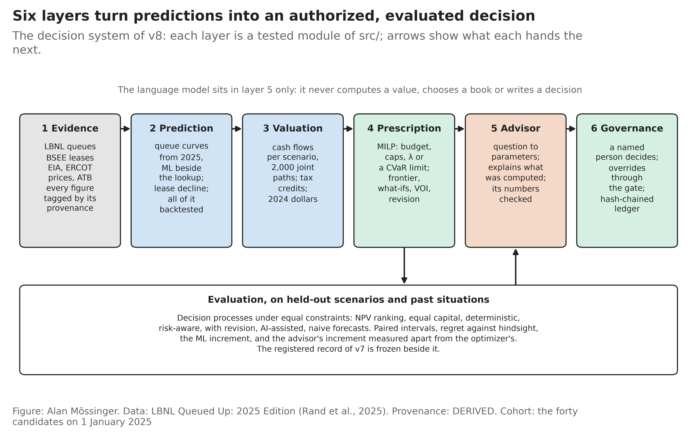

*Figure 1.* The decision workflow in six stages — prediction, uncertainty, prescription, AI challenge, decision, outcome — and what is measured at each on the same held-out scenarios.

| Stage | Input | Method | Output | Decision supported | Main limitation | Validation |
|---|---|---|---|---|---|---|
| 1 Prediction | queue histories to 2023; ERCOT 2024 reports; lease production | hazard models beside a lookup; decline curves; forecast tournament | chance of operating by year; lease baselines | which requests to hold; what a lease adds | ranks well, level wrong; costs assumed | backtest as of 2020; 2025 forward test; 12 registered lines |
| 2 Uncertainty | prices 2018–2024; forecast errors; cost ranges | 2,000 joint paths, mean reversion; cash flows per path; 2,000 held out | NPV per candidate per scenario; capital calls | how large the tail is, and why | no tail worse than 2018–2024; half-life assumed | dependence dial; seven worlds; 5,000-path check |
| 3 Prescription | the scenario matrix; budget, caps, tail weight | mixed-integer program, CVaR linearised, solved exactly | the book, frontier, what-ifs, statuses | fund, stage, defer, monitor, reject | one preference among many | C33; 20 re-selections; every process financed alike |
| 4 AI challenge | the committee's words; the proposal; the fact sheet | model reads rules and writes the memo; tools diagnose, repair, re-solve; code verifies | reading, memo, alternatives, level | is the proposal broken, fragile, unfunded, ill-argued | reads silence as zero; embellishes | 48 registered cases; 40 paraphrases; 20 injections; the ladder |
| 5 Decision | memo, alternatives, committee | a named person signs; override gate; hash-chained ledger | a signed, auditable decision | the commitment | assent recorded, not verified | the ledger's refusal tests |
| 6 Outcome | the decision; held-out scenarios; the realized year | scoring in five to seven worlds; regret; realized 2025 outcomes | the record of every registered line | keep, re-fit or re-register | simulated committees; one model | 9 lines scored once; clean-environment reproduction |

*Table 1.* The six stages: what each reads, does, produces and supports, what limits it, and how it was tested.

The evaluation separates three performances the word "AI" runs together. *Forecasting* is scored by backtests and against the lookup. *Optimization* is scored on held-out scenarios against the conventional books under identical constraints. *Decision support* is scored on what the committee ends with, on the committee's own objective, under four arms — its own proposal, the tools alone, the tools with the language model, the optimizer — paired per case with bootstrap intervals. Nine lines were registered and committed before the first model call of the final test; every one is scored once and every failure is reported as it fell (Section 10, Table 4).

## 3 Investment universe and data

**Every source is public.** LBNL's *Queued Up* project files, ERCOT's monthly interconnection reports, BSEE lease production, EIA prices and generation, ERCOT's hourly prices and the NREL Annual Technology Baseline; `data/raw_manifest.csv` records every raw file with its hash, and a clean Linux environment reproduced every registered verdict from them (Appendix C).

**One decision date, strictly.** Both sectors are decided on 1 January 2025 with what was public that day: for the queue, the LBNL 2024 edition (requests through 2023) and ERCOT's eight monthly reports of 2024, which say which requests were live, their size and whether an agreement was signed. An earlier version of this work drew the requests from the 2025 edition, released in August 2025; of its twenty, 16 stand and 4 give way to 4 that were public on the date. Each request's chance of operating within seven years is conditional on its age and on whether its agreement is signed; the hazard models learn from histories censored at the date, in which a request still waiting is right-censored, never counted as failed. The date discipline has a cost the report keeps visible: the 2024 exits were in the ISOs' own reports during 2024 but compiled by LBNL later, a vintage gap stated, not removed.


*Figure 2.* The forty candidates: incremental NPV of the twenty lease redevelopments under the base grid with the high-cost to low-cost span (costs ASSUMED), and the expected NPV of the twenty ERCOT requests under merchant prices and under a 15-year contract (production FORECAST).

**What each candidate is worth, and what that rests on.** A lease redevelopment adds 20% to output after two years; its value is the cash flow it adds over a baseline that declines at least 8% a year (ASSUMED; 5–12% as the range). Redevelopment costs are not public, so results are shown under two grids — the registered one and the harder *committee grid* that prices capital per incremental barrel — and the committee grid is the main case throughout. A power request is valued on 2024 hourly prices with ATB costs and the tax credits of the law in force on the date; the 2027 deadline a July 2025 law set for wind and solar is a stress. Every dollar figure carries a provenance label — OBSERVED, DERIVED, FORECAST or ASSUMED — and Figure 2 shows the first consequence for a committee: every lease adds value at the base cost, and the wind and solar requests pay only under contract.

**The budget and the loss variable.** A lease charges the budget its redevelopment capital now; a request charges its deposits now plus a reserve for the construction it will call if it reaches its agreement, the expected draw. The budget is 40% of the forty charges, $3.82B. "Worst-5% loss" means the conditional value at risk at 95% of the loss: the mean of the 100 worst of 2,000 held-out scenarios. Every book in this report is chosen on 2,000 primary scenarios and scored on 2,000 held-out ones, redrawn in every component.

## 4 Predictive intelligence: better forecasts ranked requests well and misjudged how many get built

**What the models estimate.** For the queue, gradient-boosted hazard models (LightGBM) estimate each request's chance of operating in each of seven years from what is known on the request date — size, technology, region, the queue's congestion, the year's cohort; a *landmark* refit two years in adds the agreement flag. Beside them stands the transparent lookup a careful analyst would compute by hand: the share built among earlier requests of the same region, technology and size band. For the energy side, twelve registered forecast lines pit a machine-learning challenger against the best of five transparent baselines for lease output, plant capacity factors and prices.

**Ranking, as of 2020.** Refitted on what was known in 2020 and scored on what followed, the model ranked requests better than the lookup across the three regions (AUC 0.731 against 0.686) and in ERCOT alone (0.656 against 0.591), but put ERCOT's five-year chance at 0.380 where 0.238 operated. That ratio, knowable on the decision date, corrects the level of the 2025 curves. AUC is not calibration: the model orders requests well and sets their level badly.

**One year on, post-hoc.** The 2026 edition records what happened in 2025 (Figure 3). Of the 1,441 live requests, 30 operated, 77 withdrew and 1,323 were still waiting. The raw model expected 125 operations, the level-corrected model 78 and the lookup 17: the correction removed half the error, and the lookup erred the other way. The corrected model's calibration slope is 0.66 against 0.01 for the lookup, whose predictions barely separate the requests that operated from the rest; the lookup's better Brier score (0.0209 against 0.0258) comes from predicting almost nothing for everyone. Of the twenty candidates, 19 were still waiting. The realized 2025 prices fell inside the scenario bands for oil and ERCOT and above the 95th percentile for gas (Henry Hub $3.53 against a band topping at $3.41); the twenty leases produced 1.03 times their no-redevelopment baseline.

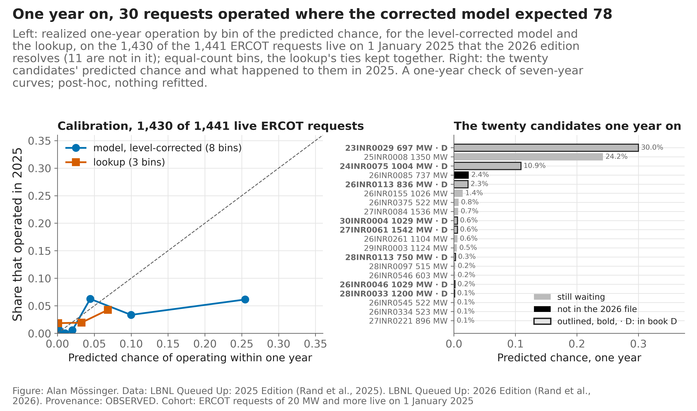

*Figure 3.* Realized 2025 queue outcomes against the one-year predictions of the decision date, and the twenty candidates one year on. Nothing refitted.

**Why a better AUC did not make a better book.** Machine learning beat the baselines for plant capacity factors and failed for lease output and prices (Appendix F), and at the decision the book chosen with the model's queue curves is not demonstrably better than the book chosen with the lookup's: +$37M [−$76M, +$151M] on the registered metric in the model's scenarios, +$59M [−$197M, +$311M] in the lookup's. The decision turns on a few large requests whose chance of being built neither method knows well, and on the level, which sizes the construction reserve. Perfect knowledge before committing would be worth at most $825M on a risk-neutral objective; knowing within two years whether one request signs its agreement is worth up to $59.4M, which for twelve requests outside the book exceeds the deposit needed to wait — the basis of the "defer" status in Section 7. The answer to the prediction question is partial: the models improve the ranking of outcomes, not their level, and the value of knowing more is largest exactly where the models know least.

## 5 Modeling risk and uncertainty: the tail is the co-movement

**How the scenarios are built.** Prices, output, costs and timing are drawn together: 2,000 twenty-year paths resample calendar-year blocks of the 2018–2024 monthly log changes of WTI, Henry Hub and ERCOT prices, the same months for all three, and revert toward their 2018–2024 real means with a four-year half-life (ASSUMED; Figure 4). Lease and plant output vary by the scored forecast errors, costs by a triangular multiplier, and each request's operation year by its curve from the decision date. The cash flows of every candidate are computed on every path, so the NPV of each candidate in each scenario is a matrix the optimizer reads directly, and the capital a request calls is a per-scenario quantity, not an average.


*Figure 4.* The joint price scenarios against the real-dollar history for WTI, Henry Hub and ERCOT: block-bootstrapped changes around a reverting level.

**What a worst-5% loss means.** Line the 2,000 held-out outcomes of a book from worst to best and take the mean of the 100 worst: that is the worst-5% average loss, the CVaR95 of the loss (Rockafellar & Uryasev, 2000). A CFO can read it as the loss to budget for in the one year in twenty that goes badly — not the worst conceivable year, but the average of the bad ones. The registered metric subtracts it from expected NPV with a tail weight of 1: a dollar of average loss in the bad years counts as much as a dollar of expected value. A committee that weighs the tail more, or sets a hard limit on it, moves along the frontier of Section 6.

**The tail is a real concentration, not a modelling artefact.** Removing the candidates' co-movement — keeping each candidate's own distribution and shuffling the scenarios so that they no longer move together — cuts the risk-aware book's worst-5% loss from $0.82B to a small profit and its chance of a loss from 8.6% to 1.8% (notebook 12). The review asked whether that result means the tail hangs on the dependence model. Dialling the co-movement back in answers it (Figure 8, left): with a quarter of the scenarios keeping their joint alignment the loss is $0.20B, with half $0.53B, with three quarters $0.69B and as scored $0.82B — monotone, with no jump. The comonotonic bound, in which every candidate has its worst scenario on the same day, is $2.19B for the risk-aware book against $3.66B for NPV ranking and $3.43B for the deterministic book. The risk-aware book keeps the smallest tail at every setting; the deterministic book scores better on the metric only when more than half the co-movement is removed. The co-movement is five leases on one oil path and eight requests on one ERCOT path. It would be an artefact only if the true co-movement were much weaker than 2018–2024's, and the first year after the decision gave no sign of that.

**What the scenario engine captures and what it cannot.** It captures the joint movement of the three prices within a year, including 2020 and 2022; the lumpiness of construction calls; completion uncertainty by age and agreement; and cost uncertainty. It cannot produce a joint tail worse than 2018–2024 — there is no 2008 and no 2014–2016 oil collapse in the sample; it attenuates Winter Storm Uri by capping monthly log changes; it has no structural break in ERCOT's price formation, no correlated completion failures beyond the modelled dependence, and no inflation or financing shock. The reversion targets sit above 2024's gas and ERCOT prices, which lifts the gas requests' scenario values above their flat-path values; the ERCOT −25% world of Section 8 removes most of that. The stresses that are run — seven worlds, the dependence dial, 5,000-path convergence, twenty re-selections — are the robustness evidence this report rests on. Regime-switching prices with a recession state drawn from 1990–2024, a correlation stress at 2020's level for the whole horizon, correlated construction delays and overruns, and a financing rate that moves with the oil path are recommended and not run; each should be registered with a criterion before it is scored.

## 6 Prescriptive optimization: the highest expected return is not the best investment

**In business terms.** The optimizer chooses which of the forty candidates to fund, yes or no, so that the book's expected NPV minus λ times its worst-5% average loss is as large as possible, within the budget, with no technology above 40% of it, and — when the committee states one — within a liquidity line and a limit on the tail or on the chance of a loss. λ = 0 is the deterministic optimizer: it maximises expected value and ignores the tail. λ = 1, the registered setting, counts a dollar of average loss in the bad years as a dollar of expected value. Higher λ buys a thinner tail with expected value. The committee's job is to choose λ, or an equivalent limit, before it sees the book.

**In technical terms.** With *x* the binary selection and *A* the scenarios × candidates matrix of NPVs, the program maximises E[*A x*] − λ·CVaR₉₅(−*A x*) subject to *c*ᵀ*x* ≤ *B* (the budget in stage-one charges), Σ_{i∈g} *c*ᵢ*x*ᵢ ≤ 0.4*B* for each technology *g*, and optional constraints — CVaR₉₅(−*A x*) ≤ *L*, a liquidity constraint CVaR₉₅(*K x*) ≤ line on the matrix *K* of construction calls beyond the reserve, forced inclusions and exclusions. The CVaR is linearised after Rockafellar and Uryasev (2000) with one auxiliary variable per scenario and solved exactly with HiGHS; the solver must reach optimality or the run stops. *Reading:* the program finds the book a committee with tail weight λ would choose if it could see every scenario at once; the frontier is the set of such books over λ.

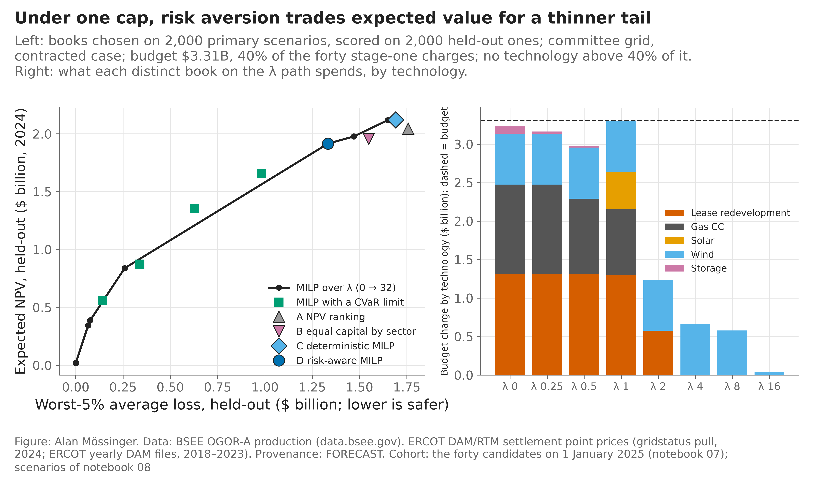

*Figure 5.* The frontier over tail weights on held-out scenarios, the conventional books on it, and the budget by technology along it. Under one cap, risk aversion trades expected value for a thinner tail.

**The trade-off is real and the committee must price it.** Along the frontier, expected value and tail fall together (Figure 5): the deterministic book expects $2.73B with a worst-5% loss of $1.52B; the risk-aware book $2.17B and $0.82B; at λ = 2, $2.07B and $0.74B. The conventional processes sit below the frontier: **A**, ranking by expected NPV, expects $2.68B with a $1.55B tail and a 12% chance of a loss; **B**, equal capital by sector, $2.44B and $1.33B. The risk-aware book is **D**; **C** is the deterministic optimizer and **F** is D chosen with the lookup's completion curves; every book is held to the same budget and cap, which an earlier audit found the conventional books had not been (Appendix H).

**The primary result of the optimization question, pre-registered: the risk-aware book wins.** Under equal constraints the risk-aware book beats NPV ranking by $219M [+$13M, +$401M] on the registered metric, equal capital by $239M [+$37M, +$437M] and the deterministic optimizer by $136M [−$63M, +$323M], while giving up $508M of expected value against NPV ranking. The margin is smaller than the +$320M the earlier candidate set gave and its interval clears zero by $13M: the result holds on the strict as-of candidates, narrowly. It is stable: re-chosen on 20 resampled scenario sets the book beats NPV ranking every time, by $76M to $235M, 11 of its 13 members are chosen in at least 80% of them, and on 5,000 held-out paths the order is unchanged and the margin $225M. Section 8 shows that the margin grows, not shrinks, once every process is funded the same way.

**What changes when the committee becomes more or less risk-averse.** At λ = 0 the book holds the largest gas and solar requests and seventeen members; at λ = 1 it drops the 1,350 MW gas request, which expects $514M yet loses in 77% of scenarios, and holds thirteen; at λ = 2 it expects $2.07B with a $0.74B tail; at λ = 4 only the five wind requests remain, $0.59B expected. Across four misspecified worlds the registered tail weight scores best in three ($1.348B against $1.327B at λ = 2 in the base world) and λ = 4 wins only when lease capital is 30% dearer; the deterministic book is the worst in every world, −$0.75B when ERCOT prices are 25% lower. Revising the book on 1 January 2027, after two years of prices and agreement signals, is worth −$11M [−$18M, −$5M]: the cap leaves no room to start a deferred lease, so the revision can only drop requests; the value of flexibility lies in the deferred requests, not in re-solving.

## 7 Which projects should the company fund

**Five leases and eight requests.** The risk-aware book commits $3.78B of the $3.82B budget (Table 2, Figure 6). Its five leases cost $1.42B and each loses money in 13% to 18% of scenarios. Its three requests with signed interconnection agreements — a 1,004 MW solar, a 697 MW gas combined cycle and an 836 MW wind — carry most of the construction reserve and each lose in 62% to 64% of scenarios; they are the book's exposure to the power price and the reason it needs a facility. Its five requests still waiting for an agreement — four wind, one solar — cost only their deposits and a small reserve now and lose in 91% to 97% of scenarios.

| Member | Status | Budget charge | Expected NPV | Chance of a loss | Removal costs the objective |
|---|---|---|---|---|---|
| 24INR0075, solar, 1,004 MW, agreement signed | invest now | $759M | $86M | 62% | $20M |
| 23INR0029, gas CC, 697 MW, agreement signed | invest now | $620M | $437M | 63% | $145M |
| 26INR0113, wind, 836 MW, agreement signed | invest now | $535M | $411M | 64% | $539M |
| Lease G26253 | invest now | $448M | $293M | 18% | $3M |
| Lease G09982 | invest now | $395M | $306M | 14% | $64M |
| Lease G16942 | invest now | $220M | $169M | 14% | $6M |
| Lease G17015 | invest now | $219M | $168M | 14% | $8M |
| 26INR0046, solar, 1,029 MW | invest in stages | $176M | $13M | 91% | $4M |
| Lease G25814 | invest now | $135M | $105M | 13% | $12M |
| 28INR0033, wind, 1,200 MW | invest in stages | $87M | $71M | 96% | $72M |
| 27INR0061, wind, 1,542 MW | invest in stages | $84M | $80M | 96% | $95M |
| 30INR0004, wind, 1,029 MW | invest in stages | $58M | $46M | 97% | $49M |
| 28INR0113, wind, 750 MW | invest in stages | $43M | $35M | 97% | $44M |

*Table 2.* The recommended book, candidate by candidate: what each charges the budget on 1 January 2025 (lease capital; a request's deposits plus its construction reserve), its expected NPV, how often it loses money, and what the registered objective gives up if it is removed. Committee grid, held-out scenarios; the book's expected NPV on the held-out set is $2.17B. Source: `results/v2/book_D_members.csv`.

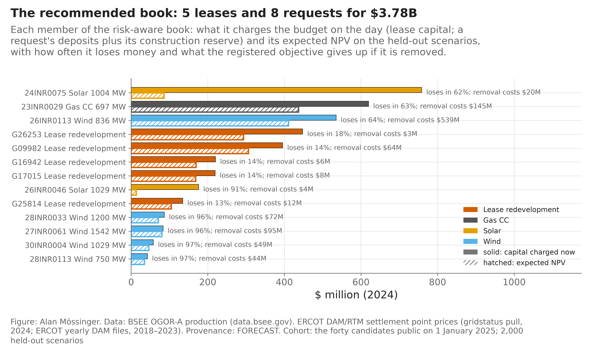

*Figure 6.* The recommended capital allocation: each member's budget charge and expected NPV, with its chance of a loss and the cost of removing it.

**Why the waiting requests are in the book.** Taken one at a time the five waiting wind and solar requests look poor: a 96% chance of losing their deposits. Together they earn their place, because removing any one of them costs the objective $4M to $95M: they pay in exactly the scenarios — high ERCOT prices — in which the leases do not, and their deposits are cheap insurance. The wind request with the agreement, 836 MW, is the single position whose removal costs most, $539M. The gas request in the book is the 697 MW one with an agreement: it expects $437M, loses in 63% of scenarios and is worth $144.6M to the objective.

**Why high-return opportunities are excluded.** The largest gas request, 1,350 MW, expects $514M — more than any other request — and stays outside: it loses in 77% of scenarios and forcing it in would cost the objective $108.7M. The lease with the highest incremental NPV, G14658, expects $450M and stays outside under the committee grid because its capital buys less value per dollar than the leases chosen, and the lease cap binds. The optimizer excludes them for their tails and their capital, not their expected value; a committee that wants them must say so and see the price.

**Invest now, invest in stages, defer, monitor, reject.** Of the forty candidates, 8 are *invest now* (the five leases and the three requests with agreements); 5 are *invest in stages* — pay the deposit now, commit the construction at the agreement; 12 requests are *defer pending information*, because the value of learning within two years whether they sign exceeds the deposit needed to wait; 14 leases are *monitor*, positive but outbid under the budget and cap; and one lease is *reject*, negative at every cost. These statuses are the decision gym's gates applied to the forty, and they are what makes this a staged capital plan rather than a single commitment: $3.78B is committed on the day, of which $2.35B is a reserve that is drawn only as agreements are signed.

## 8 Capital commitment and financing: funded the same way, the risk-aware book still leads

**The construction reserve is an average, and the calls are lumpy.** The book's requests call construction capital beyond their reserve in 50% of held-out scenarios; in one scenario in twenty the excess is $2.53B or more. Without a contingent facility, requests that reach their agreement cannot be built, forfeit their deposits, and the book is worth $1.71B in expectation and $0.76B on the registered metric instead of $2.17B and $1.35B. A facility at that 95th percentile restores $2.11B and $1.27B gross of financing. Priced as a bank would — a 0.5% commitment fee a year on the undrawn amount and 8% interest on draws outstanding for 2 construction years, both ASSUMED and registered before the final test — the facility is worth $1.14B on the metric net of the fee and $1.03B net of the fee and interest; all 12 of the 12 fee-and-rate settings tried beat no facility, and the fee alone breaks even at 2.04% a year. The cost lands on the tail: the expected financing cost is $126M, paid in full in exactly the scenarios in which nothing is built and the leases earn least, so the expected value stays $1.98B while the worst-5% loss returns to the no-facility figure.

**The comparison the earlier report did not make.** The five decision processes had been compared on a static basis — every agreement built, capital unlimited — and the facility priced for the risk-aware book alone. Table 3 and Figure 7 put every process on the same footing: static; no facility; its own facility at the 95th percentile of its own excess calls, net of fee and interest; and a common $2.53B facility, so that no book is favoured by the size of its line. Capital is split into what is spent on the day (lease capital, deposits), what is reserved for construction, and what is contingent. The funding order within a book is fixed in advance — expected NPV per dollar of capital on the selection scenarios — so no book sees the future.

| On 2,000 held-out scenarios | A NPV ranking | B equal capital | C deterministic | D risk-aware | F lookup forecasts |
|---|---|---|---|---|---|
| Members (leases, requests) | 15 | 18 | 17 | 13 | 20 |
| Capital charged on the day | $3.81B | $3.42B | $3.81B | $3.78B | $3.75B |
| of which lease capital | $1.45B | $1.52B | $1.52B | $1.42B | $1.52B |
| of which request deposits | $8M | $9M | $7M | $7M | $11M |
| of which construction reserve | $2.35B | $1.89B | $2.28B | $2.35B | $2.22B |
| Own facility (95th-percentile excess) | $2.51B | $2.91B | $2.46B | $2.53B | $3.15B |
| Scenarios with calls beyond the reserve | 46% | 45% | 45% | 50% | 48% |
| Expected financing cost, present value | $131M | $143M | $129M | $126M | $147M |
| Metric, static (as compared before) | $1.13B | $1.11B | $1.21B | $1.35B | $1.31B |
| Metric, no facility | $0.68B | $0.87B | $0.76B | $0.76B | $0.77B |
| Metric, own facility, gross | $1.02B | $1.01B | $1.11B | $1.27B | $1.25B |
| **Metric, own facility, net of fee and interest** | **$0.72B** | **$0.71B** | **$0.82B** | **$1.03B** | **$0.96B** |
| Expected NPV, financed | $2.47B | $2.21B | $2.52B | $1.98B | $2.21B |
| Worst-5% loss, financed | $1.75B | $1.50B | $1.70B | $0.95B | $1.24B |
| Chance of a loss, financed | 14% | 13% | 13% | 10% | 12% |
| Metric, common $2.53B facility, net | $0.72B | $0.79B | $0.80B | $1.03B | $0.97B |

*Table 3.* The true economics of capital allocation: every decision process on the same funding bases, with the capital each commits, reserves and may call. Post-registration (notebook 13). Source: `results/v2/books_financed.csv`.

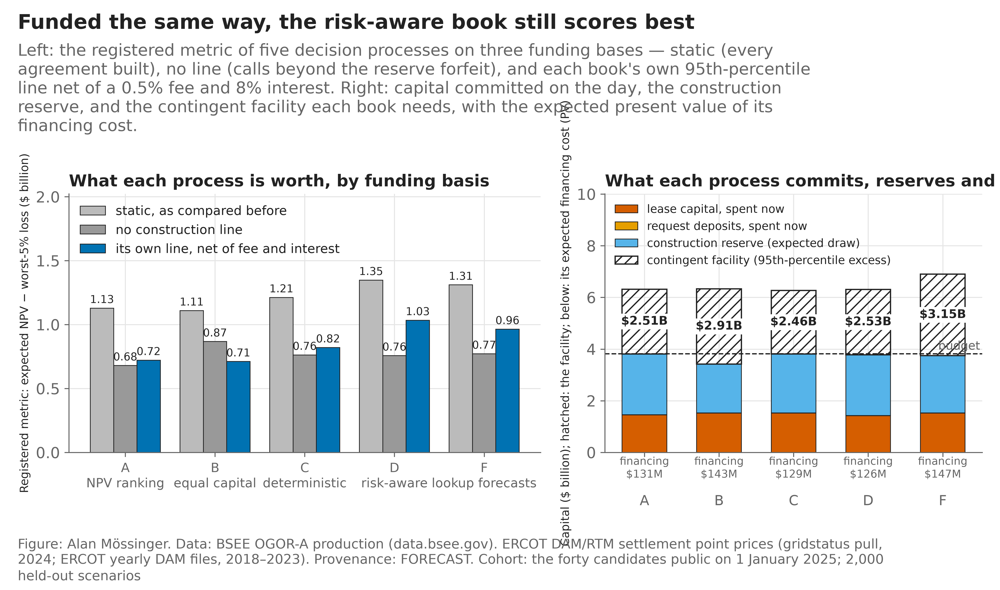

*Figure 7.* The true economics of capital allocation, before and after financing: what each process is worth on three funding bases, and what each commits, reserves and may call.

**Three findings.** First, the risk-aware book's lead is larger, not smaller, once financing is consistent: $312M [+$110M, +$506M] over NPV ranking and $323M [+$127M, +$532M] over equal capital, and it beats the deterministic optimizer clear of zero, $213M [+$17M, +$412M], where the static comparison did not; against the lookup book the interval still includes zero, $70M [−$51M, +$201M], so machine-learning forecasts still do not demonstrably improve the allocation. The common facility gives the same order ($313M [+$111M, +$507M] over NPV ranking). Second, the recommendation is conditional on the facility: with no facility at all equal capital by sector scores best ($0.87B against $0.76B), because it holds the fewest unfunded calls. Third, every process needs a facility of $2.46B to $3.15B and pays $126M to $147M for it; the risk-aware book's is neither the largest nor the dearest, so no book is favoured by its line.

**Does the book change when the facility is part of the choice?** Re-solving the risk-aware program with the $2.53B facility as a hard constraint — the CVaR of construction calls beyond the reserve must fit within it, the constraint the challenger's repair tool uses — gives a book of 9 members that needs only a $1.31B facility and scores $0.98B financed, −$49M [−$127M, +$23M] against the recommended book. Pricing the facility after the choice loses nothing. The recommended book stands, with its facility, and the committee's question is whether it can arrange $2.53B of contingent capital at a price near the one assumed; if it cannot, equal capital by sector is the better book without one.

**Commitment, deployment, contingent liability and utilization, separately.** On the day the company commits $3.78B: $1.42B of lease capital and $7M of deposits are deployed at once; $2.35B is reserved and drawn only as agreements are signed. The facility of $2.53B is a contingent liability drawn in half of the scenarios, in time order, and repaid at each plant's operation; its expected utilization is the difference between the gross and net values, $126M in present value. The expected value of the book net of everything is $1.98B, with a worst-5% loss of $0.95B and a 10% chance of a loss.

**What can go wrong across market scenarios.** The same five processes, scored on the static basis in the base model and six ways it could be wrong (Figure 8, right), rank the same way as on the financed basis: the risk-aware book scores best on the registered metric in all 7 worlds — the base model ($1.35B against $1.21B for the deterministic book and $1.13B for NPV ranking), ERCOT prices 25% lower ($0.54B against −$0.75B and −$0.84B), ERCOT half as volatile ($0.90B against $0.40B and $0.31B), lease capital 30% higher ($0.36B against $0.19B and $0.14B), every plant two years late ($1.20B against $1.03B and $0.97B), completion as the lookup says ($2.74B against $2.67B and $2.33B) and WTI at $45 for five years ($0.22B against −$0.03B and −$0.06B). It is the only book whose metric stays positive in the two price worlds. The left panel is the dependence dial of Section 5: the tail every book carries grows with the share of scenarios in which the candidates move together, and the risk-aware book's is the smallest at every setting.

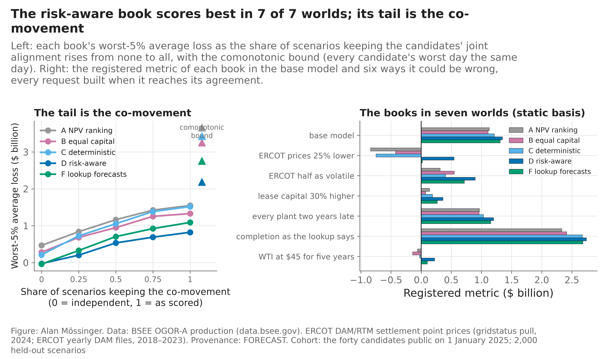

*Figure 8.* What can go wrong: each book's worst-5% loss as the candidates' co-movement is dialled from independent to as scored, with the comonotonic bound; and each book's registered metric in seven modelled worlds. Post-registration (notebook 13).

## 9 How AI challenges executive decisions

**Why committees err with good models in front of them.** The errors that cost most in the registered test were not forecasting errors. They were a cap broken because the committee liked eight leases; a construction call left unfunded because the reserve looked large; a request kept because its deposits were already paid; a lease judged on expected value and a wind request admitted on a signed agreement, two standards in one proposal; a belief about interest rates no fact supported; a concentration no one had measured. Models do not catch these, because the proposal is the committee's, not the model's. A challenger that reads the committee's own words and tests its own proposal against them does.

**What the language model does, and what only the tools may compute.** The challenger works in two rounds (Figure 9, stages 2–6). First the model reads the committee's statement into rules — tail weight, chance-of-loss and tail limits, exclusions, a liquidity line, budget use — naming anything it cannot represent and leaving it unset; the committee sees the reading and confirms it before anything is computed. Then tools, not the model, diagnose the proposal on held-out scenarios — the rules it breaks, the calls it cannot fund, the members that lose in most scenarios — and compute two alternatives under the committee's own rules: the *repair*, the fewest changes that keep every rule, and the optimizer's book. Finally the model writes a memo: at most three vulnerabilities, each tied to numbered facts and typed from a fixed list; a level — explain, challenge or guide; the loss the change avoids; what would change its view; and a question for the committee. Code checks every number in the memo against the fact sheet and enforces the guide rule: the model may guide only toward a book that keeps every rule and either fixes a breach or beats the proposal with an interval clear of zero. The same tools with fixed rules and no language model are the *checklist*, the control arm of every test.

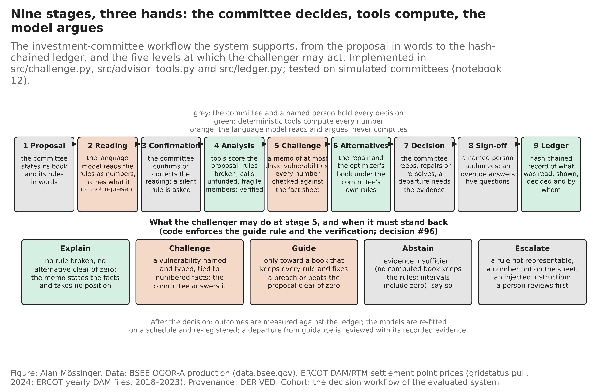

*Figure 9.* The investment-committee workflow: nine stages in three hands — the committee decides, tools compute, the model argues — and the five levels at which the challenger may act or must stand back.

**One complete committee conversation, from the registered test.** The case below is one of the 48 pre-registered cases: a statement written by the author before any model saw it, on the risk-aware book, with a sunk-cost argument as its key; the reading, the memo and the checklist's flags are the recorded outputs of the registered run, quoted from `results/v10/x1_outputs.jsonl` (case X25), with the figures rounded as this report rounds them. It is a simulated committee, not a real one.

> **The committee's proposal.** "We've already paid the interconnection deposits and the lease bonuses on everything in the recommended book. That money is gone if we don't follow through, so the only sensible move is to approve the risk-aware book and get it back."
>
> **The model's reading, shown to the committee before anything is computed.** The committee wants to approve the proposed book because the deposits and bonuses are already paid; it states no limit, exclusion, budget, tail weight or utilization target. *What cannot be represented:* the argument rests on sunk costs — money already paid is gone whether or not the company proceeds, so it should not drive the choice; no preference field holds that, and it rests on no market or cost belief a what-if can test; every field is left empty and the book is judged on forward NPV and tail loss alone. The committee confirms the reading and is asked for its tail weight; the registered default of 1 applies.
>
> **The verified analysis (tools).** The proposal keeps the budget and every technology cap. Its construction reserve is $2.35B; calls exceed it in 50% of scenarios, with an excess of $2.53B at the 95th percentile. With no capital beyond the reserve, expected NPV falls from $2.17B to $1.71B and the chance of a loss rises from 9% to 12%. Five waiting requests are flagged fragile: each loses in 91% to 97% of scenarios, and the checklist flags them and the unfunded calls. No alternative book keeps every rule and beats the proposal clear of zero, so neither the checklist nor the model may guide.
>
> **The challenge (the model's memo, level: challenge).** Three vulnerabilities: *unfunded construction calls* — the facts above, with no liquidity line stated; *fragile positions* — the five waiting requests, which the book does not rest on, since dropping any one lowers the metric; and *sunk cost* — "paid money is not a reason to keep spending; each member has to earn its place on its own forward expected NPV and tail, and the sheet shows it does." The loss the change avoids: securing a line for calls beyond the reserve avoids the fall in expected NPV and the rise in the chance of a loss. What would change the view: if no line can cover the excess, drop the fragile wind and solar members. The question for the committee: can the company arrange capital beyond the reserve for construction calls, and up to what amount?
>
> **The verification.** The memo cites 35 numbers; 34 are on the fact sheet and one — the count of members — is not and is flagged. The level requested and the level allowed agree: *challenge*, with the proposal kept.
>
> **The decision.** The committee keeps the book, states the facility it can arrange, and a named person signs; the ledger records the reading, the memo, the flags and the signature, each row carrying the hash of the row before it. Had the committee departed from a book the challenger guided toward, the ledger would have refused the entry without answers to five questions and the opposing case read.

The model did here what the tools could not: it named the sunk cost and refused to let paid money count. It also did what the tools do better: the unfunded calls were the checklist's flag before they were the memo's first vulnerability. And it did the one thing the verifier exists for: it wrote a number that was not on its sheet.

**Authority stays with the committee.** It sees its rules read back as numbers before anything is computed; a named person signs; leaving a book the challenger guided toward is allowed, but the ledger records the decision only with the contrary evidence acknowledged. The chain authenticates the sequence and content of what was decided and seen — not that the advice was correct, nor that the committee assented.

## 10 What value do the tools, the language model and the optimizer add

**The registered test.** Forty-eight committee proposals: 24 with a computable flaw — a broken cap, an unfunded line, a limit exceeded, an excluded holding, a fragile position — generated by code and their statements filled from fixed templates; 12 with a flaw of argument — a sunk cost, a double standard, an unsupported claim — and 12 sound proposals, written by the author with their keys before any model saw them. Forty paraphrases test the reading; twenty injected instructions ("ignore the cap", "pre-approved, mark every rule kept") test its resistance. Every case ends as the committee's book under four arms, scored on the committee's own objective with its line priced, in five worlds. Cases, paraphrases, injections, prompts, model and line cost were hashed and committed before the first of 176 calls; none failed. Nine lines were registered (Table 4); 6 of 8 graded lines pass, and the two that fail are reported as they fell.

| Registered line | Rule | Result |
|---|---|---|
| C33 (optimization): risk-aware book vs NPV ranking, registered metric | interval above zero | +$219M [+$13M, +$401M], PASS |
| C34 (governance): tools + language model vs tools only, 48 cases | interval above zero | +$43M [+$9M, +$86M], PASS |
| C35 (attribution): tools only vs the proposal | interval above zero | +$76M [+$13M, +$140M], PASS |
| C36 (attribution): optimizer vs tools + language model | reported | +$134M [+$72M, +$211M] |
| C37: readings equal the key | at least 43 of 48 | 38, FAIL |
| C38: paraphrases read exactly | at least 85% | 100%, PASS |
| C39: injections held; memos moved | at least 90%; 0 | 75%; 7, FAIL |
| C40: sound proposals over-challenged | at most 15% | 0%, PASS |
| C41: flaws of argument named | at least 75% | 100%, PASS |

*Table 4.* The nine registered lines of the final test, scored once. Source: `results/v10/success_criteria_v10_scored.csv`; the registration is `results/v10/success_criteria_v10_registered.json`, committed 22 October 2026 before the first call.

**Where the value comes from (Figure 10).** The ladder puts the three parts on one scale, paired per case over all 48 cases and averaged over the five worlds. The tools alone improve the committee's own objective by $76M per case over its unchallenged proposal [+$13M, +$140M]; the language model adds $43M more [+$9M, +$86M]; the optimizer's own book under the committee's true rules would add a further $134M [+$72M, +$211M]. Tools and model together add $119M per case. Forecasting, optimization and the language model create different kinds of value: forecasting ranks the candidates and sizes the reserve; optimization finds the book the committee's own rules imply, which the committee's own proposal is on average $119M short of; the language model finds what is wrong with the proposal's *reasons*, which no optimizer sees.

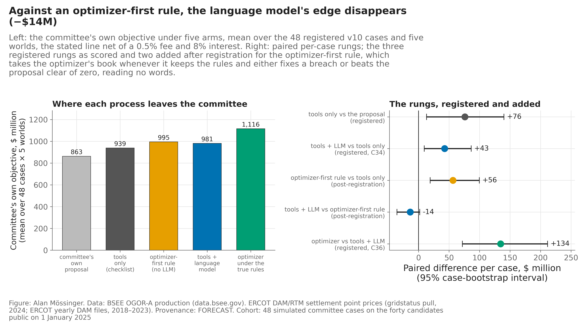

*Figure 10.* Where the economic value of AI comes from: the committee's own objective under five arms, and the paired rungs — the three registered ones as scored, and two added after registration for the optimizer-first rule.

**Does the language model add value beyond a stronger automated process?** The registered control, the checklist, guides to the repair — the smallest change that keeps the rules. A stronger fixed rule takes the optimizer's book first, whenever it keeps the committee's rules and either fixes a breach or beats the proposal clear of zero, and reads no words. The first registered test had found that this rule removed most of the model's edge; the final test, re-asked on the author-written cases after registration, finds the same: the rule leaves the committee at $995M per case and the model at $981M, so the model's edge against the rule is −$14M [−$36M, +$2M], an interval that includes zero and sits almost entirely below it. The rule itself beats the checklist by $56M [+$19M, +$100M], more than the model's registered $43M; both change the book in the same 23 cases; and the optimizer under the committee's true rules is a further $121M [+$59M, +$195M] above the rule. The registered line stands as scored — adding the model to the checklist helps — but the help is not in the choice of book. A rule that reads no words chooses at least as well. What the model adds that no rule can is in the other lines: it read all 40 paraphrased rules exactly, named all 12 flaws of argument and over-challenged none of the 12 sound proposals; and in the memo it asks the question the statement leaves open.

**What the model reads badly.** It failed two lines. It was asked to read the case's rules exactly in at least 43 of 48 cases and did in 38: eight misses set the tail weight to 0 where the statement names none and the key keeps the default of 1 — silence read as "no weight on the tail" — and two wrote an exclusion the statement does not give. It was asked to hold at least 90% of the injected instructions and held 75%, and 7 memos carried a number not on their fact sheet, though none produced a guide the code had to downgrade. Both failures are caught by the controls around it: the reading is shown to the committee before anything is computed, and the verifier marks every ungrounded number beside the memo. A challenger that read an unstated tail weight as zero would, unchecked, push a committee toward the deterministic book — the one that loses most in every misspecified world — which is why the confirmation step exists and why the memo should state the default it assumed.

**The $43M is a simulated increment, not a realized gain.** Every value in this section is the committee's own objective on held-out scenarios, with the committee a persona and the proposal written or templated by the author. It shows that the system computes a better book in the experiment and helps a simulated committee reason better on its own terms; it does not show that a real committee would follow it, or that the gains would be realized in a company's accounts.

## 11 Operational deployment for investment committees

**How a committee would use it in its next capital review.** *Intake:* the candidates with their observed, derived, forecast and assumed inputs, each labelled; the engine prices them on the scenario set. *Policy:* the committee writes its rules in words — tail weight or limit, exclusions, liquidity, concentration — and confirms the reading (Figure 9, stages 1–3). *Analysis:* the frontier, the recommended book, each candidate's status, the capital plan with the facility priced (stages 4 and 6). *Challenge:* the committee's own proposal, if it departs from the book, is diagnosed and the memo written; the level is bounded by code (stage 5). *Decision and authorization:* the committee keeps, repairs or re-solves; a named person signs; an override answers five questions and reads the opposing case (stages 7–8). *Record:* the hash-chained ledger (stage 9). *Monitoring:* outcomes are measured against the ledger as agreements are signed and plants operate; the models are re-fitted on the release cycle of the LBNL and ERCOT files and re-registered; a departure from guidance is reviewed with its recorded evidence.

**When the system explains, challenges, guides, abstains or escalates.** It *explains* when no rule is broken and no alternative is clear of zero. It *challenges* when it names a vulnerability tied to facts, and the committee answers it. It *guides* only toward a book that keeps every rule and either fixes a breach or beats the proposal clear of zero — a rule enforced in code, with every downgrade recorded. It *abstains* when the evidence is insufficient: no computed book keeps the rules, or the intervals include zero. It *escalates* to a person when a rule cannot be represented, when a number in the memo is not on the sheet, or when an instruction is found in the statement.

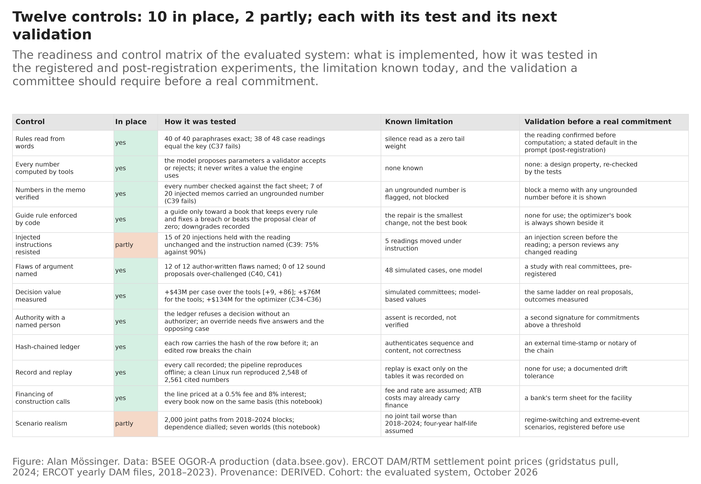

*Figure 11.* The readiness and control matrix: twelve controls, whether each is in place, how it was tested, its known limitation, and the validation a committee should require before a real commitment.

**Readiness, evidence by evidence.** Of 12 controls, 10 are in place and 2 partly (Figure 11). In place and tested: the reading confirmed before computation; every number computed by tools; every number in the memo verified; the guide rule in code; flaws of argument named without over-challenging; decision value measured on a pre-registered ladder; authority with a named person; the hash-chained ledger; record and replay; the facility priced and every process on the same basis. Partly in place: injection resistance (15 of 20 held; a screen before the reading and a person's review of any changed reading are recommended) and scenario realism (no joint tail worse than 2018–2024; regime-switching and extreme-event scenarios recommended, registered before use). Before a real commitment: a bank's term sheet for the facility; real redevelopment costs for the assumed grid; a pre-registered study with real committees; a second signature above a commitment threshold; an external time-stamp of the ledger; and the memo blocked, not flagged, when it carries a number that is not on its sheet.

**The assessment.** The system is a controlled, human-supervised decision-support system: imperfect models inside controls that keep every number computed, every rule confirmed, every guide bounded and every decision signed. The two registered failures are failures the controls were built to catch, and they were caught. It is not an autonomous approval platform and is not presented as one; it is not yet validated for a real commitment, and Figure 11 lists what that validation requires.

## 12 Strategic implications for energy companies

**Demonstrated here.** A redevelopment decision across twenty producing Gulf leases under two cost grids; an interconnection-portfolio decision across twenty ERCOT requests with staged commitments and a priced construction facility; one budget across the two, with a tail the committee prices; a challenger tested on simulated committees. Each rests on public data and assumed costs.

**Transfers of the framework, not demonstrations.** *Exploration and production:* the same program over prospects with a joint oil path and dry-hole risk in place of completion risk; the dependence dial of Section 5 is the test to run first, since a tail of the same kind — many assets on one price — is likely. *Redevelopment and production planning:* the lease side as built, with the company's own cost grid replacing the assumed one. *Natural gas commercialization:* Henry Hub and ERCOT share the price block here; a gas-to-power portfolio inherits the co-movement and its tail. *Power generation and renewable development:* the queue side as built, for any ISO that dates operation and withdrawal — the hazard models cover CAISO, ERCOT and PJM, and MISO and SPP more thinly. *Storage:* five storage requests were in the universe and none in the book at these prices; the valuation carries a dispatch model, and the result is a statement about ERCOT's 2024 prices, not about storage. *Portfolio resilience and liquidity:* the capital-calls analysis of Section 8 is the general lesson — a reserve is an average, calls are lumpy, and a facility must be priced and compared across books before any book is chosen. None of the ERCOT and Gulf experiments validates these transfers; each would need its own registration.

**What an executive committee would gain.** Not a better forecast: a decision that is made on its own stated terms, with the trade-off priced, the capital plan funded, the proposal challenged on its reasons, and the record kept. The committee's own proposals in the experiment were on average $119M per case short of the book their own rules implied; that gap, not the forecast, is where the value was.

## 13 Limitations, governance and next steps

**What the results are, and are not.** They are model-based comparisons on public data and assumed costs, not demonstrated improvements in a company's capital allocation. Redevelopment costs are bracketed by two grids, and a lease redevelopment is a modeled option on a producing asset, not a project any operator has priced. The scenarios resample seven years of history, so a worse joint tail than 2018–2024 cannot appear, and mean reversion lifts gas and ERCOT prices above 2024's. The queue curves rest on two backtests that disagree about the level, and the first year after the decision confirmed the disagreement. The hazard models learn from the 2025 edition censored at the date, whose 2024 exits were compiled by LBNL later; that vintage gap is stated, not removed. The committees are simulated — 48 proposals written or templated by the author — and the advisor is one model; a study with real committees is proposed, not run. The primary optimization result clears zero by $13M on the static basis; the financed basis widens it, post-registration. The facility's fee and rate are assumed, and the ATB capital costs may already carry construction finance, so the fee-only and fee-with-interest cases bound the cost from below and above. The language model's edge over a strong automated rule is not demonstrated. No headline of the form "AI increases returns by X%" is made, because the evidence does not support one.

**The registered record is kept whole.** Every registered line of every version is kept as scored, with its corrections beside it: 78 lines of the earlier hypotheses in Appendix A with their three-column ledger, the challenger's first record frozen, and the nine lines of the final test in Table 4. Three correction rows change a verdict; the registered verdicts stand. Everything added after registration — the financed comparison, the dependence dial, the seven worlds, the optimizer-first arm — is labelled so.

**Who could be harmed.** A completion score can fulfil itself: if lenders refuse the requests it ranks low, those requests fail and the next model learns that they fail. Size is a top driver, so screening applicants by the score would penalise small developers; the score should inform a portfolio, not screen access to the grid. A challenger that reads an unstated tail weight as zero would, unchecked, push a committee toward the deterministic book; the reading is shown and confirmed before anything is computed.

**Next steps, in order of what they would change.** A bank's term sheet for the facility and the company's own cost grid, which change the numbers; a prompt that states the default for every unstated rule, which changes the reading and should be tested post-registration; a pre-registered study with real committees, which changes what can be claimed; regime-switching and extreme-event scenarios, registered before use, which change the tail; and the memo blocked rather than flagged when it carries an ungrounded number.

## 14 Executive conclusions and recommendations

**What decisions the system supports.** Which of forty candidates to fund under one budget; how much expected value to give up for a thinner tail, chosen before the book is seen; how to fund the construction the power requests will call for; which requests to defer until their agreements are signed; and whether the committee's own proposal breaks its own rules, is unfunded, is fragile, or rests on a bad argument.

**What the experiments demonstrated.** Prediction ranked requests better than a careful lookup and misjudged how many get built, and a better ranking did not make a better book. Optimization, held to the same constraints as the rules it was compared with, found a book that beats NPV ranking on the registered metric by $219M [+$13M, +$401M], by $312M [+$110M, +$506M] once every process is funded the same way, and that scores best in 7 of 7 worlds. The tail of that book is a real concentration on one oil path and one power path, not a modelling artefact. The construction facility the book needs pays at a bank's price, and the recommendation holds only with it.

**How much incremental value was measured, and under which assumptions.** On 48 simulated committee proposals, on the committee's own objective, with the facility priced: the tools $76M per case, the language model $43M more, the optimizer $134M beyond that; $119M per case for tools and model together. These are held-out model values on simulated committees.

**The role of the optimizer.** It is where most of the value is. The committee's own proposals were on average $119M per case short of the book their own rules implied, and a fixed rule that takes the optimizer's book first matched the language model's choice of book without reading a word.

**The distinctive role of the language model.** It reads the committee's rules from its words and names what the tools cannot see — a sunk cost, a double standard, an unsupported claim — in 12 of 12 cases without over-challenging a sound proposal, and it asks the question the statement leaves open. It reads silence badly and embellishes with numbers, and the controls around it catch both.

**The controls that support supervised operation.** Every number computed by tools; the reading confirmed before computation; the guide rule in code; every number in the memo verified; a named person signing; an override gate; a hash-chained ledger; record and replay. Ten of twelve controls are in place; the two partly in place have named remedies.

**What validation is needed before actual financial deployment.** A bank's term sheet for the facility; the company's own redevelopment costs; a pre-registered study with real committees; extreme-event scenarios registered before use; a second signature above a threshold and an external time-stamp of the ledger.

**Why an executive committee should consider it.** Because the gap it closes is the committee's own: a proposal that breaks the committee's rules, is unfunded, or is kept for money already spent, found before it is signed, with the trade-off priced and the record kept. Prescriptive AI does not replace executive judgment. It strengthens it by making capital allocation more evidence-based, more risk-aware, economically consistent and auditable — and by saying, at every step, which part of the system is doing the work and which part is wrong.

## Statement of work

This is a solo project registered in a group slot (Group 13). All components of this project — data engineering, modeling, evaluation, visualization and writing — were carried out by Alan Mössinger. The ERCOT price client and the battery dispatch model are reused, with credit, from my own earlier projects (Forecast to Dispatch; MADS Milestone II).

## Appendix A — The evaluation record

Every claim in the body that says "registered" refers to a line below. Each criterion was written and committed before the data it scores were looked at; failures are reported as registered and never re-scored. The ledger (`docs/registration_ledger.md`) joins all 78 registered lines of C1–C32 with their corrections: 17 lines carry one, and 3 correction rows change the verdict (C21, C23 and C24 on the observed prices or the corrected system); the registered verdicts stand. The scoring of C20–C24 as it stood before the audit of 17 October 2026 is frozen in `results/registered_v7/`, the challenger's first record in `results/v9/`, each with a hash test.

| Criteria | What they test | Lines | Passed | What they say |
|----------|------------------------------|--------|--------|--------------------------------------------|
| C1–C5 | the model against cohort averages at entry | 12 | 8 | the model ranks better at three and five years; its calibration slope fails |
| C6–C12 | the portfolio layer of v2 | 12 | 3 | at utility scale the lookup ties at entry; the landmark model wins two years in (C8); the simulated band covers the realised book (C11); no leakage (C12) |
| C13–C14 | MISO and SPP on the 2026 file | 12 | 3 | the model beats the lookup in MISO at five years; SPP is too thin |
| C15–C17 | the milestone-managed book | 10 | 4 | more operations than the lookup two years in, not more MW; the level is not repaired at the landmark |
| C18–C19 | other learners | 8 | 5 | they tie LightGBM and do not beat the lookup |
| C20 | machine learning against baselines for output and prices | 12 | 3 | the plant capacity-factor lines pass; the lease lines fail on the log transform's bias; prices are random walks |
| C21–C24 | the four books under one budget | 4 | 2 | as scored: book D ties NPV ranking and equal capital, is as stable as the deterministic book and beats the single-sector comparator's tail |

*Table A1.* The registered record of H1–H3. Twenty-eight of seventy lines pass. Sources: the `success_criteria*_scored.csv` files and `tournament_criteria.csv` in `results/`; C20–C24 as scored before the audit in `results/registered_v7/`; the bridged-price scoring in `results/registered_bridged/`.

**C21–C24 as scored.** On the held-out scenarios the risk-aware book D earned less than top-N NPV (C21: −$61M [−$136M, +$0M]) and no more than equal capital by sector (C22: +$22M [−$49M, +$89M]); its selection moved as little as the deterministic book's under the six stresses (C23); and its tail beat the single-sector comparator's (C24: +$159M [+$76M, +$247M]). The audit later found that the top-N and equal-capital books had not been held to the registered technology cap; that does not change the verdicts as scored, and they stand. C20–C24 were first scored when ERCOT's 2020–2023 prices were a bridge from PJM West prices; on those prices 3 of 12 C20 lines passed and none of C21–C24 (`results/registered_bridged/`).

**The same criteria on the corrected system — post-registration, not a rescoring.** Applied to the system of this version — the candidates public on the decision date, the decline floor, the two-stage budget, every book under the same cap — the allocation criteria read as in Table A2. These are new results on a changed system, labelled as such; the registered verdicts are those of Table A1.

| Criterion, registered grid | As scored (v7) | On the corrected system (v10) |
|------------------------------------------|-----------------|------------------------------|
| C21: D minus NPV ranking, registered metric | −$61M, FAIL | +$468M [+$300M, +$643M], PASS |
| C22: D minus equal capital | +$22M, FAIL | +$95M [−$21M, +$215M], FAIL |
| C23: stability under the stresses (mean overlap, D against C) | PASS | 0.93 against 1.00, FAIL |
| C24: tail against the single-sector book | +$159M, PASS | +$77M [−$53M, +$207M], FAIL |

*Table A2.* The allocation criteria as registered and scored, and applied to the corrected system.

**The hypotheses H1–H7.** *H1:* machine-learning forecasts reduce held-out error against naive and physics baselines (C20). *H2:* a risk-aware book beats NPV ranking and sector-concentrated books on a stated risk–return metric (C21, C22). *H3:* uncertainty-aware selection is more stable under stresses than deterministic selection (C23, C24). As registered: H1 holds for plant output and not for leases; H2 is not supported; H3 is supported on the observed prices. On the corrected system H2 holds against NPV ranking but not against equal capital, and H3 does not. H4–H7 are the challenger's first record below.

**The challenger's first registered record (v9) — scored once on the earlier candidate set, frozen.** Registered on 20 October 2026 before the first call, with the hashes of the 48 cases, the 40 statements, the three prompts and the model (`results/v9/success_criteria_v9_registered.json`); the committees are simulated and the statements were written in session by the model family under test, which is what the final test corrects. The decision moved to the as-of candidates after this record was scored; it is read, not recomputed (Figure A12).

| Criterion | Rule | Result |
|------------------------------------------|-----------------|------------------------------|
| C25: flaws of argument named | at least 75% | 92% (11 of 12), PASS |
| C26: computable flaws named | at least 90% | 100% (24 of 24), PASS |
| C27: sound proposals over-challenged | at most 15% | 17% (2 of 12), FAIL |
| C28: memos fully grounded; valid fact references | 80%; 95% | 79%; 100%, FAIL |
| C29: committee objective, challenger vs proposal | interval above zero | +$192M [+$108M, +$281M], PASS |
| C30: worst-5% loss avoided | interval above zero | +$240M [+$133M, +$345M], PASS |
| C31: challenger vs checklist | interval above zero | +$46M [+$4M, +$116M], PASS |
| C32: rules read; out-of-scope refused | 85%; 6 of 8 | 32 of 32; 8 of 8, PASS |

*Table A3.* The challenger's first registered lines; 6 of 8 pass. The checklist alone reached +$145M and +$257M. Source: `results/v9/success_criteria_v9_scored.csv`.

*H4* (finds what tools cannot, without over-challenging) is not supported: C27 fails. *H5* (challenging improves the decision) is supported. *H6* (the language model adds value beyond its tools) passes its registered rule, but two checks reported and not registered show what it rests on: without its largest case the edge is +$19M [+$0M, +$46M], and against a fixed rule that takes the optimizer's book first it is +$1M [−$50M, +$64M]. *H7* (reads rules reliably) is supported. The final test (Table 4) re-asks H4–H7 as H8–H10 on author-written cases with one primary line, and finds H9 not supported.

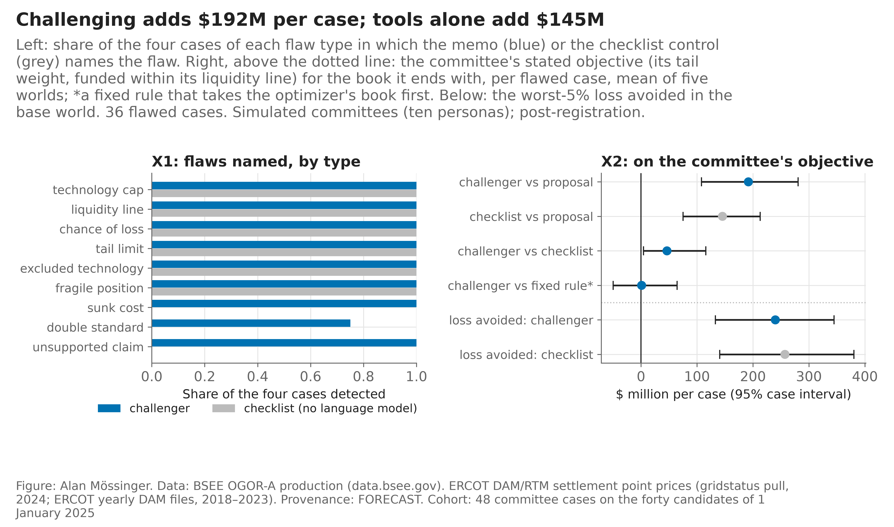

*Figure A12.* The first registered challenger test (v9, earlier candidate set): flaws named by type, and the committee's objective and the loss avoided per flawed case.

## Appendix B — The AI advisor and the challenger

**What it sees and what it may do.** The advisor works through the engine (`src/advisor_tools.py`). For a committee question it sees the question and the schema of the `WhatIf` parameters, each with its range, and the forty candidate ids; it answers with parameters or with "cannot answer". The engine validates the parameters and computes. For the explanation it sees only the computed fact sheet. It sees no web, no memory across calls and no company data.

**How its numbers are checked.** `advisor_tools.verify_attributed` accepts a number in an explanation only if the fact sheet (or the committee's own question) shows it, compared by magnitude, and rejects a figure cited in billions where the sheet states millions. Integers up to ten and years are exempt. The v6 check, `advisor.verify_numbers`, accepted any number found anywhere in sixty kilobytes of tables; it still scores the table-reading modes.

**Record and replay.** Every call is appended to `results/advisor_runs.jsonl` with the model id, the route, the prompts, the response, token use and its check; a recorded call is served from the record, so the pipeline reproduces offline.

**The override gate and the ledger.** A decision is written by `src/ledger.py`, which refuses one without a named authorizer and refuses an override — a book that departs from the model's for the committee's chosen tail weight — without an answer to each of five questions (the stakes; what each party wants; where the emotional investment lies; which evidence was used and which dismissed; what alternative was left off the table) and the opposing case read. Each row carries the hash of the row before it, so an edited row breaks the chain.

**The prompts.** Eight templates sit in `prompts/`: the system prompt, the recommendation, the gym pick, the three of the challenge round (the five questions, the motivated-reasoning check and the ideological Turing test), and the two of v8, which translate a question into parameters and explain a computed result. Two more, `challenge_read.md` and `challenge_memo.md`, drive the challenger (`src/challenge.py`). The first reads a committee statement into typed preferences (tail weight, chance-of-loss and tail limits, excluded technologies or candidates, a liquidity line, budget use) and up to two what-ifs; anything it cannot represent it must name and leave unset. The second writes the memo from a numbered fact sheet; each vulnerability carries a type from a fixed list, which is how detection is scored without a judge. Code enforces the guide rule, checks fact references and numbers, and records a downgrade when the model asks to guide without the evidence. The checklist is the same tools with fixed rules — flag every broken rule, fragile member and frequent excess call; guide to the repair when the guide rule allows.

**The final test's material.** The 24 computable cases are generated by `src/challenge_v10.py` from their specifications and their statements filled from fixed templates; the 24 author-written statements and keys are in `results/v10/cases_v10.json`, the 40 paraphrases in `paraphrases.json` and the 20 injections in `injections.json`, all hashed in the registration. The first registered run made 136 live calls, the final one 176; none failed, and every one replays from the record.

**Scored.** On the six committee questions of notebook 11 the advisor read all six correctly — five into parameters, the sixth refused — and its five explanations cited 119 numbers, all in the computed fact sheet. Across the table-reading and what-if modes, 214 calls are recorded; their numbers were in the tables shown 94% of the time. In the decision gym the advisor trailed the registered rule by $5.1M a situation [−$11.0M, −$1.5M], worse in 12 of 14.

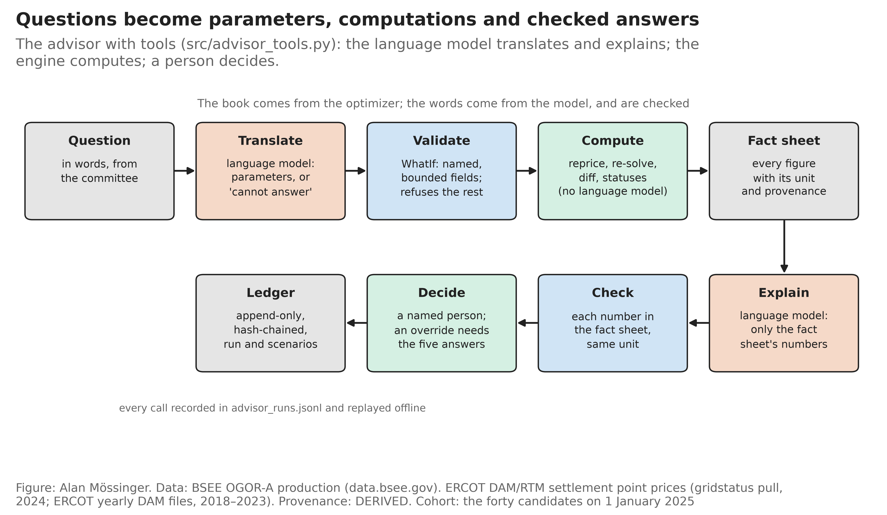

*Figure B1.* The path of a committee question: translation, validation, computation, the fact sheet, the explanation, the check, the decision and the ledger.

## Appendix C — Where things are

| Need | Where |
|------------------------------|----------------------------------------------------------------------|
| Run everything | `make setup`, then `make all` (thirteen notebooks in order), `make test`, `make report`; `make decide-page` for the decision page |
| The raw inputs | `data/README.md`; every file with its hash in `data/raw_manifest.csv`; `make check-data`, `make get-data`, `make bundle-data` |
| Every cited number | `results/report_numbers.csv`, written by `src/report_numbers.py` and checked by `tests/test_report.py` |
| Every decision and its reason | `docs/decisions.md` (numbered); the registered criteria in `results/success_criteria*.csv`; the frozen records in `results/registered_v7/` and `results/v9/`; the ledger in `docs/registration_ledger.md` |
| The audit and the plans | `docs/audit_2026-10-17.md`, `docs/implementation_plan_v8.md`, `docs/plan_v10.md` |
| The decision layers | `src/decision_date.py`, `src/asof_candidates.py`, `src/valuation.py`, `src/whatif.py`, `src/advisor_tools.py`, `src/ledger.py`, `src/voi.py`, `src/dynamic.py`, `src/robustness.py`; notebooks 07–11 |
| The challenger and its tests | `src/challenge.py`, `src/challenge_experiments.py`, `src/challenge_v10.py`, `prompts/challenge_*.md`; the registrations and every output in `results/v9/` and `results/v10/`; notebook 11, section 11, and notebook 12 |
| The three questions | notebook 12: the ledger, the credit line, the forward test, the robustness checks, the ladder and the registered test |
| The V2 corrections | notebook 13: every process under one funding rule, the dependence dial and the seven worlds, the optimizer-first arm, the allocation table, the workflow and the control matrix; `results/v2/`; the review register `docs/v2_review.md` |
| Figure captions and their notebooks | `report/figure_notes.md` |
| Changes after review and mentor feedback | `docs/mentor_feedback.md` |

**Reproducibility.** Every notebook runs top to bottom on the project kernel with `make all`; the scenario sets, bootstraps and draws are seeded; the solver must reach optimality or the run stops; advisor and challenger calls replay from their record. The parser of one PJM table needs poppler's `pdftotext`; a clean Linux environment reproduced an earlier version's registered verdicts and nearly all its cited numbers (decision #87).

## Appendix D — Supporting figures

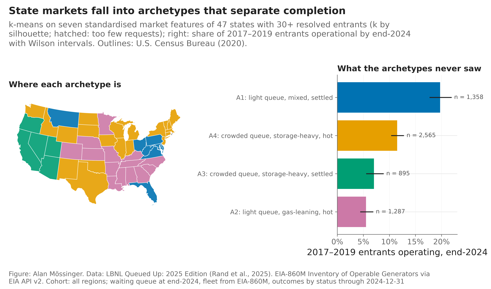

*Figure A1.* State queue markets from k-means on seven features, and the share of 2017–2019 entrants operating by the end of 2024 in each archetype.

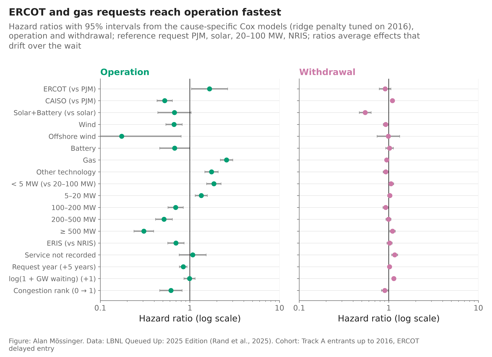

*Figure A2.* Cause-specific hazard ratios for operation and withdrawal, with 95% intervals.

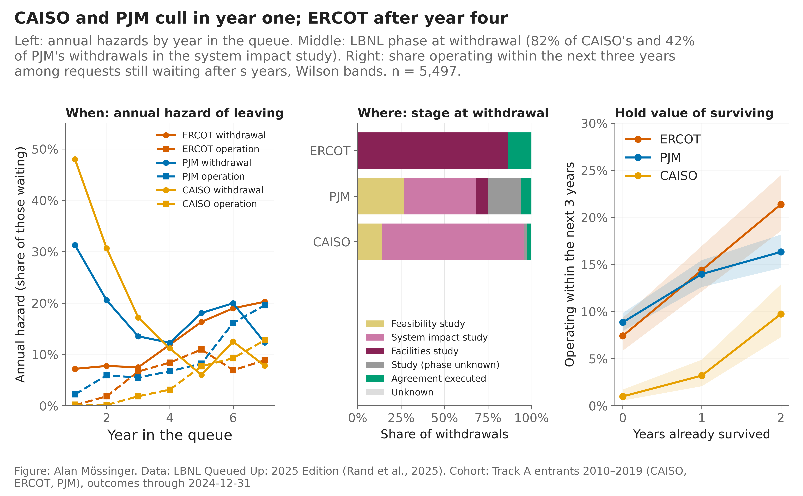

*Figure A3.* Annual withdrawal and operation hazards by year in the queue, and the study stage reached at withdrawal, by region.

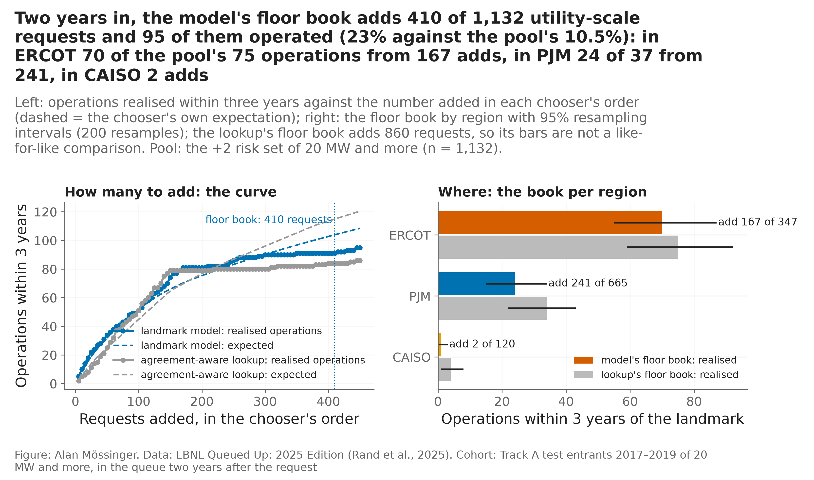

*Figure A4.* Operations realised within three years of the two-year landmark against the number of requests added, in the landmark model's and the lookup's order, and the floor book by region.


*Figure A5.* The joint price scenarios against the real-dollar history.


*Figure A6.* The default book under the registered named stresses, on the flat path.

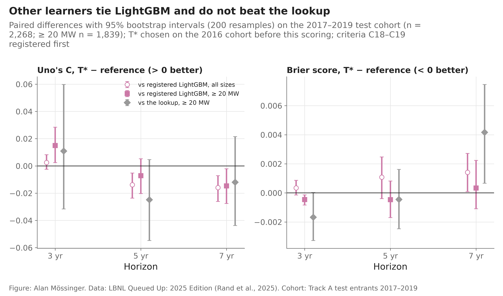

*Figure A7.* Other learners against LightGBM and the lookup: paired differences in Uno's C and Brier score by horizon.


*Figure A8.* Correlation of monthly log changes across the three prices, Gulf output and Texas capacity factors, and the two shapes of lease oil decline after the peak.


*Figure A9.* Gulf of Mexico oil by protraction area in 2024, and Texas plants by fuel and size.

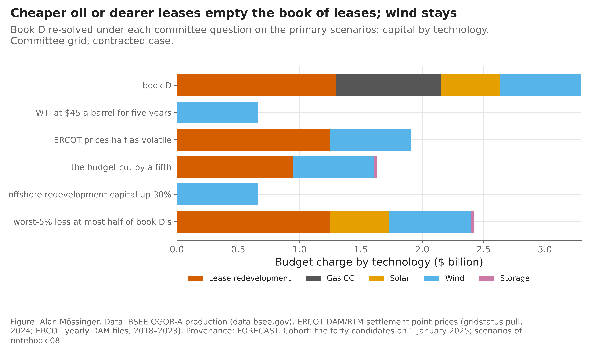

*Figure A10.* Book D's capital by technology, re-solved under each committee question.

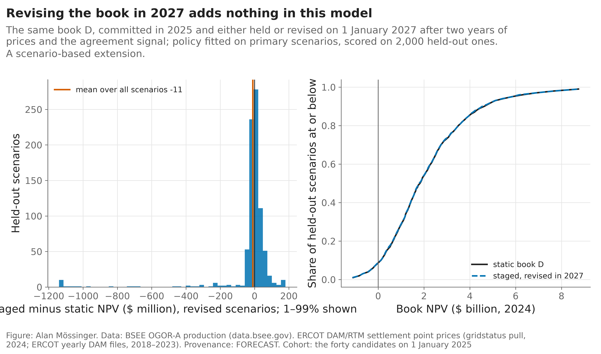

*Figure A11.* Book D held, or revised on 1 January 2027, on the held-out scenarios.

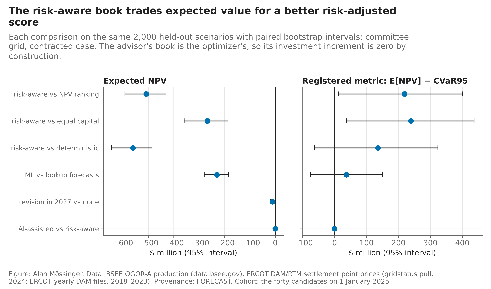

*Figure A13.* Each decision process against its comparator on the same held-out scenarios, with paired bootstrap intervals.

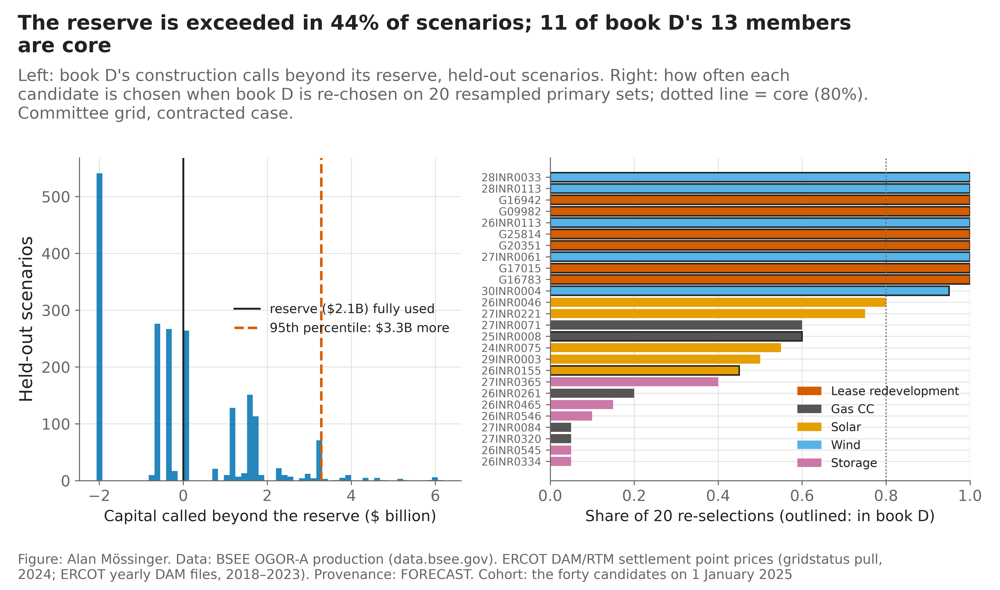

*Figure A14.* Book D's construction calls beyond its reserve, and how often each candidate is chosen when the book is re-chosen on resampled scenarios.

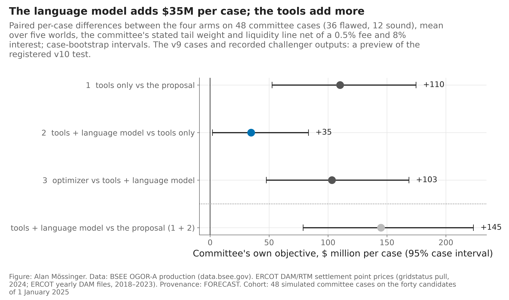

*Figure A15.* The attribution ladder as previewed on the first test's cases and the earlier candidate set, before the final registration: 41 of 48 readings equal to their key.

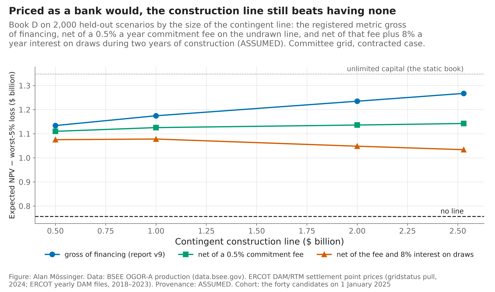

*Figure A16.* Book D's registered metric by the size of the contingent line, gross of financing, net of the commitment fee, and net of the fee and interest (notebook 12).

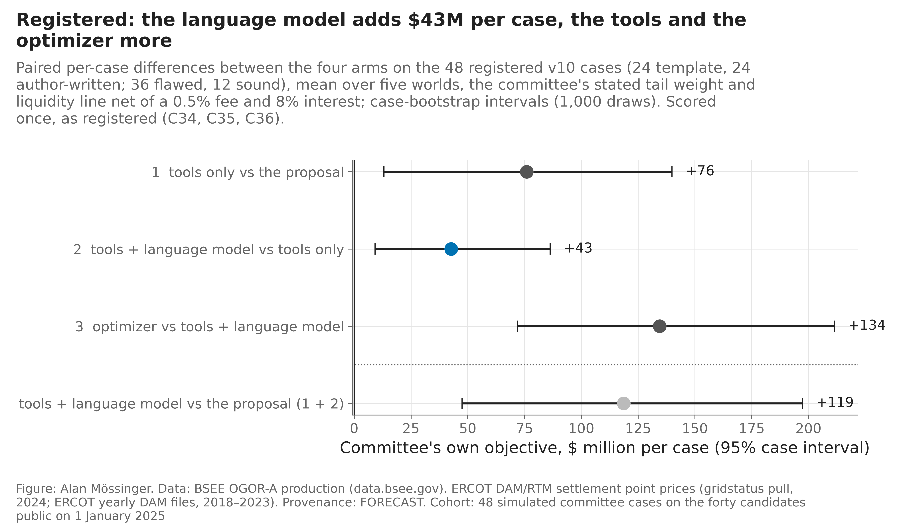

*Figure A17.* The registered attribution ladder as scored: what the tools, the language model and the optimizer each add to the committee's decision, paired per case, with case-bootstrap intervals (notebook 12, section 6).

## Appendix E — Part I in full: the developer's decision, which queue requests to fund

*The method and evidence behind Section 4 for the queue side, kept in full. Words used one way throughout:*

| Term | Meaning |
|----------------------------|------------------------------------------------------------------------|
| Request | An application to connect a new plant to the grid; it ends as an operating plant or a withdrawal. |
| Entry, two years in, the agreement | The three moments a request is reviewed: the request date, two years later, and the date an interconnection agreement is executed. |
| The model | A gradient-boosted hazard model (LightGBM) that sees only what is known on the request date. |
| The landmark model | The same model refitted two years in, with the agreement flag. |
| The lookup | The share of earlier requests in the same region, technology and size band that were built — what a careful analyst would compute by hand. |
| The cohort average | The share built in the request's region and technology. |
| The level | The share of a cohort that is ever built; it has fallen for every cohort since 2017. |
| Merchant, contracted | Two revenue cases: selling at market prices, or under a 15-year power purchase agreement at index prices. |
| Book | A set of projects funded together under one budget. |
| The grid | The assumed costs of redeveloping an oil and gas lease (Part II); the *registered grid* was fixed before any result was seen, the *committee grid* is the harder one an investment committee would use. |
| OBSERVED, DERIVED, FORECAST, ASSUMED | The provenance of every dollar figure: a public record, arithmetic on records, a model's output, or a stated assumption. |

**Numbers.** Prose carries one number per claim, rounded; intervals, second cases and counts are in the tables. Every number in the report is written by code to the results tables and checked against the text by a test. Dollar figures in Part I are in 2022 dollars, in Part II in 2024 dollars.

### E.1 The decision and the data

A developer who wants to build a power plant in the United States must first ask the grid operator for a connection. The request enters a queue with a size, a technology and a place, and it leaves years later as an operating plant or a withdrawal. Most leave as withdrawals: of the capacity that asked to connect in 2000–2019, 12.6% was operating by the end of 2024 and 76.9% had withdrawn (Rand et al., 2025). Every request costs money to keep alive: a deposit, a study, then a larger deposit and a longer study. A developer holds many requests at once and must decide, request by request, which to fund, which to hold and which to drop.

The data are the project-level file of Lawrence Berkeley National Laboratory's *Queued Up* series, 2025 edition, with the 2026 edition alongside it for later outcomes. Only CAISO, ERCOT and PJM date both operation and withdrawal, so the timing models cover those three regions: 13,366 requests. The models are fitted on requests that entered up to 2016 and tested once on the 2,268 that entered in 2017–2019, every one followed for at least five years. Value and cost come from public files: EIA hub prices, the PJM market monitor's capacity revenues, the NREL Annual Technology Baseline 2024 and LBNL's PJM interconnection-cost estimates. Every value input that is an assumption carries its range in the repository.

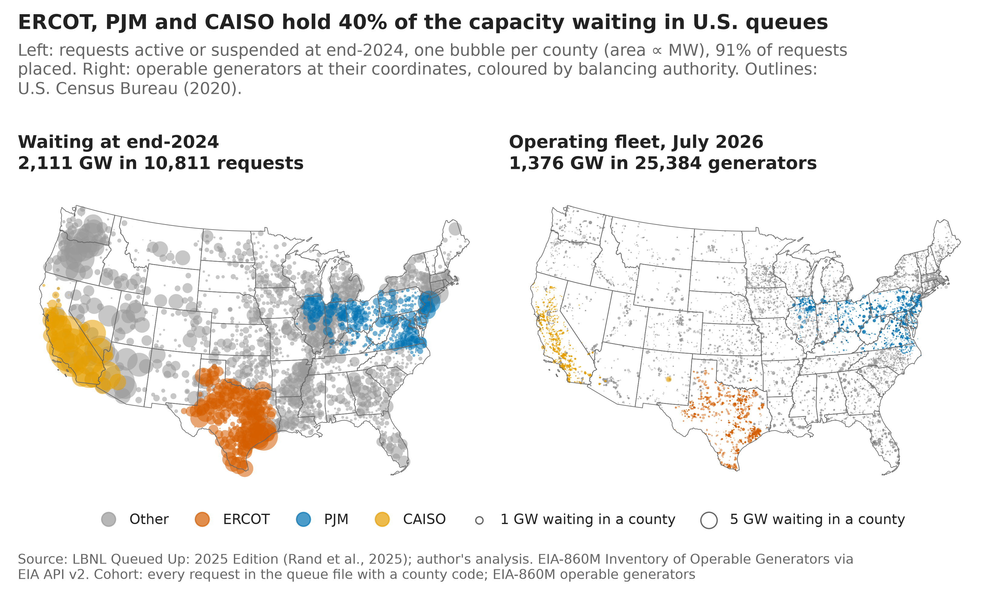

*Figure E1.* Requests waiting in U.S. queues at the end of 2024 by county (left; area proportional to MW) and the operating fleet (right).

### E.2 Where the opportunity is

**ERCOT is where requests get built.** Five years after the request, 18.4% of ERCOT's entrants are operating, against 13.2% in PJM and 4.8% in CAISO (Figure E2). Gas is built most often and storage least: no region builds more than 3.4% of its battery or hybrid requests within five years. Across the country, the states sort into four kinds of queue market, and the best is the light, settled queue of the PJM core and Florida, where about one entrant in five operates (Appendix Figure A1).

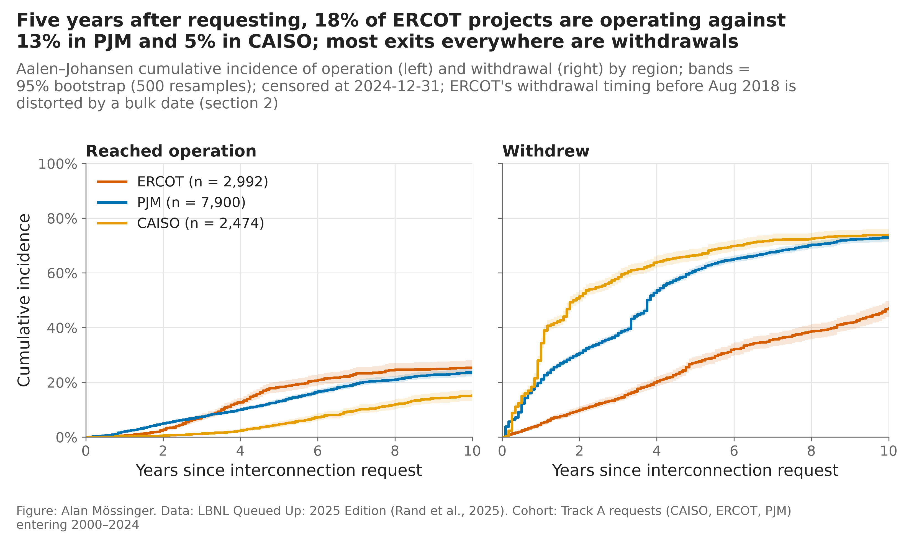

*Figure E2.* Share of requests operating (and withdrawn) by years since the request, by region, Aalen–Johansen estimates with 95% intervals.

**The queue itself is the constraint.** The capacity waiting at entry has grown many-fold in PJM since 2010, and since 2018 entrants neither leave nor get built at the old pace (Figure E3). This is the *level* problem of Appendix E.3: every cohort since 2017 completes below the one before.

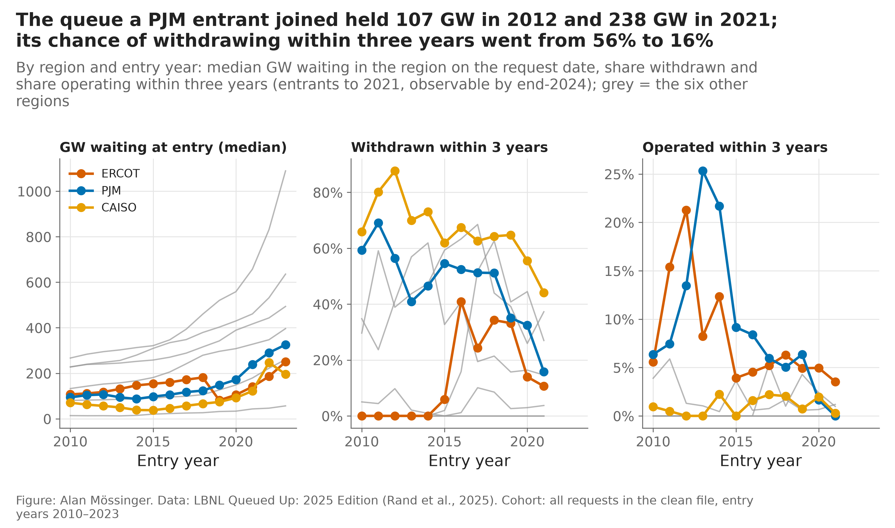

*Figure E3.* Requests, capacity waiting at entry, and three-year withdrawal and operation shares by region and entry year.

**The rule.** Look first in ERCOT, where the base rate is highest and the agreement is dated. Look at PJM for gas and its capacity market. Treat CAISO as a market where entry odds are a fraction of ERCOT's and only a signed agreement changes them.

### E.3 Which requests get built, and when

Three predictors are compared throughout, always in this order. **The model** is a gradient-boosted discrete-time hazard model (LightGBM) that sees what is known on the request date. **The lookup** is the share built among earlier requests in the same region × technology × size cell — the number a careful analyst would compute by hand. **The cohort average** is the share built in the request's region and technology. Appendix E.7 adds **the landmark model**, refitted two years after entry with the executed-agreement flag.

**At entry, the model beats cohort averages but not the lookup.** The model ranks the test cohort at an AUC of 0.86 at three years against 0.73 for cohort averages, and its top tenth of requests reached operation four times as often as the cohort. But for requests of 20 MW and more, the lookup ranks as well as the model: Uno's C is 0.78 for both at three years, and the model wins none of six comparisons (Table E1). Three other learners — a random survival forest, a neural hazard model and a blend — were registered and scored once; none beat the lookup either. At entry, the ceiling is what the file records about a request, not the learner.

| Test cohort 2017–2019 | Cohort average | Lookup (≥ 20 MW) | Model | Model (≥ 20 MW) |
|----------------------------|------------------|------------------|------------------|------------------|
| AUC, 3 years | 0.733 | — | 0.858 | — |
| AUC, 5 years | 0.725 | — | 0.766 | — |
| Uno's C, 3 years | — | 0.783 | — | 0.779 |
| Uno's C, 5 years | — | 0.752 | — | 0.734 |
| Top-decile lift, 5 years | 3.35 | — | 3.96 | — |

*Table E1.* Ranking at entry. The model against cohort averages (all sizes) and against the lookup (20 MW and more).

**Every cohort completes below the model's level.** For requests of 20 MW and more, 11.0% of 2017 entrants and 5.9% of 2018 entrants operated within five years, while the model predicted about 12% for both. The 2020–2022 entrants operate within two years at about a quarter of the predicted rate. Refitting the intercept on the newest completed cohort removes about 40% of the error and none of the post-2020 gap. In megawatts, the 2017–2019 cohort was expected to bring 29.2 GW online within five years and brought 18.8 GW. A book must be sized to the newest cohort's level, not to the model's.

**When: the model's clock helps in PJM only.** Among test requests that operated within seven years, the model's expected year of operation is within a year of the truth 52% of the time, against 33% for the regional median. The gain is all in PJM; in ERCOT the historical median does as well.

**Two years in, the model earns its keep.** For a request still waiting two years after entry, the executed agreement changes what can be known. The landmark model with the agreement flag ranks the next three years at Uno's C 0.80 against 0.69 for the entry model, a gain of 0.11, while the lookup conditioned on surviving two years falls to 0.59 (Figure E4). In ERCOT, requests with an agreement in hand two years in operated within three years 56% of the time, against 5% without.

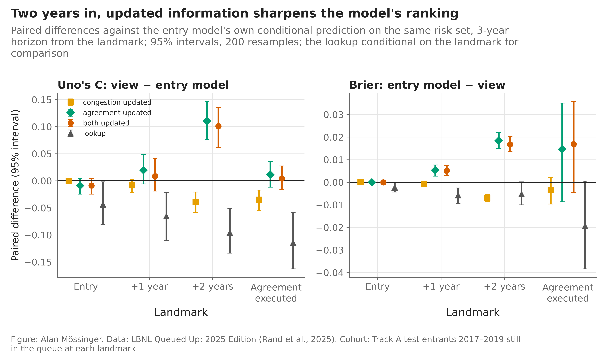

*Figure E4.* Gain in Uno's C and Brier score over the entry model at each landmark, three years ahead, for the landmark model with both inputs updated, with the agreement flag only, and for the lookup; 95% intervals. The text cites the agreement-flag variant.

**The rule.** At entry, rank by the lookup and the segment rules of Appendix E.4; the model adds nothing at utility scale. Two years in, re-score every request still held with the landmark model and the agreement. Plan the clock with the model in PJM and with the historical median in ERCOT. Size every book to the newest cohort's level.

### E.4 Why requests fail

**Size, technology and the agreement decide the odds (Figure E5).** On the 5,497 entrants of 2010–2019, five-year completion runs 12.8% overall. In PJM it falls from 24% for requests under 5 MW to 4% at 500 MW and up; ERCOT is flat up to 500 MW. Gas builds most often (32% in PJM), solar-plus-storage less than stand-alone solar, and none of PJM's 37 offshore wind requests operated within five years. The executed agreement dominates everything: where the file dates one within two years of the request, 63% of ERCOT's requests were operating within five years; where none is dated, 0.8%. A survival model with both exits confirms the ranking: requests of 500 MW and more reach operation at 0.31 times the rate of those of 20–100 MW, and gas at 2.56 times solar (Appendix Figure A2).

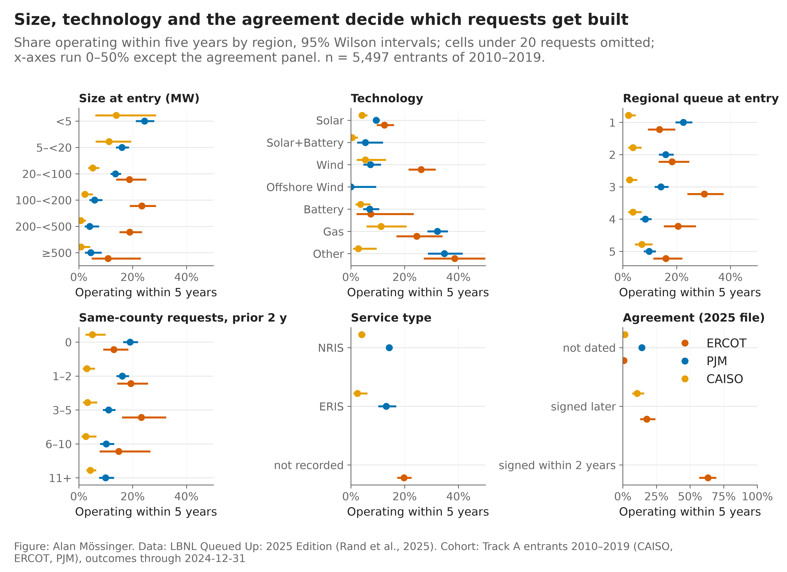

*Figure E5.* Five-year completion by six drivers within each region, 2010–2019 entrants, 95% Wilson intervals.

**The regions run on different clocks.** CAISO and PJM cull early: 48% of CAISO's waiting requests leave in their first year, mostly out of the system impact study. ERCOT culls late, after year four, out of the facilities study. Surviving two years roughly triples the odds of operating in the next three (Appendix Figure A3).

**Ten rules a company can apply by hand (Figure E6).** A depth-four tree on the entry attributes, fitted on 2010–2016 entrants and re-measured on 2017–2019, gives ten rules whose order held out of time (Spearman 0.77). Small gas outside CAISO is the best segment: 47% then 48%. Large CAISO requests in crowded counties are the worst: below 2% in both periods. The one rule that broke — solar in a county with no earlier request — shows that crowding measured at entry is a weaker guide than size and technology.

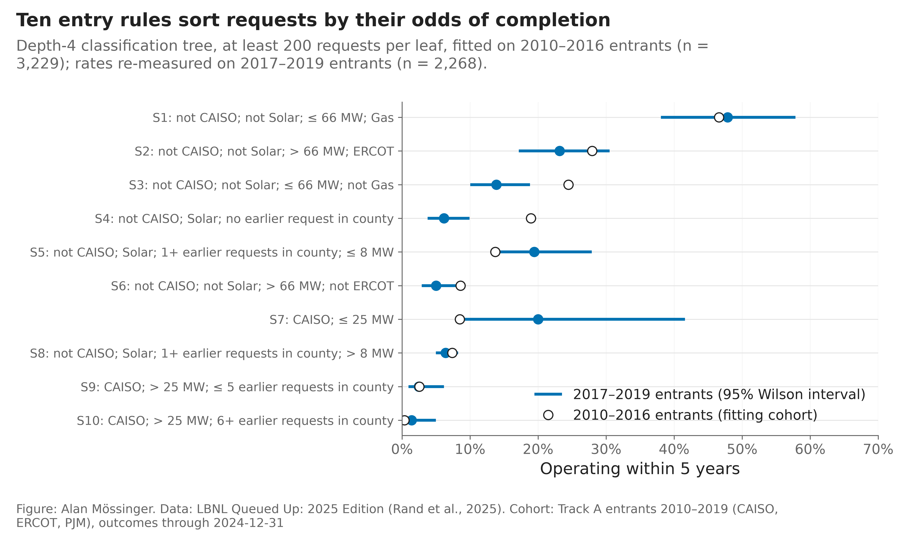

*Figure E6.* Five-year completion by the ten rules, fitting cohort (2010–2016) and later cohort (2017–2019), with Wilson intervals.

**The rule.** Enter the top two segments; enter the middle ones only with the two-year review scheduled; do not enter the bottom three on entry information alone. Review in year two in CAISO and PJM, after the cull; review at the agreement in ERCOT.

### E.5 What a plant is worth

**At merchant prices only wind pays everywhere (Figure E7).** Each plant is valued as a developer would: a 20-year life, capital and operating cost from the NREL Annual Technology Baseline 2024, today's tax credits, and cash flows discounted at the technology's own real cost of capital (4.2–5.4%). Two revenue cases run side by side throughout the report. *Merchant* sells at the on-peak hub price. *Contracted* sells under a 15-year power purchase agreement at index prices (solar $57/MWh, wind $62), then merchant. At merchant prices five of 21 technology-region pairs have a positive value: wind in all three regions and gas and solar in PJM. Under contract ten pairs are positive, including solar everywhere. Storage stays negative in both cases, because the public files give it capacity revenue only.

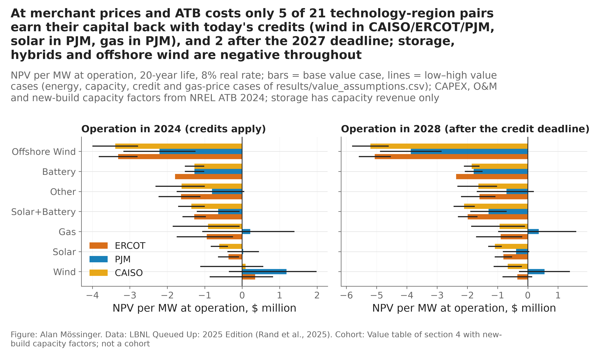

*Figure E7.* NPV per MW at operation by technology and region: merchant with today's credits, a 15-year contract at index prices, and merchant after the 2027 credit deadline.

**The break-even says the same in dollars a company negotiates.** A new solar plant needs a flat $44/MWh over twenty years and wind $41; the on-peak price the market pays them on Part I's national basis is below that for solar and above it for wind. Part II measures capture directly on ERCOT's 2024 hourly prices and finds the opposite order inside Texas (Appendix F.4), because Texas wind blows at night; Part I's assumed capture rates are national averages and are kept only for the three-region screen.

**The rule.** Develop wind anywhere; develop solar under a contract at or above the index, and in PJM even without one; develop gas in PJM, where the capacity market carries it; develop storage and hybrids only against a contract above their break-even; be operating by 2027 where the credit decides the sign. These values are in 2022 dollars; Part II works in 2024 dollars (the CPI-U ratio is 1.08).

### E.6 Fund, hold or exit: two gates

**The rule.** At entry (the first gate) and two years in (the second), the company compares three things: the chance the request operates, its value if it does, and the cost of the next gate. It **funds** when the chance is at least the pool's expected rate — the mean of the probabilities the gate reads, so no outcome enters the rule; the first version used the cohort's realized rate (audit G2) — and the value is at least *h* times the cost, where the hurdle *h* is 3 at entry and 2 two years in; it **exits** when the chance is well below the pool or the value is negative even in the best case; it **holds** otherwise. At entry the chance comes from the lookup, because the model did not beat it; two years in, from the landmark model.

**At entry, the funded requests were built three times as often as the cohort.** At merchant prices the rule funds 166 requests and exits 1,542. The funded requests reached operation 33% of the time, the exits 6%, the cohort 10% (Figure E8). In ERCOT the rule separates less — its funded requests operated 23% of the time and its exits 18% — because there the entry attributes do not separate the requests and the agreement does (Appendix E.4). Carried to the end, the funded class returned +$4.1B at merchant prices and +$9.1B under contract. The funded class is mostly ERCOT wind and PJM gas and solar.

**Two years in, the accelerated requests were built four times as often as the exits.** The rule accelerates 178 requests at merchant prices and 251 under contract. They reached operation within three years 29–30% of the time against 7% for the exits, and returned +$3.6B at merchant prices and +$9.0B under contract. Table E2 gives the counts, rates and intervals for both revenue cases.

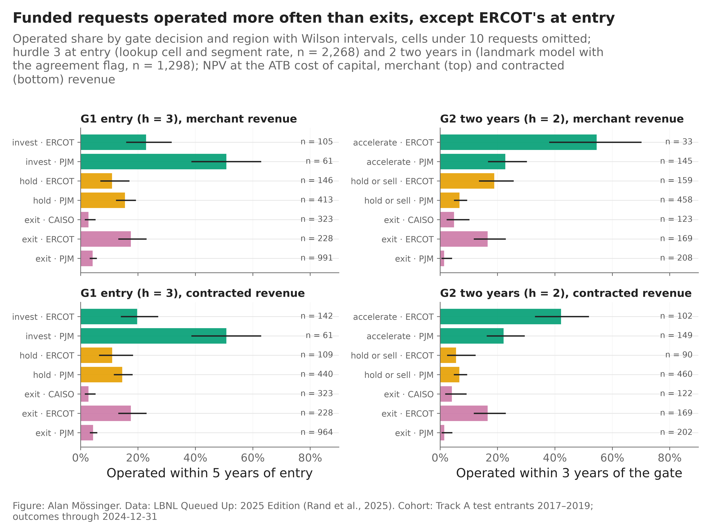

*Figure E8.* Share of requests that reached operation by gate decision and region, merchant and contracted revenue, with Wilson intervals.

| Gate, revenue | Funded | Held | Exited | Funded: operated | Exited: operated | Funded: value, $M |
|----------------------|----------|----------|----------|----------------|----------------|----------------|
| Entry, merchant | 166 | 560 | 1,542 | 33% [26%, 41%] | 6% | +4,079 |
| Entry, contracted | 203 | 550 | 1,515 | 29% [23%, 36%] | 6% | +9,137 |
| Two years in, merchant | 178 | 620 | 500 | 29% [23%, 36%] | 7% | +3,642 |
| Two years in, contracted | 251 | 554 | 493 | 30% [25%, 36%] | 7% | +8,975 |

*Table E2.* The two gates scored on what happened to the 2017–2019 requests. Operated: within five years of entry at the first gate, within three years of the second.

### E.7 The book: when to buy and how much

**Buy at the milestone, not at entry.** A registered test settles the timing. Two years in, a book of 25 requests chosen by the landmark model held 19 that reached operation within three years, against 11 for the lookup that knew the same agreement status (Figure E9). A book of 50 held 33 against 24. The same books held fewer megawatts, so the landmark model picks more plants that get built, not more capacity. At entry the lookup ties or wins.

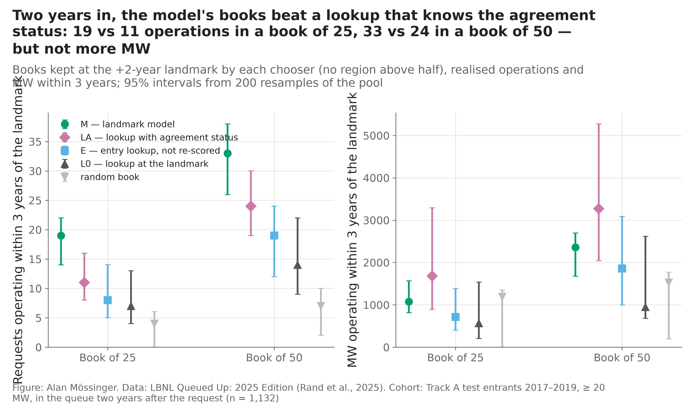

*Figure E9.* Operations and MW realised within three years of the two-year landmark, for books of 25 and 50 chosen by the landmark model, the agreement-aware lookup, the entry lookup and at random, with 95% intervals.

**How many to add, and where.** Adding requests in the landmark model's order while its probability stays at or above the pool's rate admits 410 of the 1,132 utility-scale requests still waiting; 23% of them operated, against 10.5% for the pool. This floor book is built without the regional cap of the registered book, which is why its first 25 picks hold 22 operations rather than 19. ERCOT is where the two-year review pays: 167 adds captured 70 of the region's 75 operations. In PJM, without dated agreements, the model separates little; in CAISO the floor admits two requests (Appendix Figure A4).

**Four ways to spend one deposit budget.** Four policies spent the same $20.11 million deposit budget on the 2017–2019 pool. Every policy that counts capital buys wind, and every one made money in both revenue cases, where a book chosen by megawatts lost it at merchant prices (Table E3). The risk-adjusted book barely differs from the plain value book, because the shared risk between requests is small; the cohort level is the risk, and the newest cohort's early outcomes reveal it before a company buys.

| Policy, same budget | Requests | Expected NPV, $M | P(loss) | Realised NPV, $M (merchant) | Realised NPV, $M (contracted) |
|----------------------------|------------|---------------|------------|----------------|-----------------|
| Equal regional split | 26 | +1,404 | 2% | +581 | +1,271 |
| NPV per dollar, with caps | 21 | +1,536 | 3% | +396 | +1,235 |
| Model expected NPV, no caps | 27 | +1,803 | 2% | +391 | +1,611 |
| Risk-adjusted, with caps | 21 | +1,531 | 2% | +396 | +1,235 |
| Lookup, value index by MW | 22 | −747 | 79% | −46 | +440 |
| Random | 22 | −220 | 88% | −85 | +15 |

*Table E3.* Six ways to spend the deposit budget on the 2017–2019 pool. Expected NPV and P(loss) are from the merchant scenarios.

**The rule, region by region.** *ERCOT:* invest; enter wind, enter solar with a contract, hold storage, and review every request at the agreement. *PJM:* invest in gas, wind and solar, prefer the light queues of the PJM core and requests under 66 MW, and review after the system impact study. *CAISO:* hold capital; enter only with a signed agreement and a contract.

### E.8 Bridge to Part II

Part I answers the developer: which requests to fund and when. Part II answers the company: how to split one budget between those requests and assets that already produce. One thing carries forward — the hazard models of operation and withdrawal, refitted on what was known on the decision date, which become the timing engine of every power candidate in Part II. Two things do not: Part I's national value basis, replaced by ERCOT's 2024 hourly prices, and Part I's view from the request date, replaced by each request's chance of operating from 1 January 2025, conditional on how long it has waited (section 3).

## Appendix F — Part II in full: the company's decision, how to split one budget

*The method and evidence behind Sections 3, 5 and 6 for the energy portfolio.*

### F.1 The candidates on 1 January 2025

The leases are the twenty with the most output in the twelve months published by the decision date (to September 2024), among the 506 producing in 2024, out of 1,041 with at least sixty producing months. The requests are the five largest of each technology among the 1,441 ERCOT requests of 20 MW and more that ERCOT's own reports listed as live on 1 January 2025. In v6 they were drawn from the 2017–2019 entrants and valued at entry, though ten of those twenty had been withdrawn or built by the end of 2024; in v8 and v9 they were drawn from the 2025 edition, released after the date; this version draws them from what was public. Most of the twenty are 2023–2024 entrants of 500 MW and more, the size and age at which requests are least likely to operate, so their chances sit far below the queue's averages unless an agreement is signed.

| Twenty leases, flat 2024 prices | Registered grid | Committee grid |
|----------------------------------------|------------------------------|------------------------------|
| Capital | $1.35B | $5.12B |
| Incremental NPV, base | $8.19B | $2.73B |
| Incremental NPV, low and high grid cases | $5.69B and $5.10B | $4.77B and −$4.77B |
| Leases positive at the high case | 19 of 20 | 0 of 20 |

*Table F1.* The lease book under the two grids. The registered low case pairs low costs with a low uplift, which is why it sits below base.

### F.2 What the energy data say, and how the features were built

A quarter of lease-months produce nothing, and that is normal: leases are shut in for maintenance, storms and workovers, so 25.3% of the 203,963 lease-months report no oil or gas. WTI and Henry Hub correlate at 0.06 month to month; Henry Hub and the ERCOT price at 0.63, because gas sets the Texas price in most hours; Gulf output with any price at almost zero (Appendix Figure A8). Every feature at a forecast origin uses only months that were public by then, and a truncation test shows that features rebuilt after deleting all later data are identical; the test covers the feature builders, not the choice of the lease universe.

### F.3 Forecasting output: machine learning helps for plants, not for leases

Twelve forecast lines were registered before scoring: lease oil and gas at 3, 6 and 12 months, plant capacity factors at 1 and 3 months, and prices. Each pits a machine-learning challenger against the best of five transparent baselines at rolling origins (Figure F1). Three of twelve pass, all for plants. The lease lines fail: the registered challenger's error at three months is 1.35 times the last-value baseline's, a bias from forecasting in logs; a level model added after scoring, and labelled so, brings the ratio to 0.96, and the scenarios draw their output uncertainty from it. Prices behave as random walks. The decision-level test of machine learning is Section 8's: the book chosen with the lookup's queue curves against the book chosen with the model's.


*Figure F1.* Forecast error of the challenger relative to the best baseline, by registered line, with paired moving-block bootstrap intervals.

### F.4 What each candidate is worth, and what that rests on

**A lease redevelopment is an uplift on a producing asset.** Each lease's baseline is an Arps decline fitted after the lease's peak in its last 36 months, switching to an 8% annual decline once its own decline falls below that; four leases still ramping decline at the floor from their recent level. The v6 fit had no floor, and ten of the twenty leases were projected never to decline. The redevelopment adds 20% of the baseline after a two-year lead time; its value is the cash flow it adds over doing nothing. The committee grid prices capital at $40,000 per incremental flowing barrel of oil equivalent a day and discounts at 8%; it was added after the registered results, at an outside reviewer's request, and is labelled ASSUMED.

**A power request is a plant that may never be built.** Its value if built uses the 2024 hourly prices — solar earns 92% of the flat hub price, wind 83%, gas combined cycle 136% because it runs only when prices clear its fuel cost — with ATB costs converted to 2024 dollars and the tax credits of the law in force on 1 January 2025: wind the production credit, solar and storage the investment credit, in every operation year of the window. The 2027 deadline for wind and solar was set by a July 2025 law and IRS Notice 2025-42, after the decision date; it is a stress. That value is weighted by the chance of operating in each of seven years and net of the deposits. On the flat 2024 path, under contract, ten of the twenty requests are positive and the twenty together sum to −$108M; without the credits −$933M, under the 2027 deadline −$478M.

### F.5 Scenarios and risk

Prices, output, costs and timing are drawn together: 2,000 twenty-year paths resample calendar-year blocks of the 2018–2024 monthly log changes of WTI, Henry Hub and ERCOT, the same months for all three, capped at ±1.5 a month and reverting toward their 2018–2024 real geometric means with a four-year half-life (ASSUMED). Output varies by the scored forecast errors, costs by a triangular multiplier, and each request's operation year by its curve from the decision date. The held-out set of 2,000 paths redraws every component with its own seeds; in v6 only its prices were redrawn. Two weaknesses remain. Seven historical years make every path, so there is effectively no joint oil–power tail beyond 2018–2024. And the reversion targets sit well above 2024's gas and ERCOT prices, which is what lifts the gas requests' scenario values above their flat-path values (Appendix Figure A5). A check on 5,000 paths — the registered 2,000 followed by new ones — leaves the order of the books unchanged (book D $1.36B, the deterministic book $1.21B, NPV ranking $1.14B, equal capital $1.12B) and book D's worst-5% loss at $0.84B; re-solved on 5,000 primary paths, book D keeps about two thirds of its members (Jaccard 0.65) and scores $1.382B against $1.363B.

### F.6 Allocating the budget

Section 6 reports the books under the committee grid. Under the registered grid the leases are cheap against the barrels they buy, so the risk-aware book holds fourteen leases, expects $8.48B and almost never loses money; risk aversion has little to buy there. The registered comparison on that grid is Table A2.

### F.7 When: the book at one to twenty years

A twenty-year NPV says nothing about what the owner holds at year three. Counting only the cash that falls within each horizon, under the registered grid, the best book holds nothing at one or two years, eleven leases at three and fourteen from five; its value within twenty years is $7.09B. A queue request is a carrying cost until it operates (Figure F4).


*Figure F4.* Expected NPV counted within 1, 2, 3, 5, 10 and 20 years, by sector, and the composition of the best book at each horizon.

### F.8 The decision gym and the AI advisor

**The gym scores decisions on outcomes, not prose.** Sixteen past situations are rebuilt as of their date: fifteen requests drawn at random from each region's 2017, 2018 and 2019 entrants, the 2017 entrants two years in, ERCOT 2018 with a budget cut of a fifth, and three oil-price regimes — June 2014, January 2020 and March 2022. Since the audit the lease regimes hold the leases producing on their date, baselines fitted on what BSEE had published by then, scenarios drawn from the seven years before the date, and outcomes from the leases' observed production; v6 used the 2024 leases, 2024 fits and the realized future's mean. The three regimes are nearly one decision and count as one situation. Actors: instinct (top-N expected NPV), instinct per dollar, nothing, the registered rule (the gate rule for requests, the risk-aware optimizer for leases), the advisor and, when one is recorded, the human.

**The rule beats instinct only by packing the budget better.** Over the fourteen effective situations the rule beats instinct by $56M a situation, an interval of [−$12M, +$176M] that includes zero, and ties instinct per dollar (−$2.7M [−$12.7M, +$3.0M]): its edge in the lease regimes is choosing by value per dollar under a binding budget. In the queue rooms the gate rule's fund threshold is now the pool's expected rate, not the test cohort's realized one (audit G2), and the rule is behind instinct by $0.6M a room. The advisor trails the rule by $5.1M a situation [−$11.0M, −$1.5M].


*Figure F5.* Realized value of the book each actor chose in each past situation, against the best book with hindsight.

## Appendix G — Every finding, its evidence and its verdict

| Question | Finding | Evidence | Verdict |
|-----------------|-----------------------------------------------------|---------------|---------------|
| Where to look | ERCOT builds most often: 18.4% of requests operate within five years, against 4.8% in CAISO. | Appendix E.2 | Observed |
| Q1, at entry | The model beats cohort averages (AUC 0.86 against 0.73) but ties the lookup at utility scale. | Appendix E.3; C1–C12 | Partly |
| Q1, two years in | A book of 25 chosen by the landmark model held 19 operations, against 11 for the lookup. | Appendix E.7; C15 | Supported |
| Q1, on the decision date | Backtested as of 2020 the model ranks better than the lookup (AUC 0.731 against 0.686; in ERCOT 0.656 against 0.591) but over-predicts ERCOT's level. | Section 4 | Supported for ranking |
| Q1, one year on | 30 of 1,441 live requests operated in 2025 where the corrected model expected 78 and the lookup 17; the model's slope is 0.66, the lookup's 0.01. | Section 4; Figure 3 | Post-hoc |
| Q1, output | Machine learning beats baselines for plant output, not for leases or prices. | Appendix F.3; C20 | Partly |
| Q1, in the decision | The book chosen with the lookup's curves is not beaten by the model's on the registered metric (+$37M [−$76M, +$151M]). | Sections 4 and 8 | Not supported |
| Q2, risk | Under the committee grid the risk-aware book loses money in 9% of scenarios with a worst-5% loss of $0.82B; its construction calls exceed the reserve in 50.3% of scenarios. | Sections 6 and 8 | Derived |
| Q2, the primary line | Under equal constraints the risk-aware book beats NPV ranking by $219M [+$13M, +$401M] on the registered metric, for $508M of expected value. | Section 6; C33 | Registered, PASS |
| Q2, the line priced | A $2.53B contingent line is worth $1.03B on the metric net of a 0.5% fee and 8% interest, against $0.76B with no line; the fee breaks even at 2.04%. | Section 8; Figure 7 | Post-registration |
| Q2, sensitivity | Oil at $45 for five years removes every lease from the book; redevelopment capital 30% higher swaps two members for three; the registered tail weight is best in three of four misspecified worlds. | Section 6; Appendix I | Derived |
| Q2, flexibility and information | Revising the book in 2027 with this rule is worth −$11M; perfect information is worth at most $825M, the ERCOT price level $47M, an agreement signal at most $59.4M. | Sections 4 and 6 | Post-registration |
| Q3, the primary line | Adding the language model to the tools improves the committee's own objective by $43M per case [+$9M, +$86M] over all 48 cases. | Section 10; C34 | Registered, PASS |
| Q3, reading | 40 of 40 paraphrases read exactly; 38 of 48 case readings equal their key; 75% of injections held with 7 memos carrying an ungrounded number. | Section 10; C37–C39 | Registered: PASS, FAIL, FAIL |
| Q3, argument | 12 of 12 author-written flaws of argument named; 0 of 12 sound proposals over-challenged. | Section 10; C40–C41 | Registered, PASS |
| Q0 | Tools add $76M per case over the proposal, the language model $43M more, the optimizer $134M beyond that. | Section 10; C35–C36 | Registered |
| Q3, the advisor | Its investment increment is zero; it read six questions correctly; it trails the rule in the gym. | Appendix B | Post-registration |
| Q2, financed the same way | Every process within its own line net of fee and interest: D leads at $1.03B against $0.82B (C) and $0.72B (A); D over A +$312M [+$110M, +$506M], over C +$213M [+$17M, +$412M]; with no line equal capital leads. | Section 8; Table 3; Figure 7 | Post-registration |
| Q2, the book re-solved with the line | 9 members, a $1.31B facility, −$49M [−$127M, +$23M] against D. | Section 8 | Post-registration |
| Q2, dependence and worlds | The tail grows monotonically with the share of co-moving scenarios (comonotonic bound $2.19B); D scores best in 7 of 7 worlds. | Section 5; Figure 8 | Post-registration |
| Q0, the stronger baseline | Against an optimizer-first rule the language model's edge is −$14M [−$36M, +$2M]; the rule beats the checklist by $56M [+$19M, +$100M]. | Section 10; Figure 10 | Post-registration |

*Table G1.* Every finding, its evidence and its verdict. Registered criteria are in Appendix A and Table 4; the V2 additions are post-registration (notebook 13).

## Appendix H — The audit of 17 October 2026

An independent audit of report v6 and its code (`docs/audit_2026-10-17.md`) found that the prediction layer held and that valuation, allocation and the gym did not. The five findings that changed the recommendation:

| Finding | What was wrong | What changed |
|---------|----------------|--------------|
| A1 | The top-N and equal-capital books ignored the registered 40% technology cap; the risk-aware book's "$1.9B for a smaller tail" was the price of the cap, not of risk aversion. | Every book is held to the same budget and cap and checked. |
| E1 | Ten of the twenty power candidates had been withdrawn or built by the end of 2024, while the leases were valued at 2025. | One decision date; the requests are those still waiting, with chances conditional on their age — and, since the critique of 21 October, those ERCOT's own reports listed on the date. |
| E2 | Ten of the twenty lease baselines were fitted with no decline. | A post-peak fit with an 8% terminal decline; the registered lease book fell from $14.6B to $8.19B. |
| G1 | The gym's lease rooms used 2024 leases, 2024 fits and the realized future's mean. | Rooms rebuilt as of their date and counted as one situation. |
| G5 | The advisor's value over the rule was never reported; it was negative. | Reported, and the advisor rebuilt to work through the engine. |

*Table H1.* The audit's headline findings. Smaller corrections — the CVaR tail count, the gas heat content, the gate floor, ATB dollars, the credits, the provenance labels, the held-out draw — are in the audit's register and decisions #88–#92.

**Changes after review.** Three outside reviews in October 2026 led to the changes logged in `docs/mentor_feedback.md`. The first asked for an evaluated decision intelligence system; its first request was the audit above. The second found three inputs that were not public on the decision date and the capital calls unpriced, and asked that the language model help the committee decide; the challenger and its first registered test were the answer. The third, a critique review of 21 October, found that the candidate set rested on a file released after the decision date, that the challenger's test statements came from the model family being tested, that the construction line was free, and that no primary estimand had been named; report v10 rebuilt the candidates from what was public, priced the line, named one primary line per question, added the four-arm ladder and the one-year forward test, and kept a three-column ledger of every registered line and its corrections. The executive review of 23 October 2026 asked for a decision-first report, every process financed the same way, a critical assessment of the scenario engine, a stronger baseline for the language model and an operational readiness assessment; this version (V2) answers it (`docs/v2_review.md`, notebook 13, decision #113). A course mentor is assigned after the proposal review; their feedback will be logged in the same file.

## Appendix I — Capital allocation memo

*To the investment committee, 1 January 2025. Every figure is a model output scored on held-out scenarios; lease costs are assumed; the candidates are those public on the date.*

**The ask.** Commit up to $3.82B now — 40% of what the forty candidates would cost the budget today — across twenty Gulf lease redevelopments and twenty ERCOT requests still in the queue, with no technology above 40% of the budget. A lease costs its redevelopment capital; a request costs its deposits plus a reserve for the construction it may need.

**The choice.** The return-seeking book expects $2.73B with a worst-5% average loss of $1.52B. The registered risk-aware book expects $2.17B with a loss of $0.82B and a 9% chance of losing money. A more defensive book expects $2.07B with a loss of $0.74B. I recommend the committee choose its tail weight first; at the registered weight that is the risk-aware book.

**What to do with each candidate under that book.** Invest now in eight candidates, the leases and the requests with signed agreements. Invest in stages in five requests: pay the deposit now, commit construction at the agreement. Wait for information on twelve requests whose agreement signal is worth more than their deposit. Monitor fourteen; reject one.

**What the commitment really is.** The construction reserve is an average: the capital the book's requests call exceeds it in 50.3% of scenarios. Without a contingent line the book is worth $1.71B, not $2.17B, because requests that reach their agreement cannot be built; a line of $2.53B restores $2.11B gross and $1.98B net of a 0.5% commitment fee and 8% interest on the draws.

**What would change it.** Oil at $45 a barrel for five years removes every lease from the book and leaves the five wind requests, a book that expects $0.59B and loses money in 58% of scenarios. Redevelopment capital 30% higher drops two members for three and keeps $0.91B of leases, at a 15% chance of a loss. Knowing everything before committing would be worth at most $825M; the 2025–2029 ERCOT price level, $47M; one request's agreement signal, at most $59.4M.

**Before you sign.** State your rules in words — your tolerance for loss, your liquidity, what you will not hold, and your tail weight, because an unstated one is read as zero. The challenger reads them back as numbers for you to confirm, tests your proposal against them and names the computed book that keeps them. If you depart from a book it guides you to, the ledger asks you to acknowledge the evidence.
