## Abstract

An energy company that holds interconnection-queue requests must decide, request by request, whether to fund, hold or exit them — and, across its whole book, how to split capital between those requests and assets that already produce. This report builds both decisions from public records and scores them on what happened.

Part I uses 13,366 requests in CAISO, ERCOT and PJM, tested on the 2,268 that entered in 2017–2019. At entry a gradient-boosted hazard model ranks requests better than cohort averages (AUC 0.86 against 0.73 at three years) but no better than a careful lookup at utility scale. Two years in, with the executed agreement known, its edge is real: a book of 25 it chose held 19 requests that reached operation, against 11 for the lookup. Every cohort since 2017 completes below the model's level, so books must be sized to the newest cohort.

Part II places twenty offshore Gulf lease redevelopments and twenty ERCOT requests under one budget and 2,000 joint price scenarios drawn from observed prices, Winter Storm Uri included. The leases carry the book, but their value halves when they are priced as an investment committee would ($14.6B to $7.0B), and the power requests pay only where a contract or the scenarios' price spikes carry them. A risk-aware optimizer cannot beat NPV ranking on the registered metric under either cost grid; under the committee's it cuts the worst-5% loss from $1.3B to $0.3B for $1.9B of expected value. An LLM advisor, run live on 96 recorded calls, cited numbers that its tables hold 94% of the time, chose a book that overlaps the optimizer's by 0.89, and beat instinct by $228M a situation in the decision gym.

## Capital Allocation Memo

*To the investment committee. Part II carries the evidence; every number is computed by code and checked against the text.*

**The ask.** Split $7.81B — 40% of the forty candidates' capital at committee prices — across twenty Gulf of Mexico lease redevelopments and twenty ERCOT queue requests, with no technology above 40% of the budget.

**The recommendation.** Fund the risk-aware book: ten lease redevelopments, three wind requests under 15-year contracts and four gas requests, $7.4B of capital. It expects $5.8B (median $5.3B), loses money in 3% of scenarios, and its worst 5% averages a $0.3B loss. Do not fund solar or storage at 2024 prices.

**The alternative.** Funding eighteen leases and four gas requests by expected value raises the expectation to $7.7B and the worst-5% loss to $1.3B. On the registered metric that trade favours the larger book by $888M; choosing between them is a question of the committee's appetite for risk, which this memo states rather than decides.

**Why.** The leases already produce: even priced as developments at an 8% real rate, all twenty are positive. The requests rarely get built: Part I's models give them a 6%–23% chance of operating within seven years. On the flat 2024 path only wind under contract earns its capital; in the scenarios the gas requests earn $427M between them, because ERCOT prices spike, as they did in 2019, 2021 and 2023.

**What would change it.** The capital per incremental barrel and the uplift: at the high-cost case the lease book is worth −$2.0B. Five years of $42 oil cuts it to $4.25B. The gas requests rest on ERCOT prices spiking again; a carbon price of $50 a tonne drops one of them (overlap 0.88).

**When.** Under the registered grid lease capital pays back from about year three, and later under the committee's; a queue request is a cost until it operates. An owner with a one- or two-year horizon funds nothing.

**The record.** Under the registered cost grid two of the four allocation criteria pass on the observed prices and two fail; on the bridged prices they were first scored on, all four failed, and that scoring is kept. In sixteen past situations the registered rules beat instinct by $236M a situation and the advisor by $228M, almost all of it in the lease regimes.

## How to read this report

**Two decisions, two parts.** Part I is for a developer deciding, request by request, which interconnection-queue requests to fund. Part II is for a chief financial officer splitting one budget between those requests and oil and gas assets that already produce. Each part ends in rules a company can apply; section 16 collects every finding, with its evidence, in one table. The registered evaluation record is Appendix A. A reader in a hurry can read the memo, section 16 and the conclusion.

**Words used one way throughout.**

| Term | Meaning |
|----------------------------|------------------------------------------------------------------------|
| Request | An application to connect a new plant to the grid; it ends as an operating plant or a withdrawal. |
| Entry, two years in, the agreement | The three moments a request is reviewed: the request date, two years later, and the date an interconnection agreement is executed. |
| The model | A gradient-boosted hazard model (LightGBM) that sees only what is known on the request date. |
| The landmark model | The same model refitted two years in, with the agreement flag. |
| The lookup | The share of earlier requests in the same region, technology and size band that were built — what a careful analyst would compute by hand. |
| The cohort average | The share built in the request's region and technology. |
| The level | The share of a cohort that is ever built; it has fallen for every cohort since 2017. |
| Merchant, contracted | Two revenue cases: selling at market prices, or under a 15-year power purchase agreement at index prices. |
| Book | A set of projects funded together under one budget. |
| The grid | The assumed costs of redeveloping an oil and gas lease (Part II); the *registered grid* was fixed before any result was seen, the *committee grid* is the harder one an investment committee would use. |
| OBSERVED, DERIVED, FORECAST, ASSUMED | The provenance of every dollar figure: a public record, arithmetic on records, a model's output, or a stated assumption. |

**Numbers.** Prose carries one number per claim, rounded; intervals, second cases and counts are in the tables. Every number in the report is written by code to the results tables and checked against the text by a test. Dollar figures in Part I are in 2022 dollars, in Part II in 2024 dollars.

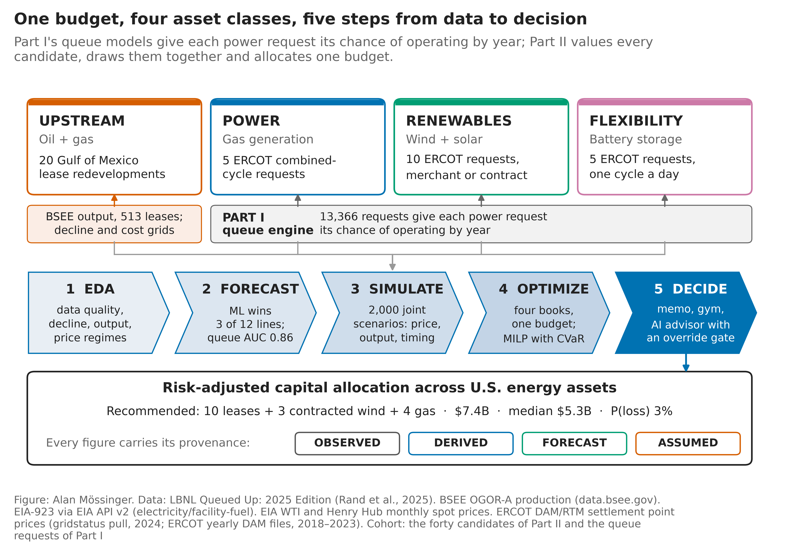

*Figure 1.* The work in one picture: the four asset classes one budget is split across, the queue engine of Part I that times every power candidate, the five steps, and the decision they produce.

## Questions and hypotheses

The proposal set four research questions and three hypotheses, with thresholds registered before any result was seen.

| | Question or hypothesis | Where it is answered |
|--------------|--------------------------------------------------------|------------------------------|
| RQ1 Predict | Can machine learning improve output, completion and timing predictions against naive and physics-based baselines? | Sections 3, 7 and 10 |
| RQ2 Quantify | How do forecast error, price uncertainty and correlation change portfolio risk? | Section 12 |
| RQ3 Allocate | Under one budget, does a risk-aware multi-energy book beat NPV ranking and sector-only books out of sample? | Section 13 |
| RQ4 Explain | Which features and constraints actually change selection, diversification and timing? | Sections 4, 10, 11 and 13 |
| H1 | Well-validated machine-learning forecasts reduce held-out error against naive and decline baselines. | Section 10 |
| H2 | A diversified risk-aware book beats concentrated and top-N books on a stated risk-return metric. | Section 13 |
| H3 | Uncertainty-aware selection is more stable under stresses than deterministic selection. | Section 13 |

*Table 1.* The questions and hypotheses, and the sections that answer them; the registered criteria behind each are in Appendix A.

## Related work

**Interconnection queues.** Lawrence Berkeley National Laboratory's *Queued Up* series documents the size of U.S. queues and their completion rates, and is the data source of Part I (Rand et al., 2025). Johnston, Liu and Yang (2023) analyse the queue empirically as an economic process. Part I adds a prediction layer that is scored out of time, and a decision layer that is scored on what happened.

**Survival and dynamic prediction.** Requests end in one of two ways, operation or withdrawal, which is a competing-risks problem (Fine & Gray, 1999; Aalen & Johansen, 1978). Discrete-time hazards make such models compatible with gradient boosting (Allison, 1982; Ke et al., 2017). Updating a prediction at a later date with information known then is landmarking (van Houwelingen, 2007), and Uno's C is the concordance measure for censored outcomes used throughout (Uno et al., 2011).

**Forecasting production and prices.** Arps (1945) decline curves remain the physics baseline for oil and gas output. Forecasts are judged out of sample at rolling origins (Tashman, 2000; Hyndman & Athanasopoulos, 2021), and dependent data need block resampling for honest intervals (Künsch, 1989). Commodity prices revert toward long-run levels over years rather than months, which the scenario engine builds in (Pindyck, 1999; Schwartz & Smith, 2000).

**Portfolios of energy assets.** Mean-variance portfolio theory (Markowitz, 1952) was carried into generation planning by Awerbuch and Berger (2003) and Roques, Newbery and Nuttall (2008), who show that diversification across fuels has value once their risks are modelled jointly. Conditional value-at-risk turns tail aversion into a linear program (Rockafellar & Uryasev, 2000). Real-options theory explains why staging investment — the gates of Part I — has value under uncertainty (Dixit & Pindyck, 1994).

**Decision support with language models.** Grounding a language model in retrieved documents reduces invented content (Lewis et al., 2020). The advisor's challenge round draws on the psychology of motivated reasoning (Kunda, 1990) and on the ideological Turing test (Caplan, 2011), in which one side must state the other's case well enough to pass as a believer.

**What this report adds.** Public portfolio studies take completion and timing as given. Here the queue models make them a probability, and that probability enters the valuation of every power candidate. The allocation is then tested against registered criteria and an assumed cost grid that a committee could challenge.

# Part I — The developer's decision: which queue requests to fund

## 1 The decision and the data

A developer who wants to build a power plant in the United States must first ask the grid operator for a connection. The request enters a queue with a size, a technology and a place, and it leaves years later as an operating plant or a withdrawal. Most leave as withdrawals: of the capacity that asked to connect in 2000–2019, 12.6% was operating by the end of 2024 and 76.9% had withdrawn (Rand et al., 2025). Every request costs money to keep alive: a deposit, a study, then a larger deposit and a longer study. A developer holds many requests at once and must decide, request by request, which to fund, which to hold and which to drop.

The data are the project-level file of Lawrence Berkeley National Laboratory's *Queued Up* series, 2025 edition, with the 2026 edition alongside it for later outcomes. Only CAISO, ERCOT and PJM date both operation and withdrawal, so the timing models cover those three regions: 13,366 requests. The models are fitted on requests that entered up to 2016 and tested once on the 2,268 that entered in 2017–2019, every one followed for at least five years. Value and cost come from public files: EIA hub prices, the PJM market monitor's capacity revenues, the NREL Annual Technology Baseline 2024 and LBNL's PJM interconnection-cost estimates. Every value input that is an assumption carries its range in the repository.

*Figure 2.* Requests waiting in U.S. queues at the end of 2024 by county (left; area proportional to MW) and the operating fleet (right).

## 2 Where the opportunity is

**ERCOT is where requests get built.** Five years after the request, 18.4% of ERCOT's entrants are operating, against 13.2% in PJM and 4.8% in CAISO (Figure 3). Gas is built most often and storage least: no region builds more than 3.4% of its battery or hybrid requests within five years. Across the country, the states sort into four kinds of queue market, and the best is the light, settled queue of the PJM core and Florida, where about one entrant in five operates (Appendix Figure A1).

*Figure 3.* Share of requests operating (and withdrawn) by years since the request, by region, Aalen–Johansen estimates with 95% intervals.

**The queue itself is the constraint.** The capacity waiting at entry has grown many-fold in PJM since 2010, and since 2018 entrants neither leave nor get built at the old pace (Figure 4). This is the *level* problem of section 3: every cohort since 2017 completes below the one before.

*Figure 4.* Requests, capacity waiting at entry, and three-year withdrawal and operation shares by region and entry year.

**The rule.** Look first in ERCOT, where the base rate is highest and the agreement is dated. Look at PJM for gas and its capacity market. Treat CAISO as a market where entry odds are a fraction of ERCOT's and only a signed agreement changes them.

## 3 Which requests get built, and when

Three predictors are compared throughout, always in this order. **The model** is a gradient-boosted discrete-time hazard model (LightGBM) that sees what is known on the request date. **The lookup** is the share built among earlier requests in the same region × technology × size cell — the number a careful analyst would compute by hand. **The cohort average** is the share built in the request's region and technology. Section 7 adds **the landmark model**, refitted two years after entry with the executed-agreement flag.

**At entry, the model beats cohort averages but not the lookup.** The model ranks the test cohort at an AUC of 0.86 at three years against 0.73 for cohort averages, and its top tenth of requests reached operation four times as often as the cohort. But for requests of 20 MW and more, the lookup ranks as well as the model: Uno's C is 0.78 for both at three years, and the model wins none of six comparisons (Table 2). Three other learners — a random survival forest, a neural hazard model and a blend — were registered and scored once; none beat the lookup either. At entry, the ceiling is what the file records about a request, not the learner.

| Test cohort 2017–2019 | Cohort average | Lookup (≥ 20 MW) | Model | Model (≥ 20 MW) |
|----------------------------|------------------|------------------|------------------|------------------|
| AUC, 3 years | 0.733 | — | 0.858 | — |
| AUC, 5 years | 0.725 | — | 0.766 | — |
| Uno's C, 3 years | — | 0.783 | — | 0.779 |
| Uno's C, 5 years | — | 0.752 | — | 0.734 |
| Top-decile lift, 5 years | 3.35 | — | 3.96 | — |

*Table 2.* Ranking at entry. The model against cohort averages (all sizes) and against the lookup (20 MW and more).

**Every cohort completes below the model's level.** For requests of 20 MW and more, 11.0% of 2017 entrants and 5.9% of 2018 entrants operated within five years, while the model predicted about 12% for both (Figure 5). The 2020–2022 entrants operate within two years at about a quarter of the predicted rate. Refitting the intercept on the newest completed cohort removes about 40% of the error and none of the post-2020 gap. In megawatts, the 2017–2019 cohort was expected to bring 29.2 GW online within five years and brought 18.8 GW. A book must be sized to the newest cohort's level, not to the model's.

*Figure 5.* Five-year completion observed and predicted by entry year, requests of 20 MW and more.

**When: the model's clock helps in PJM only.** Among test requests that operated within seven years, the model's expected year of operation is within a year of the truth 52% of the time, against 33% for the regional median. The gain is all in PJM; in ERCOT the historical median does as well.

**Two years in, the model earns its keep.** For a request still waiting two years after entry, the executed agreement changes what can be known. The landmark model with the agreement flag ranks the next three years at Uno's C 0.80 against 0.69 for the entry model, a gain of 0.11, while the lookup conditioned on surviving two years falls to 0.59 (Figure 6). In ERCOT, requests with an agreement in hand two years in operated within three years 56% of the time, against 5% without.

*Figure 6.* Gain in Uno's C and Brier score over the entry model at each landmark, three years ahead, for the landmark model with both inputs updated, with the agreement flag only, and for the lookup; 95% intervals. The text cites the agreement-flag variant.

**The rule.** At entry, rank by the lookup and the segment rules of section 4; the model adds nothing at utility scale. Two years in, re-score every request still held with the landmark model and the agreement. Plan the clock with the model in PJM and with the historical median in ERCOT. Size every book to the newest cohort's level.

## 4 Why requests fail

**Size, technology and the agreement decide the odds (Figure 7).** On the 5,497 entrants of 2010–2019, five-year completion runs 12.8% overall. In PJM it falls from 24% for requests under 5 MW to 4% at 500 MW and up; ERCOT is flat up to 500 MW. Gas builds most often (32% in PJM), solar-plus-storage less than stand-alone solar, and none of PJM's 37 offshore wind requests operated within five years. The executed agreement dominates everything: where the file dates one within two years of the request, 63% of ERCOT's requests were operating within five years; where none is dated, 0.8%. A survival model with both exits confirms the ranking: requests of 500 MW and more reach operation at 0.31 times the rate of those of 20–100 MW, and gas at 2.56 times solar (Appendix Figure A2).

*Figure 7.* Five-year completion by six drivers within each region, 2010–2019 entrants, 95% Wilson intervals.

**The regions run on different clocks.** CAISO and PJM cull early: 48% of CAISO's waiting requests leave in their first year, mostly out of the system impact study. ERCOT culls late, after year four, out of the facilities study. Surviving two years roughly triples the odds of operating in the next three (Appendix Figure A3).

**Ten rules a company can apply by hand (Figure 8).** A depth-four tree on the entry attributes, fitted on 2010–2016 entrants and re-measured on 2017–2019, gives ten rules whose order held out of time (Spearman 0.77). Small gas outside CAISO is the best segment: 47% then 48%. Large CAISO requests in crowded counties are the worst: below 2% in both periods. The one rule that broke — solar in a county with no earlier request — shows that crowding measured at entry is a weaker guide than size and technology.

*Figure 8.* Five-year completion by the ten rules, fitting cohort (2010–2016) and later cohort (2017–2019), with Wilson intervals.

**The rule.** Enter the top two segments; enter the middle ones only with the two-year review scheduled; do not enter the bottom three on entry information alone. Review in year two in CAISO and PJM, after the cull; review at the agreement in ERCOT.

## 5 What a plant is worth

**At merchant prices only wind pays everywhere (Figure 9).** Each plant is valued as a developer would: a 20-year life, capital and operating cost from the NREL Annual Technology Baseline 2024, today's tax credits, and cash flows discounted at the technology's own real cost of capital (4.2–5.4%). Two revenue cases run side by side throughout the report. *Merchant* sells at the on-peak hub price. *Contracted* sells under a 15-year power purchase agreement at index prices (solar $57/MWh, wind $62), then merchant. At merchant prices five of 21 technology-region pairs have a positive value: wind in all three regions and gas and solar in PJM. Under contract ten pairs are positive, including solar everywhere. Storage stays negative in both cases, because the public files give it capacity revenue only.

*Figure 9.* NPV per MW at operation by technology and region: merchant with today's credits, a 15-year contract at index prices, and merchant after the 2027 credit deadline.

**The break-even says the same in dollars a company negotiates.** A new solar plant needs a flat $44/MWh over twenty years and wind $41; the on-peak price the market pays them on Part I's national basis is below that for solar and above it for wind. Part II measures capture directly on ERCOT's 2024 hourly prices and finds the opposite order inside Texas (section 11), because Texas wind blows at night; Part I's assumed capture rates are national averages and are kept only for the three-region screen.

**The rule.** Develop wind anywhere; develop solar under a contract at or above the index, and in PJM even without one; develop gas in PJM, where the capacity market carries it; develop storage and hybrids only against a contract above their break-even; be operating by 2027 where the credit decides the sign. These values are in 2022 dollars; Part II works in 2024 dollars (the CPI-U ratio is 1.08).

## 6 Fund, hold or exit: two gates

**The rule.** At entry (the first gate) and two years in (the second), the company compares three things: the chance the request operates, its value if it does, and the cost of the next gate. It **funds** when the chance is at least the pool's own rate and the value is at least *h* times the cost, where the hurdle *h* is 3 at entry and 2 two years in; it **exits** when the chance is well below the pool or the value is negative even in the best case; it **holds** otherwise. At entry the chance comes from the lookup, because the model did not beat it; two years in, from the landmark model.

**At entry, the funded requests were built two and a half times as often as the cohort.** At merchant prices the rule funds about one request in ten and drops nearly half. The funded requests reached operation a quarter of the time; the dropped ones 5%; the cohort 10% (Figure 10). The exception is ERCOT at entry, where the requests the rule dropped operated at least as often as those it funded: there the entry attributes do not separate the requests, and the agreement does (section 4). Carried to the end, the funded class returned +$4.1B at merchant prices and +$9.3B under contract, while the dropped class would have lost about $5B. The funded class is mostly ERCOT wind and PJM gas and solar; under contract, ERCOT solar joins it.

**Two years in, the accelerated requests were built twice as often as the exits.** The rule accelerates about a quarter of the requests still waiting. They reached operation within three years 18–20% of the time against 8% for the exits, and returned +$3.6B at merchant prices and +$9.0B under contract. In ERCOT under contract, the 120 accelerated requests hold more than half the region's operations. Table 3 gives the counts, rates and intervals for both revenue cases.

*Figure 10.* Share of requests that reached operation by gate decision and region, merchant and contracted revenue, with Wilson intervals.

| Gate, revenue | Funded | Held | Exited | Funded: operated | Exited: operated | Funded: value, $M |
|----------------------|----------|----------|----------|----------------|----------------|----------------|
| Entry, merchant | 237 | 964 | 1,067 | 26% [21%, 32%] | 5% | +4,130 |
| Entry, contracted | 326 | 903 | 1,039 | 21% [17%, 26%] | 5% | +9,347 |
| Two years in, merchant | 316 | 577 | 405 | 18% [14%, 23%] | 8% | +3,642 |
| Two years in, contracted | 410 | 493 | 395 | 20% [17%, 25%] | 8% | +8,989 |

*Table 3.* The two gates scored on what happened to the 2017–2019 requests. Operated: within five years of entry at the first gate, within three years of the second.

## 7 The book: when to buy and how much

**Buy at the milestone, not at entry.** A registered test settles the timing. Two years in, a book of 25 requests chosen by the landmark model held 19 that reached operation within three years, against 11 for the lookup that knew the same agreement status (Figure 11). A book of 50 held 33 against 24. The same books held fewer megawatts, so the landmark model picks more plants that get built, not more capacity. At entry the lookup ties or wins.

*Figure 11.* Operations and MW realised within three years of the two-year landmark, for books of 25 and 50 chosen by the landmark model, the agreement-aware lookup, the entry lookup and at random, with 95% intervals.

**How many to add, and where.** Adding requests in the landmark model's order while its probability stays at or above the pool's rate admits 410 of the 1,132 utility-scale requests still waiting; 23% of them operated, against 10.5% for the pool. This floor book is built without the regional cap of the registered book, which is why its first 25 picks hold 22 operations rather than 19. ERCOT is where the two-year review pays: 167 adds captured 70 of the region's 75 operations. In PJM, without dated agreements, the model separates little; in CAISO the floor admits two requests (Appendix Figure A4).

**Four ways to spend one deposit budget.** Four policies spent the same $20.11 million deposit budget on the 2017–2019 pool. Every policy that counts capital buys wind, and every one made money in both revenue cases, where a book chosen by megawatts lost it at merchant prices (Table 4). The risk-adjusted book barely differs from the plain value book, because the shared risk between requests is small; the cohort level is the risk, and the newest cohort's early outcomes reveal it before a company buys.

| Policy, same budget | Requests | Expected NPV, $M | P(loss) | Realised NPV, $M (merchant) | Realised NPV, $M (contracted) |
|----------------------------|------------|---------------|------------|----------------|-----------------|
| Equal regional split | 26 | +1,404 | 2% | +581 | +1,271 |
| NPV per dollar, with caps | 21 | +1,536 | 3% | +396 | +1,235 |
| Model expected NPV, no caps | 27 | +1,803 | 2% | +391 | +1,611 |
| Risk-adjusted, with caps | 21 | +1,531 | 2% | +396 | +1,235 |
| Lookup, value index by MW | 22 | −747 | 79% | −46 | +440 |
| Random | 22 | −220 | 88% | −85 | +15 |

*Table 4.* Six ways to spend the deposit budget on the 2017–2019 pool. Expected NPV and P(loss) are from the merchant scenarios.

**The rule, region by region.** *ERCOT:* invest; enter wind, enter solar with a contract, hold storage, and review every request at the agreement. *PJM:* invest in gas, wind and solar, prefer the light queues of the PJM core and requests under 66 MW, and review after the system impact study. *CAISO:* hold capital; enter only with a signed agreement and a contract.

## Bridge to Part II

Part I answers the developer: which requests to fund and when. Part II answers the company: how to split one budget between those requests and assets that already produce. One thing carries forward — the probability that a request operates by each year, from the entry and landmark models, which becomes the timing engine of every power candidate in Part II. Two things do not: Part I's national value basis, replaced by ERCOT's 2024 hourly prices, and Part I's gate rules, which Part II tests as a second draw of candidates in section 11.

# Part II — The company's decision: how to split one budget

## 8 The problem and the data

An energy company does not hold only queue requests. It also holds producing assets, and its capital decision runs across sectors. Part II places twenty federal offshore Gulf of Mexico lease redevelopments and twenty ERCOT queue requests — five each of gas combined cycle, solar, wind and storage — under one budget, one set of joint scenarios and one risk measure. The leases are the twenty with the most 2024 output among the 513 still producing at the end of 2024, out of 1,041 with at least sixty producing months. The requests are the five largest of each technology among ERCOT's 2017–2019 entrants. Part I's models supply each request's chance of operating by each year. Most of the Gulf's oil comes from two protraction areas, and Texas plants sit where their fuel is: wind in the west and north, solar in the west, gas along the coast and near the cities (Appendix Figure A9).

The data are public: BSEE monthly lease production for 2010–2024, EIA-923 plant generation for Texas, EIA's WTI and Henry Hub prices, ERCOT's 2024 hourly settlement prices and the EPA's eGRID. A readiness gate checked each source before any model was fitted, and every gate line passed. ERCOT refuses connections from outside the United States, so the 2018–2023 hourly prices were pulled from ERCOT's public yearly files on a U.S. GitHub runner; every month of 2018–2024 is observed. Part II was first scored with a bridge in place of those years (PJM West prices at the 2017–2019 ratio), which erased Winter Storm Uri; the verdicts scored on the bridge are kept in Appendix A beside the rescoring on the observed prices.

## 9 What the energy data say, and how the features were built

**A quarter of lease-months produce nothing, and that is normal.** Leases are shut in for maintenance, storms and workovers, so 25.3% of the 203,963 lease-months report no oil or gas; the forecasts treat these as part of the process, not as missing data. A typical lease keeps about half its peak oil a year after the peak, and the Arps curve tracks the median decline closely.

**Prices and output barely move together month to month, except gas and power.** WTI and Henry Hub correlate at 0.06; Henry Hub and the ERCOT price at 0.63, because gas sets the Texas power price in most hours; Gulf output with any price at almost zero. In Texas, wind output runs against gas-plant output (−0.55), because gas fills the hours the wind leaves. This is why the scenario engine draws prices jointly but output separately (Appendix Figure A8).

**Plants run at their technology's pace.** Measured plant by plant, Texas combined-cycle plants ran at 45% of nameplate over 2018–2024, wind at 33% and solar at 22%, each with the seasonal shape a revenue model needs.

**Every feature is built only from what was public at the forecast date.** Each source has a release lag — BSEE production three months, EIA-923 two, prices none — and every feature at a forecast origin uses only months that were public by then. A truncation test proves it: features rebuilt after deleting all later data are identical.

## 10 Forecasting output: machine learning helps for plants, not for leases

Twelve forecast lines were registered before scoring: lease oil and gas at 3, 6 and 12 months, plant capacity factors at 1 and 3 months, and prices. Each pits a machine-learning challenger against the best of five transparent baselines at rolling origins (Figure 12). **Three of twelve pass, all for plants:** the challengers cut the seasonal-naive error for gas, solar and wind capacity factors by 8%, 12% and 15%. **The lease lines fail:** the registered challenger's error at three months is 1.35 times the last-value baseline's, a bias from forecasting in logs. A level model added after scoring, and labelled as such, brings the ratio to 0.96; the scenarios draw their output uncertainty from it. Prices behave as random walks, as they should. **Do the forecasts change the decision? No.** The proposal asked for an ablation: replace the machine-learning forecasts with naive ones and keep the optimizer. In this design the forecasts set how widely each lease's output varies around its decline curve. With the naive baseline's errors in their place, the risk-aware book under the registered grid picks exactly the same 26 candidates (overlap 1.00). The allocation comes from the cost grid and the optimizer; the forecasts move the size of the tail, not the choice.

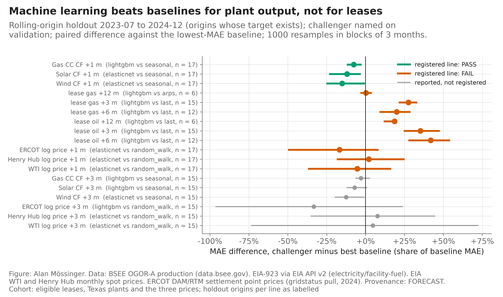

*Figure 12.* Forecast error of the challenger relative to the best baseline, by registered line, with paired moving-block bootstrap intervals.

## 11 What each candidate is worth, and what that rests on

**A lease redevelopment is an uplift on a producing asset.** Each lease gets an Arps decline baseline from its last 36 months. The redevelopment adds 20% of that rate after a two-year lead time, and its value is the cash flow it adds over doing nothing. **A power request is a plant that may never be built.** Its value if built uses the 2024 hourly prices: solar earns 92% of the flat hub price, wind 83% and gas combined cycle 135%, because Texas wind blows at night, solar produces at midday, and a gas plant runs only in the 63% of hours when prices clear its fuel cost. These are consistent with the 45% capacity factor of section 9. That value is then weighted by Part I's chance of operating in each of seven years, net of the cost of keeping the request alive.

**Under the registered grid, the leases carry the book.** At flat 2024 prices the twenty leases are worth $14.6B, every one positive, with a median break-even of $33 a barrel. The twenty requests are worth −$0.76B at merchant prices and −$0.28B under contract; only wind under contract is positive (Figure 13).

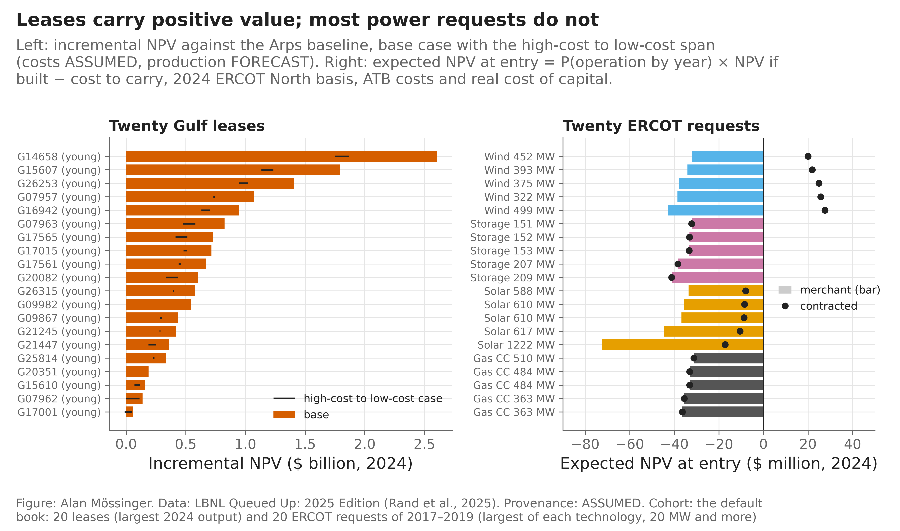

*Figure 13.* The forty candidates: capital, expected NPV and the chance of operating, with provenance.

**That result rests on two generous assumptions, and the committee grid replaces them.** The registered grid prices a 20% uplift on the largest deepwater leases as a workover of existing wells, at $4–15 million a well. On the largest lease the uplift alone is nearly twenty thousand barrels of oil equivalent a day: a development of new wells or tie-backs, whose capital scales with the barrels it buys. The registered grid also discounts the leases at 5.1% real, the ATB rate for offshore wind, where an oil and gas committee uses 8–10%. The *committee grid* prices capital at $40,000 per incremental flowing barrel of oil equivalent a day (range $25,000–$60,000) and discounts at 8% (range 5.1–10%). It was added after the registered results, at an outside reviewer's request, and is labelled ASSUMED. Under the registered grid the tornado of Figure 14 ranks the uplift and the operating cost first and the discount rate third, while the cost per well barely moves the book, because a workover is priced as cheap against the barrels it is assumed to buy; that is the item the committee grid changes.

| Twenty leases, flat 2024 prices | Registered grid | Committee grid |
|----------------------------------------|------------------------------|------------------------------|
| Capital | $1.37B | $5.51B |
| Incremental NPV, base | $14.6B | $7.0B |
| Incremental NPV, low and high grid cases | $10.0B and $9.6B | $8.9B and −$2.0B |
| Leases positive at base | 20 of 20 | 20 of 20 |

*Table 5.* The lease book under the two grids. The low and high cases set every grid item to its low or high value together; the registered low case pairs low costs with a low uplift, which is why it is below base.

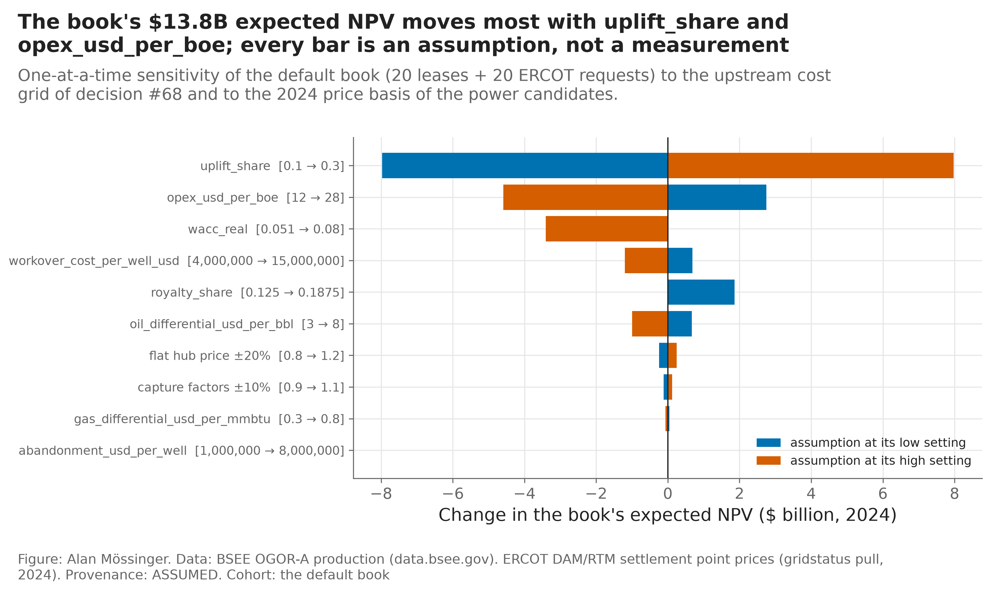

*Figure 14.* Change in the book's NPV when each registered grid item moves across its range, one at a time.

**Under the committee grid the leases still pay, at half the value and four times the capital.** Every lease stays positive at base, but the high-cost case turns the book negative. The conclusion that capital goes where the asset already produces survives; the size of the prize does not.

**The power result is about the sector, not the draw.** Part I's strongest finding is that large requests fail most, and the registered draw takes the largest. A second draw takes the five largest requests per technology among those Part I's entry rule marks to fund. Under contract, two of its five wind requests are positive and none of its solar; the entry rule marks no ERCOT gas or storage request to fund at all. Contracted wind is the only power candidate that earns its capital in either draw.

## 12 Scenarios and risk

**Prices, output, costs and timing are drawn together.** 2,000 joint paths of twenty years resample calendar-year blocks of the 2018–2024 monthly log changes of WTI, Henry Hub and ERCOT, the same months for all three, so the 2020, 2021 and 2022 episodes travel together and a spike stays with its reversal. Monthly changes are capped at ±1.5, a ×4.5 move, the largest the history shows outside February 2021; Winter Storm Uri took the hub from $26 to $1,772 a MWh and back in two months, and an uncapped draw that lands the spike without the reversal holds a ×69 price for years. The log prices revert toward their 2018–2024 real geometric means with a four-year half-life (ASSUMED). Output varies by the scored forecast errors, costs by a triangular multiplier, and each request's operation year by Part I's curves. A second, held-out set of 2,000 paths with its own seed is used only to score books. Ten years out, WTI spans $44 to $138 a barrel across the middle 90% of paths (Appendix Figure A5).

**Read the median beside the mean.** Price paths are skewed, so the mean sits above the median. Under the registered grid the default book of forty has a mean of $15.8B and a median of $14.9B across scenarios, against $13.8B on the flat 2024 path; the gap is the skew and the reversion of 2024's low power prices toward their longer-run level, not a property of the book.

| Default book of forty | Registered grid | Committee grid |
|----------------------------------------|------------------------------|------------------------------|
| Median NPV | $14.9B | $7.0B |
| Mean NPV | $15.8B | $7.7B |
| 5th percentile | $6.2B | −$0.3B |
| Chance of a loss | 0.0% | 6.1% |
| Worst-5% average (CVaR95) | a $4.9B profit | a $1.7B loss |

*Table 6.* The default book across the 2,000 primary scenarios under the two grids.

**The tail is the committee grid's.** Under the registered grid the default book never loses money in 2,000 scenarios and its worst 5% still averages a $4.9B profit. Under the committee grid it loses money in 6% of scenarios and its worst 5% averages a $1.7B loss. Removing the correlations between prices changes the book's tail by $0.6B, which is what modelling them jointly is worth.

**The registered oil stress tested the wrong thing.** Replaying the 2020 collapse from the first month leaves the lease book unchanged ($14.6B), because incremental barrels start after the two-year lead time and the 2020 shape had recovered by then. The stress that matters is a sustained one: WTI at $42 real for five years takes the lease book to $11.5B under the registered grid and to $4.25B under the committee grid (Figure 15). The named stresses of the registered run — high gas, a weak wind year, solar curtailment, a two-year delay, all at once — are in Appendix Figure A6.

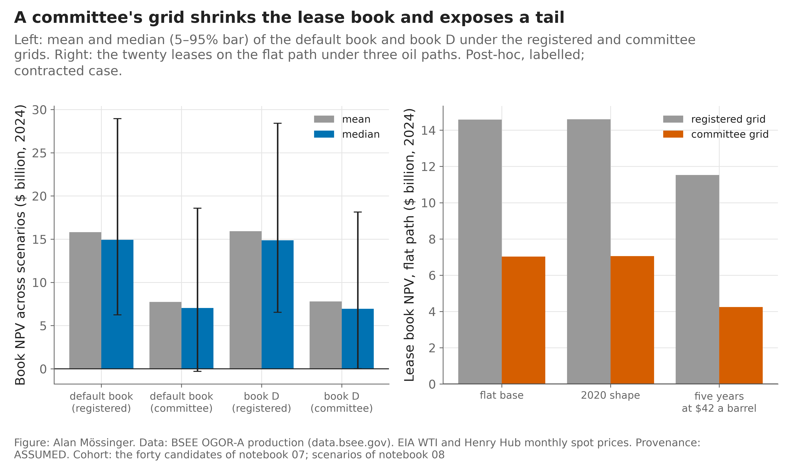

*Figure 15.* Left: mean and median (with 5–95% range) of the default book and book D under the two grids. Right: the twenty leases on the flat path under the 2020 shape and under five years at $42.

## 13 Allocating the budget

Four books compete under one budget and one cap of 40% per technology. **A** takes candidates by expected NPV; **B** splits the budget equally by sector; **C** maximises expected NPV; **D** maximises expected NPV minus the worst-5% average loss. Books are chosen on the primary scenarios and scored on the held-out ones.

**Under the registered grid, risk aversion has little to buy.** Four criteria were registered before any book was solved. On the observed prices two pass and two fail (Appendix A): book D earns $15.9B against $16.1B for book A on the held-out scenarios, a shortfall of $61M on the registered metric whose interval reaches zero but not above it, and no more than book B; its selection is as stable as the deterministic book's under the six stresses, and its tail beats the single-sector comparator's by $159M. No book's worst 5% is a loss under this grid, so there is little tail to buy (Figure 16). The books converge on the twenty leases plus contracted wind and gas. Two settings a committee might change barely move book D: a carbon price of $50 a tonne on the gas plants' emissions drops one gas request (overlap 0.88), and doubling the weight on the tail changes nothing (overlap 1.00).

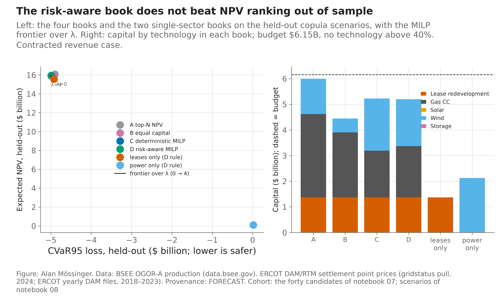

*Figure 16.* The four books and two single-sector books on the held-out scenarios, the frontier over risk aversion, and capital by technology.

**Under the committee grid the risk-aware book cuts the tail to a quarter, at a price.** With the budget set by the same rule ($7.81B), book A takes eighteen leases and four gas requests and expects $7.7B, with a 5% chance of a loss and a worst-5% average loss of $1.3B. Book D takes ten leases, three contracted wind requests and four gas requests and expects $5.8B, with a 3% chance of a loss and a worst-5% loss of $0.3B. On the registered metric — expected NPV minus the worst-5% loss — A still wins by $888M, with an interval entirely on A's side (Table 7). Whether D is the better book depends on how much the committee will pay to cut its tail, which is a policy choice, not a statistical one.

| Committee grid, held-out scenarios | A top-N NPV | B equal capital | C deterministic | D risk-aware |
|--------------------------------|-----------------|-----------------|-----------------|-----------------|
| Members | 22 | 18 | 17 | 17 |
| Mean NPV, $B | 7.7 | 6.9 | 5.8 | 5.8 |
| Median NPV, $B | 7.0 | 6.2 | 5.3 | 5.3 |
| Chance of a loss | 5% | 4% | 3% | 3% |
| Worst-5% average loss, $B | 1.3 | 0.6 | 0.3 | 0.3 |

*Table 7.* The four books under the committee grid, reported and not registered.

**Why the books hold gas requests that lose money on the flat path.** On the flat 2024 path every gas request is negative. In the scenarios ERCOT prices revert upward from a weak 2024 and spike as they did in 2019, 2021 and 2023, and the five gas requests are worth $427M between them on average. That value rests on the spikes recurring; a committee should treat it as the least secure line of the book.

## 14 When: the book at one to twenty years

**A twenty-year NPV says nothing about what the owner holds at year three.** Counting only the cash that falls within each horizon, under the registered grid, the lease book is −$1.4B within two years (the redevelopment capital), turns positive in year three and reaches $14.6B at twenty (Figure 17). A queue request is a carrying cost until it operates, and the twenty are −$0.84B at twenty years. The best book holds nothing at one or two years, twelve leases at three and all twenty from ten. Under the committee grid the capital is four times larger, so the lease book turns positive later; the horizon view is reported only for the registered grid.

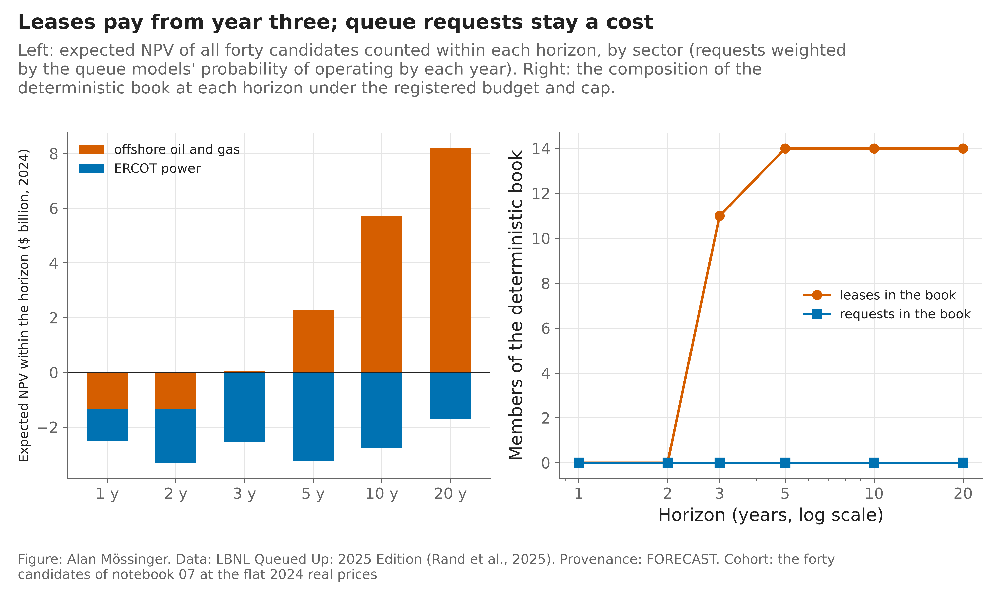

*Figure 17.* Expected NPV counted within 1, 2, 3, 5, 10 and 20 years, by sector, and the composition of the best book at each horizon.

## 15 The decision gym and the AI advisor

**The gym scores decisions on outcomes, not prose.** Sixteen past situations are rebuilt as of their date, with no outcome shown: fifteen requests drawn at random from each region's 2017, 2018 and 2019 entrants, the 2017 entrants again two years in, ERCOT 2018 with a budget cut of a fifth, and the twenty leases at the start of the 2014, 2020 and 2022 oil-price regimes. In each, instinct (top-N expected NPV), Part I's gate rule (or the risk-aware optimizer for the leases), the AI advisor and the human pick a book under the same budget; then the realized value is revealed. For a request, realized value is its value per MW if built times its MW if it in fact operated, less the gate cost — a proxy, labelled DERIVED.

**The registered rules beat instinct, mostly in the lease regimes.** The rule is Part I's gate rule in the queue rooms and the risk-aware optimizer in the lease regimes. Over the sixteen situations it beat instinct by $236M a situation, and its mean regret against hindsight was $18M against $253M for instinct (Figure 18). Almost all of that edge is in the three lease regimes, where a budget-bound optimizer beats a greedy ranking by about $1.2B each. In the 13 queue rooms the rule is ahead by only $3.7M a room on average: in 6 of them none of the drawn requests operated, so the best any rule can do is spend nothing on gate costs. In the room Part I calls decisive — ERCOT's 2017 entrants two years in — the rule beat instinct by $41M. An earlier version of the gym got that room wrong: it checked the two-year rule for a verdict the rule never issues, so it funded nothing; the corrected scores are the ones reported.

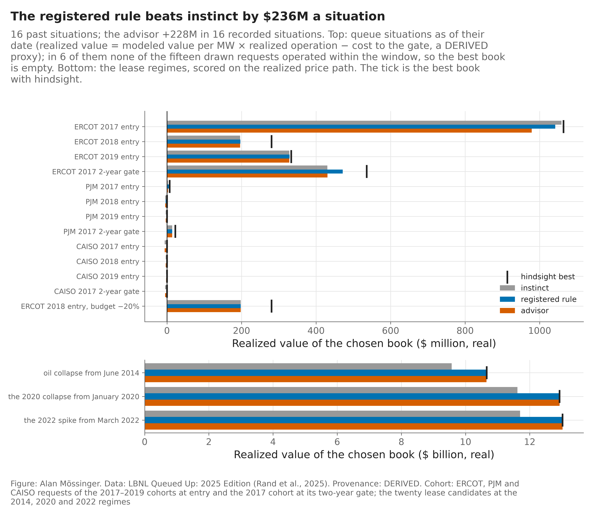

*Figure 18.* Realized value of the book chosen by instinct and by the rule in each past situation, against the best book with hindsight. Top: queue rooms ($ million). Bottom: lease regimes ($ billion).

**The AI advisor is scored, and it reasons like the rule.** An LLM advisor reads only the result tables, recommends a book per scenario and per horizon, and challenges a human's preferred book with the human in the loop: five questions tied to the human's statement, then a check for motivated reasoning and the strongest case for the opposing book. Every number it writes is checked against the tables, every call is recorded and replayable offline, and the human may override it only after answering the five questions. Run live on 96 recorded calls, 94% of the numbers it wrote appear in its tables as written; the rest are sums it computed itself, which the check counts against it on purpose. Over the seven named stresses its book overlapped the optimizer's by 0.89 and it named the risk-aware book in 3 of 7, choosing the leases alone in the simultaneous downside. In the gym it beat instinct by $228M a situation against the rule's $236M, matched it in 11 of the 16 situations, beat it in 4 and lost once, with a regret of $26M against hindsight. Its challenge rounds are in Appendix B.

# Results

## 16 Results at a glance

The proposal asked four questions: can machine learning **predict** better than transparent baselines (RQ1), how do forecast error and correlated prices change **risk** (RQ2), does a risk-aware book **allocate** better (RQ3), and which features and constraints **explain** the choice (RQ4). The table answers them, with Part I's decisions alongside.

| Question | Finding | Evidence | Verdict |
|-----------------|-----------------------------------------------------|---------------|---------------|
| Where to look | ERCOT builds most often: 18.4% of requests operate within five years, against 4.8% in CAISO. | Section 2 | Observed |
| RQ1 — predict, at entry | The model beats cohort averages (AUC 0.86 against 0.73) but ties the lookup at utility scale. | Section 3; C1–C12 | Partly |
| RQ1 — predict, two years in | A book of 25 chosen by the landmark model held 19 operations, against 11 for the lookup. | Section 7; C15 | Supported |
| Size the book | The 2017–2019 cohort brought 18.8 GW of the 29.2 GW expected; every later cohort runs lower. | Section 3 | Observed |
| Why requests fail | The executed agreement dominates: 63% operate where it is signed within two years, 0.8% where none is dated. | Section 4 | Observed |
| What a plant is worth | Wind pays everywhere; solar only under contract; storage nowhere on public revenues. | Section 5 | Derived |
| Fund, hold or exit | Funded requests operated 26% of the time against 10% for the cohort, and returned +$4.1B at merchant prices. | Section 6 | Scored on outcomes |
| RQ1 — forecast output | Machine learning beats baselines for plant output (three of twelve lines), not for leases or prices. | Section 10; C20 | Partly |
| RQ1 — does ML change the book? | No: with naive forecasts in its place the risk-aware book is identical. | Section 10 | Derived |
| RQ2 — risk | Under the committee grid the default book loses money in 6% of scenarios; the gas–power correlation of 0.63 is why modelling prices jointly moves the tail by $0.6B. | Section 12 | Derived |
| RQ3 — allocate | Under the registered grid the risk-aware book does not beat NPV ranking (two of four criteria pass); under the committee grid it cuts the worst-5% loss from $1.3B to $0.3B at a cost of $1.9B of expected value. | Section 13; C21–C24 | Partly |
| RQ4 — explain | The uplift and the operating cost decide the lease side under the registered grid, the capital per barrel under the committee's; the contract decides the power side; a carbon price moves only the gas request. | Sections 11, 13 | Derived |
| When to invest | Nothing at one or two years; twelve leases at three; the full lease book from ten. | Section 14 | Derived |
| The rule against instinct | The registered rules beat instinct by $236M a situation over sixteen past situations, almost all of it in the three lease regimes. | Section 15 | Scored on outcomes |
| The AI advisor | 94% of its numbers are in its tables; its book overlaps the optimizer's by 0.89; it beat instinct by $228M a situation. | Section 15; Appendix B | Scored on outcomes |

*Table 8.* Every finding, its evidence and its verdict. Registered criteria are in Appendix A.

**The proposal's five decision questions.**

| Question | Answer |
|-----------------------------------|-----------------------------------------------------------------|
| If the budget is cut by a fifth, what stays? | The twenty leases stay, and the risk-aware book keeps most of its members (overlap 0.82). |
| When WTI falls and gas rises, does the optimum move toward power? | No: the book keeps every member under the 2020 oil path and under high gas (overlap 1.00 in both). |
| How much diversification disappears when risks are modelled jointly? | Modelling prices jointly moves the default book's worst-5% average by $0.6B; an independent model would hide that much tail. |
| Which lease redevelopments only work under favourable costs? | Most of them: all twenty pay at the committee grid's base, but 17 turn negative at its high case. The three that survive are mid-sized leases, not the largest producers. |
| Does oil and gas raise or lower the tail risk of a Texas-and-Gulf book? | It carries the value and the tail: without it the power-only book loses money in 71% of scenarios; with it, under the committee grid, the risk-aware book cuts the tail by holding ten leases, not twenty. |

*Table 9.* The five questions the proposal set for the final demonstration, answered from Part II's tables.

## 17 Limitations and broader impacts

**What the public files cannot carry.** The agreement is dated for 30% of ERCOT's requests, 15% of CAISO's and 2.6% of PJM's, so the milestone results rest on ERCOT and CAISO. The timing models cover three regions and the regime before FERC Order No. 2023 moved interconnection to cluster studies. No entry-time model is calibrated to the post-2020 level. Part I's values are a capstone-scale DCF in 2022 dollars, with national capture rates, both merchant and contracted cases, no financing structure and no energy revenue for storage. Part II's lease costs are assumptions, not company data: the registered and committee grids bracket them, and the report never presents a modelled NPV as an observed one. The ERCOT price history holds one Winter Storm Uri in seven years, and the scenario engine caps its monthly jump at ×4.5 to keep it an event and not a level; how often such a month recurs is the least known number on the power side. EIA-923 reports plants, not generators, so no generator-level claim is made; and the gym's realized value for a request is a proxy built from the value tables.

**Who could be harmed.** A score like this can fulfil itself: if lenders refuse the requests it ranks low, those requests fail and the next model learns that they fail. Size is a top driver, so a gatekeeper using the score to screen applicants would penalise small developers for a pattern partly made by the rules. The version of this work a company should act on limits that risk: at entry it recommends public averages and rules, which treat every applicant of a kind alike, and the model is used only on requests already in the queue. The score may inform portfolio choices; it should not screen access to the grid. No headline of the form "AI increases returns by X%" is made: the advisor is scored against a rule it mostly agrees with, and the gym compares rules, not slogans.

## 18 Conclusion

For a developer, the queue is predictable where it matters least and most where it matters most. At entry a careful lookup is as good as a model; two years in, with the agreement known, the model picks the requests that get built. Every cohort since 2017 completes below the last, so a book must be sized to the newest cohort's level, and the gates that fund wind anywhere and solar under contract were scored on what happened and paid.

For a company splitting one budget, capital goes where the asset already produces, but the size of that answer is an assumption. Priced as a committee would price it, the lease book halves, its tail becomes a real loss, and the risk-aware book earns its place as a choice about risk appetite rather than a free improvement. Prediction is necessary and not sufficient: the decision is made by the assumptions, the timing and the tail, and this report shows each of them next to the numbers it moves.

## Statement of work

This is a solo project registered in a group slot (Group 13). All components of this project — data engineering, modeling, evaluation, visualization and writing — were carried out by Alan Mössinger. The ERCOT price client and the battery dispatch model are reused, with credit, from my own earlier projects (Forecast to Dispatch; MADS Milestone II).

## Changes after mentor feedback

An outside review of the previous draft (14 October 2026) led to these changes; the full log is in `docs/mentor_feedback.md`.

1. **Contradictions removed.** The claim that no book loses money in any scenario was wrong; every risk statement now gives the chance of a loss and the worst-5% average.
2. **The lease grid tested as a committee would set it.** Capital now scales with the barrels an uplift buys and the leases are discounted at 8%; the memo leads with this case, and the registered verdicts stand beside it.
3. **Median beside mean, and a sustained oil stress.** The scenario mean is shown next to its median, and five years of $42 oil replaces the 2020 replay as the stress that matters.
4. **Two bugs found and fixed.** The gym's two-year rule never funded a request, and the gas capacity factor divided each turbine by the whole plant; both are corrected and the results rerun.
5. **A report that reads.** Figure titles cut to the finding, one name per object, one number per claim, the audit trail moved to the appendices, and a closing results table.

## Appendix A — The evaluation record

Every claim in the body that says "a registered test" refers to a line below. Each criterion was written and committed before the data it scores were looked at; failures are reported as registered and never re-scored.

| Criteria | What they test | Lines | Passed | What they say |
|----------|------------------------------|--------|--------|--------------------------------------------|
| C1–C5 | the model against cohort averages at entry | 12 | 8 | the model ranks better at three and five years; its calibration slope fails |
| C6–C12 | the portfolio layer of v2 | 12 | 3 | at utility scale the lookup ties at entry; the landmark model wins two years in (C8); the simulated band covers the realised book (C11); no leakage (C12) |
| C13–C14 | MISO and SPP on the 2026 file | 12 | 3 | the model beats the lookup in MISO at five years; SPP is too thin |
| C15–C17 | the milestone-managed book | 10 | 4 | more operations than the lookup two years in, not more MW; the level is not repaired at the landmark |
| C18–C19 | other learners | 8 | 5 | they tie LightGBM and do not beat the lookup |
| C20 | machine learning against baselines for output and prices | 12 | 3 | the plant capacity-factor lines pass; the lease lines fail on the log transform's bias; prices are random walks |
| C21–C24 | the four books under one budget | 4 | 2 | on the observed prices book D ties NPV ranking and equal capital, is as stable as the deterministic book and beats the single-sector comparator's tail; on the bridged prices all four failed |

*Table A1.* The registered record. Twenty-eight of seventy lines pass. Sources: the `success_criteria*_scored.csv` files and `tournament_criteria.csv` in `results/`; the bridged-price scoring of C20–C24 in `results/registered_bridged/`.

**C21–C24 in detail, on the observed prices.** On the held-out scenarios the risk-aware book D earned less than top-N NPV (C21: −$61M [−$136M, +$0M]) and no more than equal capital by sector (C22: +$22M [−$49M, +$89M]); its selection moved as little as the deterministic book's under the six stresses (C23: mean Jaccard 0.99 against 0.99); and its tail beat the single-sector comparator's (C24: +$159M [+$76M, +$247M]). The C24 comparator rule, written before the scenarios existed, picks the near-empty power-only book, whose tail is small because the book is small; the rule is kept with that reading.

**Scored twice: on the bridged prices, then on the observed ones.** C20–C24 were first scored when ERCOT's 2020–2023 prices were a bridge from PJM West prices (× 0.77), and that scoring is kept unchanged in the repository. On the bridged prices 3 of 12 C20 lines passed and none of C21–C24: book D earned −$420M [−$659M, −$210M] against book A and −$150M [−$350M, +$24M] against book B; its tail was not below the single-sector comparator's (−$323M [−$937M, +$250M]); book A expected $21.1B and book D $20.7B out of sample, both with a worst 5% still in profit. The observed prices replace the bridge above and in every table of Part II; where a verdict moved, the body says so.

**The hypotheses.** The proposal stated three hypotheses. *H1:* well-validated machine-learning forecasts reduce held-out error against naive and physics baselines (tested by C20). *H2:* a diversified, risk-aware book beats NPV ranking and sector-concentrated books on a stated risk-return metric (C21, C22). *H3:* uncertainty-aware selection is more stable under stresses than deterministic selection, and diversification survives joint modelling (C23, C24). H1 holds for plant output and not for leases; H2 is not supported on this candidate set under either grid; H3 is supported on the observed prices and was not on the bridged ones.

## Appendix B — The AI advisor

**What it sees.** The advisor receives a system prompt and a task, followed by a DATA block of result tables from `results/` rendered as text by one formatter. It sees no web, no memory across calls and no company data. Every table carries its provenance label.

**How its numbers are checked.** `advisor.verify_numbers` accepts a number in an answer only if the same token appears in the DATA block. Years and counts up to 50 are exempt; a number rounded differently from the table counts as ungrounded, on purpose.

**Record and replay.** Every call is appended to `results/advisor_runs.jsonl` with the model id, the route it took, the sampling setting, prompts, response, token use and verification. A recorded call is served from the record, so the pipeline reproduces offline.

**The override gate.** The human may override the advisor's book only after answering its five questions — the stakes, what each party wants, where the emotional investment lies, which evidence was used and which dismissed, and what alternative was left off the table — and reading the advisor's opposing case. The answers given in the challenge round are the answers the gate needs, so the challenge and the override are one exchange; at the keyboard it runs as `python -m src.advisor`. Every decision is written to `results/decision_ledger.csv`.

**The prompts.** Six templates sit in `prompts/`: the system prompt, the recommendation, the gym pick, and the three of the challenge round, which runs with the human in the loop: the advisor asks five questions tied to the human's statement, the human answers, and only then does it judge and argue the other book. The three are reproduced here because they carry the design.

> *The five questions.* I am about to choose a book for the company's capital budget: which of the twenty Gulf lease redevelopments and which of the twenty ERCOT queue requests to fund, under one budget and a 40% cap per technology. Before you judge my reasoning, ask me the questions a careful colleague would ask. […] Ask me exactly five questions, one for each item below, each tied to something I wrote: the context and the stakes; the parties; my emotional investment; the evidence I leaned on and the evidence I passed over; the framing, and the alternative I left off the table. Do not judge yet, do not cite the tables yet, do not recommend.

> *The motivated-reasoning check.* You asked me five questions about my reasoning; here is my statement, your questions and my answers. Test whether I am reasoning toward the truth or toward the answer I already prefer. Name the specific motivated-reasoning patterns you see in my statement and my answers, with the sentence of mine that shows each: moving the goalposts; a double standard (judging the leases on the flat path and the requests on the scenarios); working backward from the conclusion; cherry-picking a scenario, a stress or a grid; treating an ASSUMED lease cost or a FORECAST chance of operation as if it were observed; counting a deposit already paid as a reason to keep paying. For each pattern, say what the tables show instead. Name the top three risks of my book and what would mitigate each. End with whether my decision survives the check.

> *The ideological Turing test.* Argue for the opposing book as its strongest advocate would, so well that a reader could not tell you do not hold the view. Lead with the strongest point: if you were trying to convince me that my book is a terrible idea, what would be your strongest arguments against it? Argue against what I actually said in my statement and my answers. Anticipate my best objection; name the assumption the opposing case rests on and the number at which it fails; then step out of the role and say which case is stronger on the tables. Finish with `CONVERGE: … | DISAGREE: …`.

**Status and record.** The advisor ran live through the author's Claude subscription on 14 October 2026: 96 calls recorded in `results/advisor_runs.jsonl`, each with its prompts, response, token use and number check, so every later run replays offline. Its numbers were in its tables 94% of the time and every number was grounded in 52% of answers; the ungrounded remainder is arithmetic it did itself, such as the capital of two requests added together, which the check refuses on purpose. In the two scripted challenge rounds it asked five questions tied to the statement, named the double standard of judging leases on the flat path and requests on the scenarios, and argued the opposing book; on the all-leases statement its convergence line kept the leases and added only the contracted wind. The transcripts are in `results/advisor_transcripts/`.

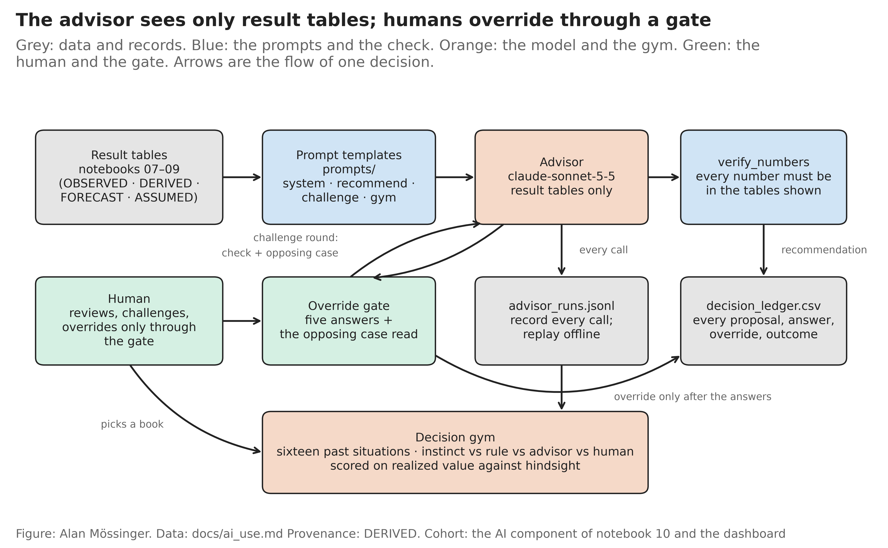

*Figure B1.* The advisor's workflow: result tables as the only input, the number check, the record and replay, the override gate, the ledger and the gym.

## Appendix C — Where things are

| Need | Where |
|------------------------------|----------------------------------------------------------------------|
| Run everything | `make all` (ten notebooks in order), `make test`, `make report` |
| Data access and dictionary | `data/README.md`; raw files hashed in `data/raw/manifest_v5.json` |
| Every cited number | `results/report_numbers.csv`, written by `src/report_numbers.py` and checked by `tests/test_report.py` |
| Every decision and its reason | `docs/decisions.md` (numbered); the registered criteria in `results/success_criteria*.csv` |
| Figure captions and their notebooks | `report/figure_notes.md` |
| The advisor | `src/advisor.py`, `prompts/`, `docs/ai_use.md` |
| Changes after review | `docs/mentor_feedback.md` |

**The proposal, section by section.** The proposal of 12 October 2026 set the structure this report follows.

| Proposal section | Where it is in this report |
|----------------------------------------|------------------------------------------------------------|
| Problem, research questions and hypotheses | Memo; Questions and hypotheses; section 8 |
| Literature and data source assessment | Related work; sections 1 and 8; `data/README.md` |
| Data processing and EDA | Sections 1–2 (queue) and 9 (energy) |
| Feature engineering and statistics | Sections 3 and 9 |
| ML methods, baselines and validation | Sections 3 and 10; Appendix A |
| Joint scenarios and uncertainty | Section 12 |
| Project cash-flow modelling | Sections 5 and 11 |
| Portfolio optimization | Sections 7 and 13 |
| Out-of-sample findings, uncertainty and ablations | Sections 6, 13 and 15; Table 9 |
| Sensitivity and limitations | Sections 11, 12 and 17 |
| Conclusions and reproducibility | Section 18; this appendix |

Two departures from the proposal are deliberate. The candidate set is forty, not sixty (five per power technology), to keep every request anchored to a real ERCOT queue entry. And the forecast split is development to 2022, validation in the first half of 2023 and holdout from July 2023 to 2024, because 2025 data did not exist when the split was registered.

## Appendix D — Supporting figures

*Figure A1.* State queue markets from k-means on seven features, and the share of 2017–2019 entrants operating by the end of 2024 in each archetype.

*Figure A2.* Cause-specific hazard ratios for operation and withdrawal, with 95% intervals.

*Figure A3.* Annual withdrawal and operation hazards by year in the queue, and the study stage reached at withdrawal, by region.

*Figure A4.* Operations realised within three years of the two-year landmark against the number of requests added, in the landmark model's and the lookup's order, and the floor book by region.

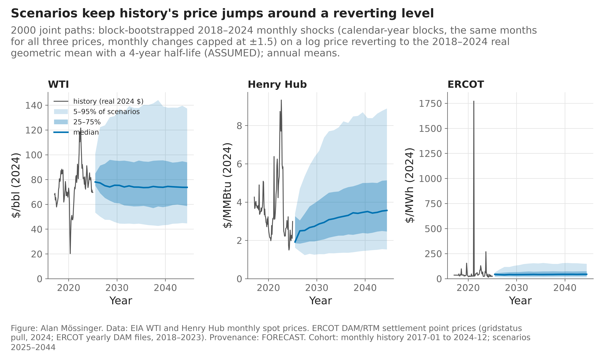

*Figure A5.* The joint price scenarios against the real-dollar history.

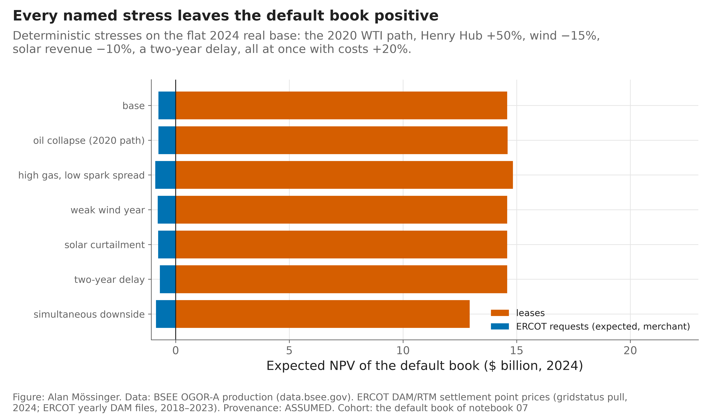

*Figure A6.* The default book under the registered named stresses, on the flat path.

*Figure A7.* Other learners against LightGBM and the lookup: paired differences in Uno's C and Brier score by horizon.

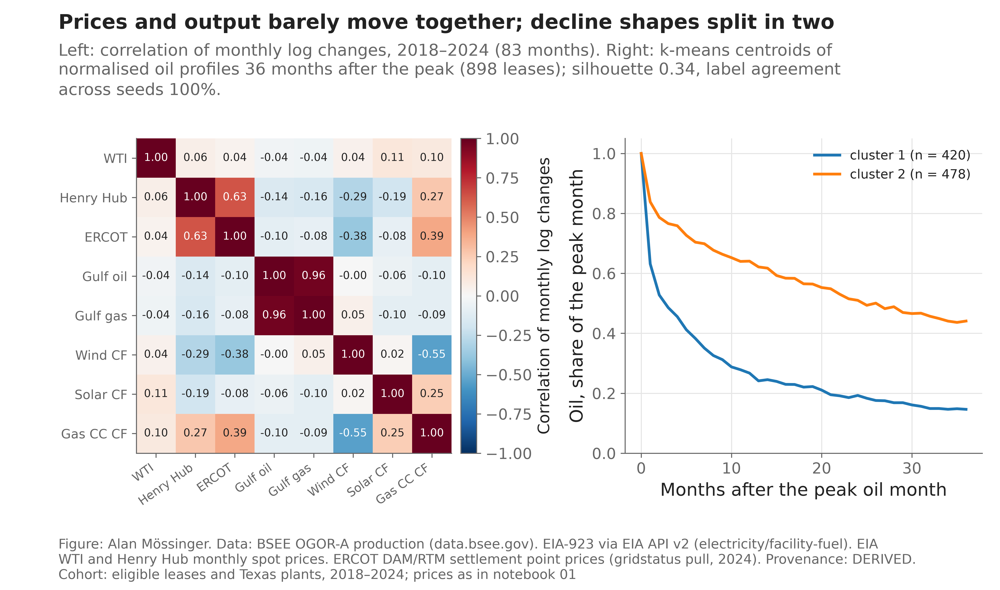

*Figure A8.* Correlation of monthly log changes across the three prices, Gulf output and Texas capacity factors, and the two shapes of lease oil decline after the peak.

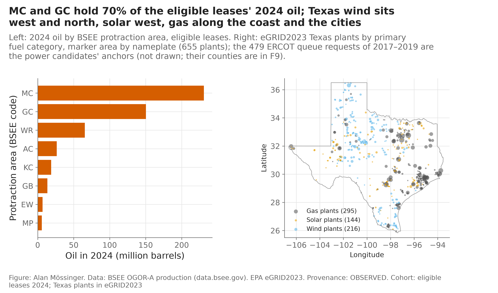

*Figure A9.* Gulf of Mexico oil by protraction area in 2024, and Texas plants by fuel and size.

