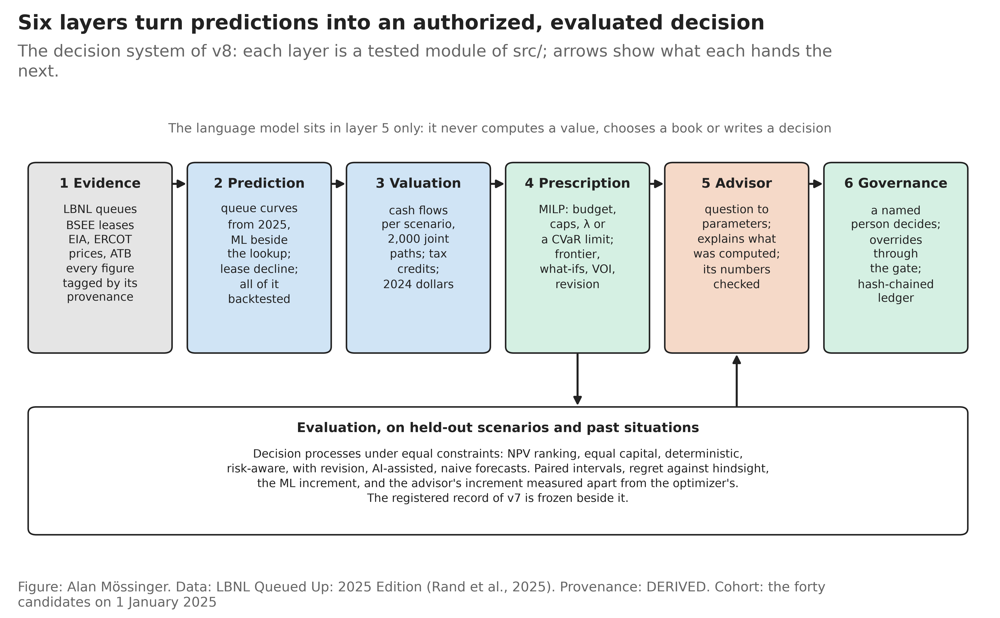
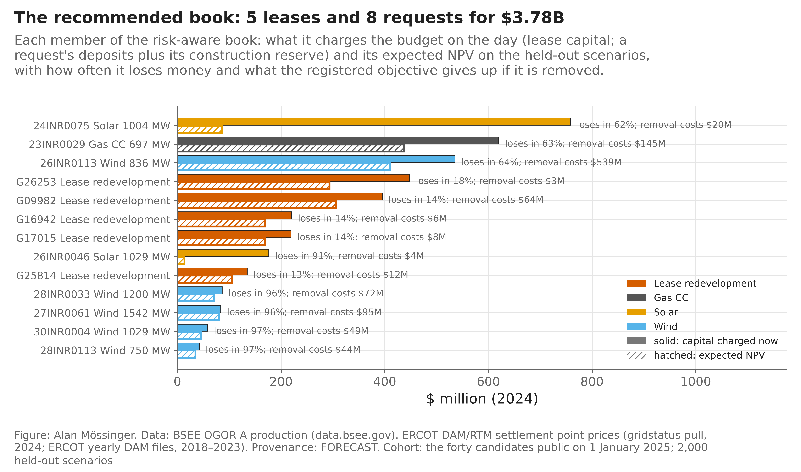
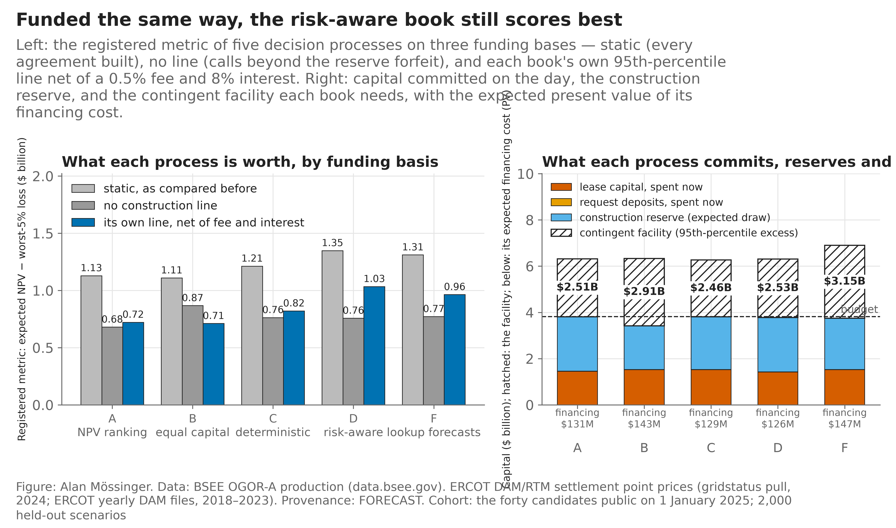
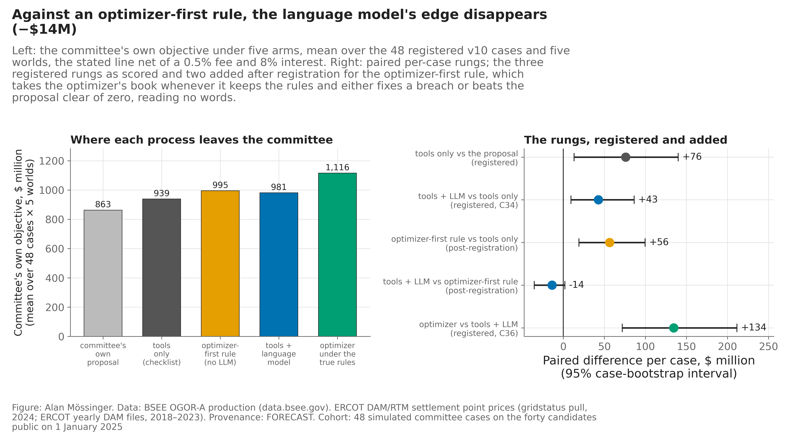

*This is the course-length edition of the report: the executive summary, the decision brief and the conclusions of the executive edition (`report/report.pdf`, 14 sections and nine appendices), with the same numbers. The method, the evidence, the registered record and every correction are in the executive edition.*

## Executive summary

**1. The problem and the objective.** Energy companies allocate one budget across investments that differ in return, market exposure, execution risk, capital intensity and downside: oil and gas, conventional generation, renewables and storage compete for the same capital. The usual tools — forecasts, project valuations, net present value — are necessary and not sufficient: they rank projects one at a time, and a set of individually attractive projects can carry a concentrated tail, an unplanned call on liquidity, and an exposure to one adverse market that no single valuation shows. The objective of this project is to build and evaluate a prescriptive decision system that helps an investment committee allocate capital under uncertainty and make decisions that are financially disciplined, transparent and auditable. The question it answers is not "what will happen" but: *given limited capital, uncertain markets, competing investments and stated risk preferences, which projects should the company fund, stage, defer or reject — and why?* The system combines machine learning, joint scenario simulation, mathematical optimization, financial analysis and a governed language model, and its ambition is operational: a decision-intelligence system a committee could use through its capital-allocation process, not a forecast it consults.

**2. The five challenges.** *Allocation across competing technologies:* distinct risk–return profiles, horizons and capital needs mean the best portfolio is not the best projects taken one by one. *Uncertainty and its interactions:* commodity prices, power prices, production, completion and construction costs are uncertain together, and their co-movement can produce portfolio losses that no single investment shows. *The gap between forecasting and deciding:* a more accurate prediction changes a ranking; it does not say how much risk to accept or when to commit. *Financing and liquidity:* some projects cost little to hold and much to build, so a portfolio that is attractive on paper can be infeasible when several call for construction capital at once. *Committee decision quality:* proposals carry inconsistent assumptions, sunk-cost reasoning, unpriced downside and departures from the company's own rules, and conventional tools find numerical errors without challenging the reasoning. These five challenges motivate a system that joins quantitative optimization to structured, governed executive reasoning.

**3. The method: six stages from prediction to a prescribed, challenged, signed decision.** *Stage 1, prediction:* hazard models and statistical baselines estimate completion probabilities, production and market variables, each scored against a transparent benchmark. *Stage 2, uncertainty:* joint scenarios of oil, gas and power prices, production, costs and timing, drawn from 2018–2024 market history with mean reversion, quantify expected value, downside and the effect of correlated risk. *Stage 3, prescription:* a mixed-integer program chooses the book under the budget, concentration limits, liquidity and the committee's tail weight, and prices the trade-off between expected value and downside. *Stage 4, AI challenge:* a governed language model reads the committee's preferences from its words, tests its proposal against them with deterministic tools, names inconsistencies and unsupported arguments and explains the alternatives; every financial number is computed by the tools, never by the model. *Stage 5, authorization:* a named person decides; recommendations, assumptions, exceptions and overrides are recorded in a hash-chained ledger. *Stage 6, evaluation:* competing strategies and decision-support methods are scored on held-out scenarios against pre-registered criteria. The architecture keeps prediction, optimization, language-based reasoning and decision authority apart, so that each contribution can be measured on its own.

**4. The experimental application.** A historical decision dated 1 January 2025, built only from what was public that day: 40 candidates — 20 producing Gulf of Mexico leases evaluated for redevelopment and 20 ERCOT interconnection requests for gas, solar, wind and storage — and a budget of $3.82B to allocate while managing return, downside, diversification and future construction financing. The data are public energy datasets, market history and technology cost benchmarks, with every assumption labelled. Strategies are scored on 2,000 held-out scenarios; further experiments vary market conditions, dependence, financing and the contributions of optimization and language-model support. The language model is tested on 48 simulated committee proposals that probe financial consistency, policy reading, reasoning and governance controls.

**5. Principal results.** *Risk-aware optimization improves the modelled risk–return balance.* The optimizer recommends five lease redevelopments and eight interconnection requests. Against NPV ranking it gives up expected NPV, $2.68B to $2.17B, and cuts the modelled worst-5% average loss from $1.55B to $0.82B; on the pre-registered risk-adjusted objective it beats NPV ranking by $219M, with an interval that is positive and narrow. *Financial feasibility changes the decision.* The book commits $3.78B including construction reserves and needs a contingent facility of $2.53B for the construction capital its requests may call; net of the facility's cost it expects $1.98B with a worst-5% loss of $0.95B. Under the same financing treatment the risk-aware book beats NPV ranking by $312M — but the recommendation depends on the facility: without one, equal capital by sector is the better allocation. Selection and financing must be evaluated together. *Better predictions do not by themselves make a better portfolio.* Machine learning ranks completion outcomes better than a transparent benchmark and sets their level badly; the portfolio built on it is not demonstrably better. Forecast accuracy creates value only through the decision. *Language-model assistance improves simulated committee decisions, with a role that must be read carefully.* On the 48 cases, deterministic tools improve the committee's own objective by $76M per case over its proposal; adding the language model adds $43M more; it also names the sunk costs, double standards and unsupported claims the tools cannot see. But a fixed optimizer-first rule matches the model's choice of book, so the experiment does not establish that the model produces better economic outcomes than a strong optimization-first process. Its demonstrated role is to read policies, challenge reasoning and communicate evidence-based alternatives. These are modelled improvements in simulated decisions, not realized returns. *Governance is what makes the assistance reliable.* Calculations stay with tools, decisions with a named person, and every recommendation is recorded; the tests also found the model reads an unstated preference as zero and held 15 of 20 injected instructions — requirements for the controls before any real deployment.

**6. Strategic implications.** Prescriptive AI can improve the structure and consistency of capital allocation where investments compete for one budget, risks are correlated and management must weigh return against downside: exploration portfolios, field redevelopment, gas commercialization, generation and renewable development, corporate portfolio optimization. Its value to an executive is a process that answers, with numbers and a record: where to allocate capital; which investments concentrate downside; how much expected value to give up for less risk; when to defer for information; whether the portfolio can be financed in adverse scenarios; and when to challenge or override a recommendation.

**7. Limitations and readiness.** The results rest on public data, modelled opportunities, assumed financial parameters and simulated committees. They are not realized returns and do not show the system is ready to authorize real commitments. Before that: company cost data in place of the assumed grid, market financing terms, extreme-event scenarios, stronger language-model controls, and a test with real investment professionals. The system is an evaluated decision-support prototype fit for supervised testing beside a committee, not a validated production system.

**8. Conclusion.** Better investment decisions need more than better predictions. A company must turn uncertain forecasts into financially feasible portfolio choices, price downside explicitly, compare allocations under its own constraints, and challenge its assumptions before committing. This study shows that risk-aware optimization improves modelled portfolio decisions over conventional selection, and that a governed language model can support executive reasoning, policy interpretation and committee oversight without holding authority. The contribution is an integrated architecture — prediction, uncertainty, prescription, financial feasibility, accountable human decision — and the opportunity is to turn AI from a forecasting capability into an operational decision-support system: one that tells executives not only what may happen, but which actions are economically justified, under which assumptions, and with what consequences.

## Executive decision brief

**The decision.** An energy company holds one capital budget of $3.82B on 1 January 2025 and forty places to put it: twenty producing oil and gas leases in the Gulf of Mexico that could be redeveloped, and twenty requests to connect new power plants — gas, solar, wind and storage — to the Texas grid, most of which, on the record of the last twenty years, will never be built. The committee must decide which to fund, how much expected value to give up for a thinner tail, how to fund the construction its power requests may call for, and when to wait for information instead of committing. Everything in this report is built only from what was public on that date.

**What is recommended.** Fund the risk-aware book: five lease redevelopments and eight power requests, committing $3.78B of the budget — $1.42B of lease capital, $7M of deposits and a $2.35B construction reserve — together with a contingent construction facility of $2.53B. On 2,000 held-out scenarios the book expects $2.17B of net present value with a worst-5% average loss of $0.82B and a 9% chance of losing money; funded within its facility and net of the facility's cost it expects $1.98B with a worst-5% loss of $0.95B. Of the 27 candidates it leaves out, 12 power requests should be deferred until their interconnection agreement is signed, 14 leases monitored and one rejected.

**Why this book and not the obvious ones.** Ranking the candidates by expected value buys $508M more expected NPV and a worst-5% loss of $1.55B instead of $0.82B. On the registered risk–return metric — expected NPV minus the worst-5% average loss — the risk-aware book beats that ranking by $219M [+$13M, +$401M] on a static basis, the pre-registered primary result of the optimization question. Once every process is funded the same way, within its own construction facility and net of the facility's cost, the margin widens to $312M [+$110M, +$506M] over NPV ranking and $213M [+$17M, +$412M] over the deterministic optimizer, and the risk-aware book is the only one of five whose metric stays positive when ERCOT prices are 25% lower or oil sits at $45 for five years.

**What the capital commitment really is.** The construction reserve is an average; the book's requests call capital beyond it in 50% of scenarios. Without a facility the book is worth $0.76B on the metric, because requests that reach their agreement cannot be built; a $2.53B facility restores $1.27B gross and $1.03B net of a 0.5% commitment fee and 8% interest, and the facility beats having none at every price tried. Equal capital by sector is the only process that scores better than the risk-aware book *without* any facility, so the recommendation is the book and the facility together, not the book alone.

**What optimization and AI contribute, in the experiment.** In a pre-registered test on 48 simulated committee proposals, deterministic tools that check the committee's own rules improved the committee's decision on its own objective by $76M per case [+$13M, +$140M]; a language model that reads the committee's words, argues from computed facts and never computes a number added $43M [+$9M, +$86M] more; the optimizer's own book under the committee's rules would add a further $134M [+$72M, +$211M]. A fixed rule that takes the optimizer's book first, reading no words, matches the language model's choice of book (the model's edge against it is −$14M [−$36M, +$2M]); what the model adds that no rule can is naming a sunk cost, a double standard or an unsupported claim, which it did in 12 of 12 cases without over-challenging a sound proposal. These are model-based gains on simulated committees, not realized returns.

**Under which conditions to approve, defer or reject.** Approve the risk-aware book if the committee accepts a worst-5% loss near $1B in exchange for an expected $2B and can arrange the $2.53B facility; approve equal capital by sector instead if no facility can be arranged; defer the twelve waiting requests until their agreements are signed; reject nothing in the book on the strength of money already spent. State the tail weight before the challenger reads the proposal — an unstated weight is the one thing the model read badly — and record any departure from its guidance with the evidence acknowledged.

**What this is and is not.** A decision-support system evaluated on public data, assumed costs and simulated committees, with ten of twelve controls in place and the validation each still needs set out in Section 11. It is ready for supervised use beside an investment committee; it is not validated for a real commitment until a bank has priced the facility, redevelopment costs have replaced the assumed grid, and the challenger has been tested with real committees.

*Figure 1.* The decision workflow in six stages — prediction, uncertainty, prescription, AI challenge, decision, outcome — and what is measured at each on the same held-out scenarios.

*Figure 1.* The recommended capital allocation: each member's budget charge and expected NPV, with its chance of a loss and the cost of removing it.

*Figure 1.* The true economics of capital allocation: what each decision process is worth on three funding bases, and what each commits, reserves and may call.

*Figure 1.* Where the economic value of AI comes from: the committee's own objective under five arms, and the paired rungs — three registered as scored, two added for the optimizer-first rule.

## Executive conclusions and recommendations

**What decisions the system supports.** Which of forty candidates to fund under one budget; how much expected value to give up for a thinner tail, chosen before the book is seen; how to fund the construction the power requests will call for; which requests to defer until their agreements are signed; and whether the committee's own proposal breaks its own rules, is unfunded, is fragile, or rests on a bad argument.

**What the experiments demonstrated.** Prediction ranked requests better than a careful lookup and misjudged how many get built, and a better ranking did not make a better book. Optimization, held to the same constraints as the rules it was compared with, found a book that beats NPV ranking on the registered metric by $219M [+$13M, +$401M], by $312M [+$110M, +$506M] once every process is funded the same way, and that scores best in 7 of 7 worlds. The tail of that book is a real concentration on one oil path and one power path, not a modelling artefact. The construction facility the book needs pays at a bank's price, and the recommendation holds only with it.

**How much incremental value was measured, and under which assumptions.** On 48 simulated committee proposals, on the committee's own objective, with the facility priced: the tools $76M per case, the language model $43M more, the optimizer $134M beyond that; $119M per case for tools and model together. These are held-out model values on simulated committees.

**The role of the optimizer.** It is where most of the value is. The committee's own proposals were on average $119M per case short of the book their own rules implied, and a fixed rule that takes the optimizer's book first matched the language model's choice of book without reading a word.

**The distinctive role of the language model.** It reads the committee's rules from its words and names what the tools cannot see — a sunk cost, a double standard, an unsupported claim — in 12 of 12 cases without over-challenging a sound proposal, and it asks the question the statement leaves open. It reads silence badly and embellishes with numbers, and the controls around it catch both.

**The controls that support supervised operation.** Every number computed by tools; the reading confirmed before computation; the guide rule in code; every number in the memo verified; a named person signing; an override gate; a hash-chained ledger; record and replay. Ten of twelve controls are in place; the two partly in place have named remedies.

**What validation is needed before actual financial deployment.** A bank's term sheet for the facility; the company's own redevelopment costs; a pre-registered study with real committees; extreme-event scenarios registered before use; a second signature above a threshold and an external time-stamp of the ledger.

**Why an executive committee should consider it.** Because the gap it closes is the committee's own: a proposal that breaks the committee's rules, is unfunded, or is kept for money already spent, found before it is signed, with the trade-off priced and the record kept. Prescriptive AI does not replace executive judgment. It strengthens it by making capital allocation more evidence-based, more risk-aware, economically consistent and auditable — and by saying, at every step, which part of the system is doing the work and which part is wrong.

## Statement of work

This is a solo project registered in a group slot (Group 13). All components of this project — data engineering, modeling, evaluation, visualization and writing — were carried out by Alan Mössinger. The ERCOT price client and the battery dispatch model are reused, with credit, from my own earlier projects (Forecast to Dispatch; MADS Milestone II).
